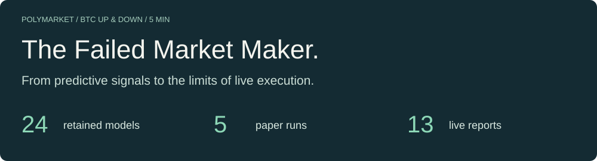

# The Failed Market Maker



**24 models. Promising simulations. No established live edge.**

An open research archive for Polymarket BTC UP/DOWN five-minute markets: original weights, every result, and the evidence behind the failed edge.

[完整中文](README.zh-CN.md) · [Paper results](#paper) · [All 24 models](#models) · [Every live run](#live) · [Download](#download)

[GitHub](https://github.com/slowchillchill/failed-market-maker) · [Hugging Face](https://huggingface.co/slowchillchill/failed-market-maker) · [Full results & sources](RESULTS.md)

<!-- summary:start -->
| Paper · R1 deployment | Live · latest attributable report | Final platform account PnL |
| --- | --- | --- |
| **+1,791.31 USDC** | **-18.8755 USDC** | **N/A** |
| June 2 run · adjusted PnL | June 22 12:06 UTC · local conservative NAV change | All 13 reports unreconciled |
| Decisions stopped June 5; not seven full days | Includes unrealized inventory | No verified cumulative account return |
<!-- summary:end -->

> Paper and live figures come from different runs and accounting methods. They are not a before/after return or a cumulative profit. Display values are rounded; linked reports retain original precision. On a narrow screen, scroll wide tables horizontally.

<a id="paper"></a>

## Every paper run, side by side.

Five independent runs. All reported gains and losses. Amounts in USDC; dates in 2026 UTC.


<!-- paper-table:start -->
| Run / duration | Metric | M3 B1 | M3 B2 | M5 BC | R1 Alpha + Policy |
| --- | --- | --- | --- | --- | --- |
| [05.17 · 02:21](evidence/paper/run-p22-three-profile-72h-20260517T022156Z/reports/report-20260517T083623Z.json)<br>6.22 h · stopped early | NAV change | +100.05 | -99.06 | -99.55 | N/A · not included |
| [05.17 · 22:34](evidence/paper/run-tpsl-three-profile-72h-no-raw-tp30-20260517T223411Z/final-reports/report-20260519T135915Z.json)<br>39.30 h · stopped early | Adjusted PnL | -55.79 | +78.42 | -47.72 | N/A · not included |
| [05.19 → 05.22](evidence/paper/run-tpsl-three-profile-72h-no-raw-v2merge-tp30-20260519T141035Z/codex_reports/report-20260522T234126Z.json)<br>72.07 h | Adjusted PnL | -104.69 | +43.09 | -0.45 | N/A · not included |
| [05.27 → 05.30](evidence/paper/run-four-profile-72h-mpv2-restart-20260527T161918Z/reports/report-20260530T162518Z.json)<br>71.98 h | Adjusted PnL | -127.80 | -100.67 | +20.20 | +1,114.97 |
| [06.02 → 06.05](evidence/paper/run-four-profile-7d-direct-official-20260602T135518Z/reports/standard/report-terminated-20260607T122104Z.json)<br>Decisions stopped June 5 | Adjusted PnL | -298.04 | -224.99 | +84.78 | +1,791.31 |
<!-- paper-table:end -->

Read row by row: the first run uses NAV change; the other four use adjusted PnL, which includes closed risk segments and the current segment. Capital top-ups are not profit. Never sum these runs into a lifetime return.

**June 2 was not a completed seven-day test.** B1/B2 last decisions: June 5 11:37:05 / 11:44:01 UTC; BC and R1: 18:09:59. Process termination: June 7. B1/B2/BC used signal outputs plus external execution and risk rules.<br>[Simulated fills, queueing and rebates depend on the original assumptions; inspect the full results and sensitivity evidence.](RESULTS.md)

<a id="models"></a>

## One scorecard for every model.

Every retained training candidate, grouped by family. Short names link to exact model IDs, files and evidence. Different datasets, targets and metrics are not one global ranking.

[M3 · 3](#m3) · [M5 BC · 1](#bc) · [IQL · 3](#iql) · [Alpha · 8](#alpha) · [Policy · 7 + 2](#policy)

<a id="m3"></a>

### M3 · supervised signals

<!-- m3:start -->
| Model | Best epoch | Train loss | Val AUC | Test AUC | Test top-decile EV |
| --- | --- | --- | --- | --- | --- |
| [M3 run3](models/m3_run3/README.md) | 1 | 1.941012 | 0.773355 | 0.743551 | +0.245144 |
| [M3 B1](models/m3_run_v7_M3-B1/README.md) | 13 | 0.277852 | 0.735678 | 0.713834 | -0.105901 |
| [M3 B2](models/m3_run_v7_M3-B2/README.md) | 12 | 0.299922 | 0.735113 | 0.713882 | -0.086622 |
<!-- m3:end -->

The original supervised checkpoint uses 65 inputs; B1/B2 collection adaptations use 76. Fixed-execution test PnL: B1 +92.2782; B2 +137.8349 USDC. These are not paper results, nor scores for newly added adaptation heads. Run3 paper/live: N/A — no corresponding report; B1/B2 live: N/A — no corresponding run evidence.

<a id="bc"></a>

### M5 BC · behavior cloning

<!-- bc:start -->
| Model | Best epoch | Train accuracy | Val accuracy | Test accuracy |
| --- | --- | --- | --- | --- |
| [M5 BC](models/m5_v7v72_bc/README.md) | 1 | 0.848722 | 0.710701 | 0.682590 |
<!-- bc:end -->

Final epoch 4: validation accuracy 0.703286; test N/A — not independently evaluated. Paper alias: m5_baseline. Live N/A — no corresponding run evidence.

<a id="iql"></a>

### M5 IQL · fixed versus native execution

<!-- iql:start -->
| Model | Best epoch | Policy loss | Val Q loss | Hold best/final | Fixed return | Native return |
| --- | --- | --- | --- | --- | --- | --- |
| [IQL-0](models/m5_iql_0/README.md) | 46 | 4.649556 | 0.029637 | 92.60% / 93.85% | +4.9119% | +0.0221% |
| [IQL-1](models/m5_iql_1/README.md) | 35 | 4.590885 | 0.028484 | 85.25% / 89.20% | +2.9932% | -2.1677% |
| [IQL-2](models/m5_iql_2/README.md) | 43 | 4.635094 | 0.035254 | 94.25% / 95.30% | +5.2949% | -2.1522% |
<!-- iql:end -->


Returns are mean window returns over 24 offline validation windows. ONNX uses the best checkpoint; final checkpoints are epoch 50. Independent test, paper and live: N/A — no corresponding independent report.

<a id="alpha"></a>

### Alpha V2 · two AUC definitions, both visible

<!-- alpha:start -->
| Model | Best epoch | Train loss | val.auc | true_best_side_auc | Val selected-side top-decile EV |
| --- | --- | --- | --- | --- | --- |
| [R1 A3 · s2](models/alpha_primary_R1_A3_seq120_bs2048_ep30_lev0p25_sr0p0_sm0p0_seed2/README.md) | 1 | 1.416982 | 0.868495 | 0.595098 | +0.065216 |
| [R1 A3 · s3](models/alpha_primary_R1_A3_seq120_bs2048_ep30_lev0p25_sr0p0_sm0p0_seed3/README.md) | 2 | 1.352764 | 0.861482 | 0.571024 | +0.138491 |
| [R2 A1 · s2](models/alpha_primary_R2_A1_seq120_bs2048_ep30_lev0p5_sr0p0_sm0p1_seed2/README.md) | 4 | 1.195743 | 0.872110 | 0.667253 | +0.042430 |
| [R3 A6 · s2](models/alpha_primary_R3_A6_seq120_bs2048_ep30_lev0p5_sr0p05_sm0p1_seed2/README.md) | 3 | 1.185670 | 0.866127 | 0.665461 | +0.013070 |
| [R4 LB2 · s1](models/alpha_primary_R4_LB2_512_seq120_bs512_ep30_lev0p5_sr0p05_sm0p1_seed1/README.md) | 2 | 1.138801 | 0.853418 | 0.649595 | +0.093210 |
| [R4 LB2 · s2](models/alpha_primary_R4_LB2_512_seq120_bs512_ep30_lev0p5_sr0p05_sm0p1_seed2/README.md) | 1 | 1.236778 | 0.871611 | 0.674253 | +0.047972 |
| [R5 A4 · s3](models/alpha_primary_R5_A4_seq120_bs2048_ep30_lev0p5_sr0p0_sm0p0_seed3/README.md) | 1 | 2.359265 | 0.867386 | 0.590465 | +0.026660 |
| [R6 C2 · s2](models/alpha_primary_R6_C2_control_seq180_bs4096_ep30_lev0p25_sr0p1_sm0p0_seed2/README.md) | 3 | 0.714006 | 0.864232 | 0.776629 | +0.068376 |
<!-- alpha:end -->

Independent test N/A — not executed. Standalone paper/live N/A — no separate strategy report. R1 s2 participates in the deployment; deployment PnL is not copied to Alpha.

<details>
<summary>8 more Alpha experiments: metrics retained, weights missing</summary>

<!-- alpha-missing:start -->
| Experiment | val.auc | true_best_side_auc | Val selected-side top-decile EV | Weights |
| --- | --- | --- | --- | --- |
| R2 A1 · s1 | 0.845420 | 0.632371 | -0.071830 | N/A · not retained |
| R3 A6 · s1 | 0.835604 | 0.631378 | -0.000114 | N/A · not retained |
| R2 A1 · s3 | 0.843929 | 0.620569 | -0.055705 | N/A · not retained |
| R5 A4 · s2 | 0.805230 | 0.561291 | -0.089587 | N/A · not retained |
| R5 A4 · s1 | 0.795446 | 0.554888 | -0.229608 | N/A · not retained |
| R4 LB2 · s3 | 0.782713 | 0.587704 | -0.121413 | N/A · not retained |
| R1 A3 · s1 | 0.806882 | 0.554470 | -0.142231 | N/A · not retained |
| R3 A6 · s3 | 0.831988 | 0.626608 | -0.083801 | N/A · not retained |
<!-- alpha-missing:end -->

[All 16 original experiment records](catalog/alpha-experiments.json)

</details>

<a id="policy"></a>

### MakerPolicy · 7 candidates + 2 repair/control runs

<!-- policy:start -->
| Model | Phase | Last BC loss | Last RL loss | 263-window sum | 30-window sum |
| --- | --- | --- | --- | --- | --- |
| [R1 A3 · s2](models/policy_primary_R1_A3_seq120_bs2048_ep30_lev0p25_sr0p0_sm0p0_seed2/README.md) | 6.5 | 0.000110815 | 0.000076921 | +46,401.53 | +5,336.60 |
| [R1 A3 · s3](models/policy_primary_R1_A3_seq120_bs2048_ep30_lev0p25_sr0p0_sm0p0_seed3/README.md) | 6.5 | 0.000117271 | 0.000079444 | +46,360.58 | N/A · not independently tested |
| [R2 A1 · s2](models/policy_primary_R2_A1_seq120_bs2048_ep30_lev0p5_sr0p0_sm0p1_seed2/README.md) | 6.5 | 0.000113844 | 0.000065989 | +46,367.90 | N/A · not independently tested |
| [R3 A6 · s2](models/policy_primary_R3_A6_seq120_bs2048_ep30_lev0p5_sr0p05_sm0p1_seed2/README.md) | 6.5 | 0.000113422 | 0.000071329 | +46,373.30 | +5,334.89 |
| [R4 LB2 · s1](models/policy_primary_R4_LB2_512_seq120_bs512_ep30_lev0p5_sr0p05_sm0p1_seed1/README.md) | 6.5 | 0.000149778 | 0.000161845 | +46,356.43 | N/A · not independently tested |
| [R4 LB2 · s2](models/policy_primary_R4_LB2_512_seq120_bs512_ep30_lev0p5_sr0p05_sm0p1_seed2/README.md) | 6.5 | 0.000143163 | 0.000158601 | +46,366.36 | N/A · not independently tested |
| [R6 C2 · s2](models/policy_primary_R6_C2_control_seq180_bs4096_ep30_lev0p25_sr0p1_sm0p0_seed2/README.md) | 6.5 | 0.000122122 | 0.000061272 | +46,395.70 | +5,332.34 |
| [6.7 C0](models/policy_phase67_C0_control_anchor/README.md) | 6.7 | 0.156779423 | 0.001588044 | +45,844.68 | N/A · not independently tested |
| [6.7 P1](models/policy_phase67_P1_signed_reward_filter/README.md) | 6.7 | 0.576368110 | 0.303230513 | +6,867.81 | N/A · not independently tested |
<!-- policy:end -->

**Positive replay PnL did not establish maker edge.** Phase 6.5/6.6: FAIL_NO_MAKER_EDGE. Phase 6.7: FAIL_CONTROL_AMPLIFICATION. The sums are over independent windows, not a continuous account. Independent val/test loss: N/A — no report. Phase 6.7 independent test: N/A — not started after failure.

Policy standalone paper/live N/A — no corresponding standalone report. Only R1 s2 has a retained complete historical Alpha + Policy ONNX pair; six other Phase 6.5 policies have weights but lack the paired historical Alpha ONNX.

**[mpv2_r1_a3_seq120_seed2](models/mpv2_r1_a3_seq120_seed2/README.md)**

One deployment: Alpha R1 A3 s2 + Policy R1 A3 s2. It owns the paper/live records on this page; it is not a 25th trained candidate.

<a id="live"></a>

## What the live ledger actually recorded.

13 live reports for the R1 deployment: 6 observable local NAV changes, all 13 final platform results unreconciled. Original local-ledger figures; no new account reconciliation. All times are UTC in 2026.

<details open>
<summary>Every live run · USDC</summary>

<!-- live-table:start -->
| UTC run | Local NAV change | Realized only | Final platform PnL |
| --- | --- | --- | --- |
| [06.18 19:42:41](evidence/live/r5-three-market-live-funds-20260618T194241Z/trading-runtime/run_manifest.json) | +0.290000 | +0.050000 | N/A · not reconciled |
| [06.18 21:12:30](evidence/live/r5-three-market-live-funds-20260618T211230Z/trading-runtime/run_manifest.json) | -5.500000 | +0.000000 | N/A · not reconciled |
| [06.18 21:57:47](evidence/live/r5-three-market-live-funds-20260618T215747Z/trading-runtime/run_manifest.json) | +0.250000 | +0.000000 | N/A · not reconciled |
| [06.18 23:02:37](evidence/live/r5-three-market-live-funds-20260618T230237Z/trading-runtime/run_manifest.json) | N/A · unobservable | +0.000000 | N/A · not reconciled |
| [06.19 00:22:00](evidence/live/r5-three-market-live-funds-20260619T002200Z/trading-runtime/run_manifest.json) | N/A · unobservable | +0.000000 | N/A · not reconciled |
| [06.19 02:00:53](evidence/live/r5-three-market-live-funds-20260619T020053Z/trading-runtime/run_manifest.json) | N/A · unobservable | +0.000000 | N/A · not reconciled |
| [06.19 09:28:50](evidence/live/r5-three-market-live-funds-20260619T092850Z/trading-runtime/run_manifest.json) | N/A · unobservable | -0.316667 | N/A · not reconciled |
| [06.21 02:24:02](evidence/live/r5-three-market-live-funds-20260621T022402Z/trading-runtime/run_manifest.json) | +0.000000 | +0.000000 | N/A · not reconciled |
| [06.21 06:16:51](evidence/live/r5-three-market-live-funds-20260621T061651Z/trading-runtime/run_manifest.json) | N/A · unobservable | +0.000000 | N/A · not reconciled |
| [06.21 13:18:04](evidence/live/r5-three-market-live-funds-20260621T131804Z/trading-runtime/run_manifest.json) | N/A · unobservable | -2.929107 | N/A · not reconciled |
| [06.21 15:08:00](evidence/live/r5-three-market-live-funds-20260621T150800Z/trading-runtime/run_manifest.json) | N/A · unobservable | +0.000000 | N/A · not reconciled |
| [06.22 08:26:24](evidence/live/r5-three-market-live-funds-20260622T082624Z/trading-runtime/run_manifest.json) | -8.505000 | -0.329808 | N/A · not reconciled |
| [06.22 12:06:33](evidence/live/r5-three-market-live-funds-20260622T120633Z/trading-runtime/run_manifest.json) | -18.875455 | -4.150730 | N/A · not reconciled |
<!-- live-table:end -->

</details>

June 21 02:24:02 had no orders or fills. A zero realized result does not imply zero total PnL when NAV is unobservable. Never sum these runs or infer ROI, maximum drawdown or final equity.

<a id="story"></a>

## The experiments behind the numbers.

**M1 / M2** → **M3** → **M5 BC / IQL** → **Alpha + Policy** → **6.7**

M1/M2 are replay and feature infrastructure, not trained models. M3 A6 and M5 BC-6 weights were not retained; BC-6 test PnL −11.0374 USDC remains part of the failure record. The newer architecture has no formal trained release here.

Earlier live runtime, SDK unit errors, startup failures and platform probes remain in the full results. They are not omitted or relabeled as strategy profits.

[Read every stage and limitation →](RESULTS.md)

<a id="download"></a>

## Explore the models. Revisit the evidence.

Original weights, normalization, feature contracts and a minimal inference example. Keep companion files together: M5 BC requires its .onnx.data file.

Choose a bundle in [the model index](MODELS.md), download its complete directory from [Hugging Face](https://huggingface.co/slowchillchill/failed-market-maker/tree/main), and follow [the inference guide](INFERENCE.md). Use Python with NumPy, PyTorch, ONNX and ONNX Runtime; see [requirements.txt](requirements.txt).

The [v1.0.0 GitHub Release](https://github.com/slowchillchill/failed-market-maker/releases/tag/v1.0.0) is a **historical full archive**, including older documentation. To add its model files to a current checkout, extract `models/` while excluding its historical model cards (archive-relative paths):

```bash
tar -xzf failed-market-maker-v1.0.0.tar.gz --exclude='models/*/README.md' models/
python -m inference.run models/m3_run3/best_model.pt --family m3 --smoke
python -m inference.run models/m5_v7v72_bc/agent_model_m5.onnx --smoke
python -m inference.run models/mpv2_r1_a3_seq120_seed2 --smoke
```

Alternatively unpack the historical full archive into a separate directory. Synthetic forward checks demonstrate executability only; they do not reproduce historical training or trading performance. Keep normalization, feature contracts and configurations with every model; BC also requires `agent_model_m5.onnx.data`.

[Development story](STORY.md) · [Model cards](MODELS.md) · [Provenance & redaction](PROVENANCE.md) · [Unified file manifest](manifest.json)

Original code and weights: [Apache-2.0](LICENSE). Curated documents and reports: [CC-BY-4.0](LICENSE-CC-BY-4.0). See [NOTICE](NOTICE) for attribution. Raw market datasets are not distributed. Historical evidence is a source record, not current deployment instructions.
