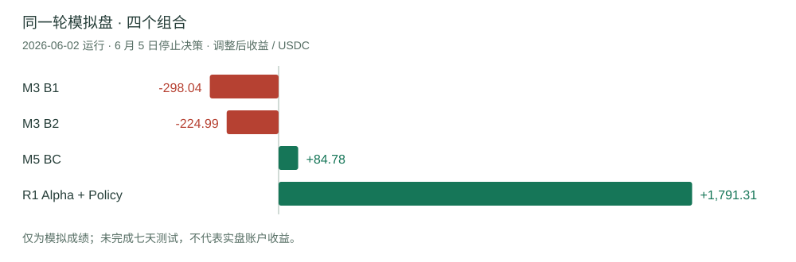
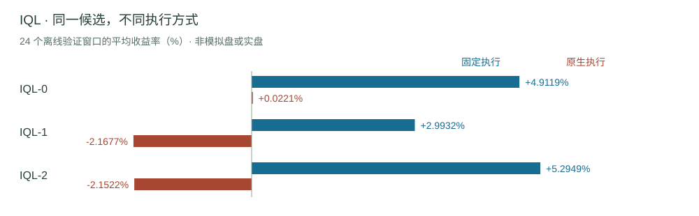

# The Failed Market Maker


**24 个模型。曾经亮眼的模拟成绩。未被证实的实盘优势。**

这是 Polymarket BTC UP/DOWN 五分钟市场的开放研究档案：保留原始权重、逐次成绩，以及未能证明交易优势的证据。

[English](README.md) · [模拟盘成绩](#paper) · [全部 24 个模型](#models) · [逐次实盘](#live) · [下载模型](#download)

[GitHub](https://github.com/slowchillchill/failed-market-maker) · [Hugging Face](https://huggingface.co/slowchillchill/failed-market-maker) · [完整成绩与来源](RESULTS.zh-CN.md)

<!-- summary:start -->
| 模拟盘 · R1 部署组合 | 实盘 · 最新可归属报告 | 平台最终账户收益 |
| --- | --- | --- |
| **+1,791.31 USDC** | **-18.8755 USDC** | **N/A** |
| 6 月 2 日运行 · 调整后收益 | 6 月 22 日 12:06 UTC · 本地保守 NAV 变化 | 13 份报告均未核对 |
| 6 月 5 日停止决策；未完成七天 | 包含未实现持仓 | 无经核对的累计账户收益 |
<!-- summary:end -->

> 模拟盘与实盘数字来自不同运行及核算口径，不是前后收益变化或累计利润。展示值适度舍入，链接报告保留原始精度。手机上可横向滑动宽表查看全部列。

<a id="paper"></a>

## 每轮模拟盘成绩，放在一起看。

五次独立运行，盈利和亏损全部展示。单位：USDC；日期：2026 年 UTC。



<!-- paper-table:start -->
| 运行／时长 | 口径 | M3 B1 | M3 B2 | M5 BC | R1 Alpha + Policy |
| --- | --- | --- | --- | --- | --- |
| [05.17 · 02:21](evidence/paper/run-p22-three-profile-72h-20260517T022156Z/reports/report-20260517T083623Z.json)<br>6.22 小时 · 提前停止 | NAV 变化 | +100.05 | -99.06 | -99.55 | N/A · 未包含 |
| [05.17 · 22:34](evidence/paper/run-tpsl-three-profile-72h-no-raw-tp30-20260517T223411Z/final-reports/report-20260519T135915Z.json)<br>39.30 小时 · 提前停止 | 调整后收益 | -55.79 | +78.42 | -47.72 | N/A · 未包含 |
| [05.19 → 05.22](evidence/paper/run-tpsl-three-profile-72h-no-raw-v2merge-tp30-20260519T141035Z/codex_reports/report-20260522T234126Z.json)<br>72.07 小时 | 调整后收益 | -104.69 | +43.09 | -0.45 | N/A · 未包含 |
| [05.27 → 05.30](evidence/paper/run-four-profile-72h-mpv2-restart-20260527T161918Z/reports/report-20260530T162518Z.json)<br>71.98 小时 | 调整后收益 | -127.80 | -100.67 | +20.20 | +1,114.97 |
| [06.02 → 06.05](evidence/paper/run-four-profile-7d-direct-official-20260602T135518Z/reports/standard/report-terminated-20260607T122104Z.json)<br>6 月 5 日停止决策 | 调整后收益 | -298.04 | -224.99 | +84.78 | +1,791.31 |
<!-- paper-table:end -->

按行阅读：首轮是 NAV 变化，后四轮为 adjusted PnL，包含已关闭风控段和当前段。补本金不计收益；不同运行不相加为累计收益。

**6 月 2 日这轮没有完成七天测试。** B1/B2 最后决策分别为 6 月 5 日 11:37:05／11:44:01 UTC；BC 与 R1 为 18:09:59。进程于 6 月 7 日终止。B1/B2/BC 使用 signal 输出及外部执行、风控规则。<br>[模拟成交、排队与返佣依赖原假设；查看完整成绩及敏感性证据。](RESULTS.zh-CN.md)

<a id="models"></a>

## 每个模型，都有自己的成绩。

24 个保留权重的训练候选全部按家族展示。短名称链接到完整身份、文件及证据。不同数据集、任务和指标不混成一张总排行榜。

[M3 · 3](#m3) · [M5 BC · 1](#bc) · [IQL · 3](#iql) · [Alpha · 8](#alpha) · [Policy · 7 + 2](#policy)

<a id="m3"></a>

### M3 · 监督信号

<!-- m3:start -->
| 模型 | 最佳轮次 | 训练损失 | 验证 AUC | 测试 AUC | 测试最高十分位 EV |
| --- | --- | --- | --- | --- | --- |
| [M3 run3](models/m3_run3/README.md) | 1 | 1.941012 | 0.773355 | 0.743551 | +0.245144 |
| [M3 B1](models/m3_run_v7_M3-B1/README.md) | 13 | 0.277852 | 0.735678 | 0.713834 | -0.105901 |
| [M3 B2](models/m3_run_v7_M3-B2/README.md) | 12 | 0.299922 | 0.735113 | 0.713882 | -0.086622 |
<!-- m3:end -->

原始监督权重为 65 维；B1/B2 collection 适配为 76 维。固定执行测试收益：B1 +92.2782、B2 +137.8349 USDC；它们不是模拟盘成绩，也不作为新增适配头的训练成绩。Run3 的模拟盘／实盘 N/A：无对应报告；B1/B2 的实盘 N/A：无对应运行证据。

<a id="bc"></a>

### M5 BC · 行为克隆

<!-- bc:start -->
| 模型 | 最佳轮次 | 训练准确率 | 验证准确率 | 测试准确率 |
| --- | --- | --- | --- | --- |
| [M5 BC](models/m5_v7v72_bc/README.md) | 1 | 0.848722 | 0.710701 | 0.682590 |
<!-- bc:end -->

末轮 epoch 4：验证准确率 0.703286；测试 N/A：未独立评测。模拟盘别名为 m5_baseline。实盘 N/A：无对应运行证据。

<a id="iql"></a>

### M5 IQL · 固定执行与原生执行

<!-- iql:start -->
| 模型 | 最佳轮次 | 策略损失 | 验证 Q 损失 | Hold 最佳／末轮 | 固定执行收益率 | 原生执行收益率 |
| --- | --- | --- | --- | --- | --- | --- |
| [IQL-0](models/m5_iql_0/README.md) | 46 | 4.649556 | 0.029637 | 92.60% / 93.85% | +4.9119% | +0.0221% |
| [IQL-1](models/m5_iql_1/README.md) | 35 | 4.590885 | 0.028484 | 85.25% / 89.20% | +2.9932% | -2.1677% |
| [IQL-2](models/m5_iql_2/README.md) | 43 | 4.635094 | 0.035254 | 94.25% / 95.30% | +5.2949% | -2.1522% |
<!-- iql:end -->



收益率为 24 个离线验证窗口的平均值。ONNX 来自最佳权重；final 为第 50 轮。独立测试、模拟盘、实盘：N/A，未找到对应独立报告。

<a id="alpha"></a>

### Alpha V2 · 两种 AUC 分别展示

<!-- alpha:start -->
| 模型 | 最佳轮次 | 训练损失 | val.auc | true_best_side_auc | 验证选定方向最高十分位 EV |
| --- | --- | --- | --- | --- | --- |
| [R1 A3 · s2](models/alpha_primary_R1_A3_seq120_bs2048_ep30_lev0p25_sr0p0_sm0p0_seed2/README.md) | 1 | 1.416982 | 0.868495 | 0.595098 | +0.065216 |
| [R1 A3 · s3](models/alpha_primary_R1_A3_seq120_bs2048_ep30_lev0p25_sr0p0_sm0p0_seed3/README.md) | 2 | 1.352764 | 0.861482 | 0.571024 | +0.138491 |
| [R2 A1 · s2](models/alpha_primary_R2_A1_seq120_bs2048_ep30_lev0p5_sr0p0_sm0p1_seed2/README.md) | 4 | 1.195743 | 0.872110 | 0.667253 | +0.042430 |
| [R3 A6 · s2](models/alpha_primary_R3_A6_seq120_bs2048_ep30_lev0p5_sr0p05_sm0p1_seed2/README.md) | 3 | 1.185670 | 0.866127 | 0.665461 | +0.013070 |
| [R4 LB2 · s1](models/alpha_primary_R4_LB2_512_seq120_bs512_ep30_lev0p5_sr0p05_sm0p1_seed1/README.md) | 2 | 1.138801 | 0.853418 | 0.649595 | +0.093210 |
| [R4 LB2 · s2](models/alpha_primary_R4_LB2_512_seq120_bs512_ep30_lev0p5_sr0p05_sm0p1_seed2/README.md) | 1 | 1.236778 | 0.871611 | 0.674253 | +0.047972 |
| [R5 A4 · s3](models/alpha_primary_R5_A4_seq120_bs2048_ep30_lev0p5_sr0p0_sm0p0_seed3/README.md) | 1 | 2.359265 | 0.867386 | 0.590465 | +0.026660 |
| [R6 C2 · s2](models/alpha_primary_R6_C2_control_seq180_bs4096_ep30_lev0p25_sr0p1_sm0p0_seed2/README.md) | 3 | 0.714006 | 0.864232 | 0.776629 | +0.068376 |
<!-- alpha:end -->

独立测试 N/A：未执行。单体模拟盘／实盘 N/A：没有独立策略报告。R1 s2 参与部署组合，但不重复记入组合收益。

<details>
<summary>另外 8 次 Alpha 实验：保留指标，权重未留存</summary>

<!-- alpha-missing:start -->
| 实验 | val.auc | true_best_side_auc | 验证选定方向最高十分位 EV | 权重 |
| --- | --- | --- | --- | --- |
| R2 A1 · s1 | 0.845420 | 0.632371 | -0.071830 | N/A · 未留存 |
| R3 A6 · s1 | 0.835604 | 0.631378 | -0.000114 | N/A · 未留存 |
| R2 A1 · s3 | 0.843929 | 0.620569 | -0.055705 | N/A · 未留存 |
| R5 A4 · s2 | 0.805230 | 0.561291 | -0.089587 | N/A · 未留存 |
| R5 A4 · s1 | 0.795446 | 0.554888 | -0.229608 | N/A · 未留存 |
| R4 LB2 · s3 | 0.782713 | 0.587704 | -0.121413 | N/A · 未留存 |
| R1 A3 · s1 | 0.806882 | 0.554470 | -0.142231 | N/A · 未留存 |
| R3 A6 · s3 | 0.831988 | 0.626608 | -0.083801 | N/A · 未留存 |
<!-- alpha-missing:end -->

[全部 16 次原始实验记录](catalog/alpha-experiments.json)

</details>

<a id="policy"></a>

### MakerPolicy · 7 个候选与 2 次修复／对照

<!-- policy:start -->
| 模型 | 阶段 | 末轮 BC 损失 | 末轮离线 RL 损失 | 263 窗口收益和 | 30 窗口收益和 |
| --- | --- | --- | --- | --- | --- |
| [R1 A3 · s2](models/policy_primary_R1_A3_seq120_bs2048_ep30_lev0p25_sr0p0_sm0p0_seed2/README.md) | 6.5 | 0.000110815 | 0.000076921 | +46,401.53 | +5,336.60 |
| [R1 A3 · s3](models/policy_primary_R1_A3_seq120_bs2048_ep30_lev0p25_sr0p0_sm0p0_seed3/README.md) | 6.5 | 0.000117271 | 0.000079444 | +46,360.58 | N/A · 未独立测试 |
| [R2 A1 · s2](models/policy_primary_R2_A1_seq120_bs2048_ep30_lev0p5_sr0p0_sm0p1_seed2/README.md) | 6.5 | 0.000113844 | 0.000065989 | +46,367.90 | N/A · 未独立测试 |
| [R3 A6 · s2](models/policy_primary_R3_A6_seq120_bs2048_ep30_lev0p5_sr0p05_sm0p1_seed2/README.md) | 6.5 | 0.000113422 | 0.000071329 | +46,373.30 | +5,334.89 |
| [R4 LB2 · s1](models/policy_primary_R4_LB2_512_seq120_bs512_ep30_lev0p5_sr0p05_sm0p1_seed1/README.md) | 6.5 | 0.000149778 | 0.000161845 | +46,356.43 | N/A · 未独立测试 |
| [R4 LB2 · s2](models/policy_primary_R4_LB2_512_seq120_bs512_ep30_lev0p5_sr0p05_sm0p1_seed2/README.md) | 6.5 | 0.000143163 | 0.000158601 | +46,366.36 | N/A · 未独立测试 |
| [R6 C2 · s2](models/policy_primary_R6_C2_control_seq180_bs4096_ep30_lev0p25_sr0p1_sm0p0_seed2/README.md) | 6.5 | 0.000122122 | 0.000061272 | +46,395.70 | +5,332.34 |
| [6.7 C0](models/policy_phase67_C0_control_anchor/README.md) | 6.7 | 0.156779423 | 0.001588044 | +45,844.68 | N/A · 未独立测试 |
| [6.7 P1](models/policy_phase67_P1_signed_reward_filter/README.md) | 6.7 | 0.576368110 | 0.303230513 | +6,867.81 | N/A · 未独立测试 |
<!-- policy:end -->

**正的回放收益没有证明做市优势。** Phase 6.5/6.6：FAIL_NO_MAKER_EDGE；Phase 6.7：FAIL_CONTROL_AMPLIFICATION。数字是独立窗口收益之和，不是连续账户收益。独立验证／测试损失 N/A：无报告；6.7 独立测试 N/A：失败后未启动。

Policy 单体模拟盘／实盘 N/A：无对应单体报告。仅 R1 s2 保留完整历史 Alpha＋Policy ONNX 组合；其余六个 Phase 6.5 Policy 权重可用，但缺配对的历史 Alpha ONNX。

**[mpv2_r1_a3_seq120_seed2](models/mpv2_r1_a3_seq120_seed2/README.md)**

一个部署组合：Alpha R1 A3 s2＋Policy R1 A3 s2。模拟盘／实盘运行归属于它，不新增计算为第 25 个训练候选。

<a id="live"></a>

## 实盘账本，实际记录了什么。

R1 部署组合的 13 次实盘报告，其中 6 次本地 NAV 可观测；全部 13 次平台最终收益尚未核对。展示原报告本地账本值，未重新核算账户。时间均为 2026 年 UTC。

<details open>
<summary>逐次实盘成绩 · USDC</summary>

<!-- live-table:start -->
| UTC 运行时间 | 本地 NAV 变化 | 仅已实现部分 | 平台最终收益 |
| --- | --- | --- | --- |
| [06.18 19:42:41](evidence/live/r5-three-market-live-funds-20260618T194241Z/trading-runtime/run_manifest.json) | +0.290000 | +0.050000 | N/A · 未核对 |
| [06.18 21:12:30](evidence/live/r5-three-market-live-funds-20260618T211230Z/trading-runtime/run_manifest.json) | -5.500000 | +0.000000 | N/A · 未核对 |
| [06.18 21:57:47](evidence/live/r5-three-market-live-funds-20260618T215747Z/trading-runtime/run_manifest.json) | +0.250000 | +0.000000 | N/A · 未核对 |
| [06.18 23:02:37](evidence/live/r5-three-market-live-funds-20260618T230237Z/trading-runtime/run_manifest.json) | N/A · 不可观测 | +0.000000 | N/A · 未核对 |
| [06.19 00:22:00](evidence/live/r5-three-market-live-funds-20260619T002200Z/trading-runtime/run_manifest.json) | N/A · 不可观测 | +0.000000 | N/A · 未核对 |
| [06.19 02:00:53](evidence/live/r5-three-market-live-funds-20260619T020053Z/trading-runtime/run_manifest.json) | N/A · 不可观测 | +0.000000 | N/A · 未核对 |
| [06.19 09:28:50](evidence/live/r5-three-market-live-funds-20260619T092850Z/trading-runtime/run_manifest.json) | N/A · 不可观测 | -0.316667 | N/A · 未核对 |
| [06.21 02:24:02](evidence/live/r5-three-market-live-funds-20260621T022402Z/trading-runtime/run_manifest.json) | +0.000000 | +0.000000 | N/A · 未核对 |
| [06.21 06:16:51](evidence/live/r5-three-market-live-funds-20260621T061651Z/trading-runtime/run_manifest.json) | N/A · 不可观测 | +0.000000 | N/A · 未核对 |
| [06.21 13:18:04](evidence/live/r5-three-market-live-funds-20260621T131804Z/trading-runtime/run_manifest.json) | N/A · 不可观测 | -2.929107 | N/A · 未核对 |
| [06.21 15:08:00](evidence/live/r5-three-market-live-funds-20260621T150800Z/trading-runtime/run_manifest.json) | N/A · 不可观测 | +0.000000 | N/A · 未核对 |
| [06.22 08:26:24](evidence/live/r5-three-market-live-funds-20260622T082624Z/trading-runtime/run_manifest.json) | -8.505000 | -0.329808 | N/A · 未核对 |
| [06.22 12:06:33](evidence/live/r5-three-market-live-funds-20260622T120633Z/trading-runtime/run_manifest.json) | -18.875455 | -4.150730 | N/A · 未核对 |
<!-- live-table:end -->

</details>

6 月 21 日 02:24:02 这轮没有下单或成交。NAV 不可观测时，已实现为零不代表总收益为零。不合计这些运行，也不推导收益率、最大回撤或最终权益。

<a id="story"></a>

## 成绩背后的实验过程。

**M1 / M2** → **M3** → **M5 BC / IQL** → **Alpha + Policy** → **6.7**

M1/M2 是回放及特征工程，不是训练模型。M3 A6、M5 BC-6 权重未留存；BC-6 的测试 PnL −11.0374 USDC 仍保留在失败记录中。新版架构在此没有正式训练交付。

早期实盘运行时、SDK 单位问题、启动失败和平台探针仍收录于完整成绩，不删除，也不记成策略盈利。

[阅读全部阶段与限制 →](RESULTS.zh-CN.md)

<a id="download"></a>

## 下载模型，回到原始证据。

提供原始权重、归一化、特征合同和最小推理示例。伴随文件必须完整保留，M5 BC 需要同目录 .onnx.data。

从[模型索引](MODELS.md)选择模型，在 [Hugging Face](https://huggingface.co/slowchillchill/failed-market-maker/tree/main) 下载其完整目录，再按[推理说明](INFERENCE.md)运行。需要 Python、NumPy、PyTorch、ONNX 和 ONNX Runtime，依赖见 [requirements.txt](requirements.txt)。

[GitHub Release v1.0.0](https://github.com/slowchillchill/failed-market-maker/releases/tag/v1.0.0) 是包含旧版文档的**历史完整归档**。向当前仓库补充模型文件时，仅提取归档内的 `models/` 目录，并排除旧模型卡：

```bash
tar -xzf failed-market-maker-v1.0.0.tar.gz --exclude='models/*/README.md' models/
python -m inference.run models/m3_run3/best_model.pt --family m3 --smoke
python -m inference.run models/m5_v7v72_bc/agent_model_m5.onnx --smoke
python -m inference.run models/mpv2_r1_a3_seq120_seed2 --smoke
```

也可以在独立目录解压历史整包。构造输入的前向检查只证明可运行，不复现历史训练或交易成绩。每个模型必须保留归一化、特征合同和配置；BC 还需要 `agent_model_m5.onnx.data`。

[完整成长故事](STORY.zh-CN.md) · [模型卡](MODELS.md) · [来源与脱敏说明](PROVENANCE.md) · [统一文件清单](manifest.json)

原创代码与权重：[Apache-2.0](LICENSE)。整理文档与报告：[CC-BY-4.0](LICENSE-CC-BY-4.0)，归属说明见 [NOTICE](NOTICE)。不分发原始市场数据集；历史证据仅为来源记录，不是当前部署指引。
