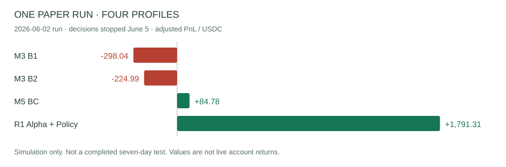
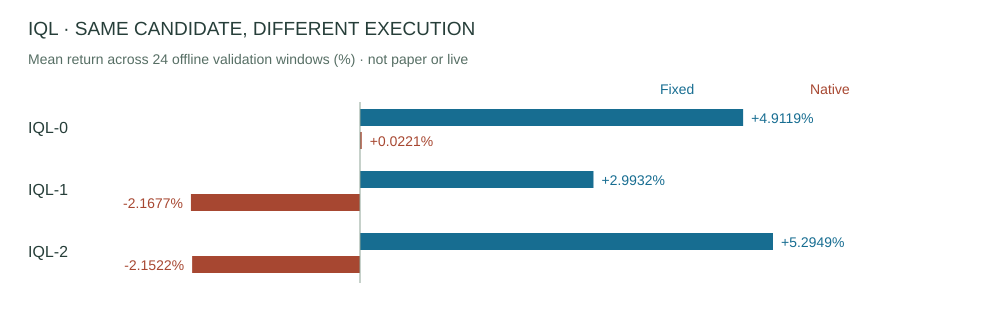

# Results and evidence

[完整中文](RESULTS.zh-CN.md) · [Model inventory](MODELS.md)

Training loss, offline replay, paper trading and live ledgers are separate evidence levels. Every N/A has a reason; it is neither zero nor proof of never running. Monetary amounts are USDC.

Read every run first, then compare models within each family. / 先看逐次运行，再按家族比较模型。

[Paper](#paper) · [Live](#live) · [M3](#m3) · [M5](#m5) · [Alpha](#alpha) · [Policy](#policy) · [Other / 其他](#other)

## Paper trade / 模拟盘

| Run (UTC) | Metric / 口径 | B1 | B2 | BC (m5_baseline) | R1 Alpha + Policy |
| --- | --- | --- | --- | --- | --- |
| [20260517 022156 UTC](evidence/paper/run-p22-three-profile-72h-20260517T022156Z/reports/report-20260517T083623Z.json) | nav_delta_total | +100.0507 | -99.0588 | -99.5530 | N/A — not included / 未包含 |
| [20260517 223411 UTC](evidence/paper/run-tpsl-three-profile-72h-no-raw-tp30-20260517T223411Z/final-reports/report-20260519T135915Z.json) | adjusted_total_pnl_usdc | -55.7933 | +78.4222 | -47.7168 | N/A — not included / 未包含 |
| [20260519 141035 UTC](evidence/paper/run-tpsl-three-profile-72h-no-raw-v2merge-tp30-20260519T141035Z/codex_reports/report-20260522T234126Z.json) | adjusted_total_pnl_usdc | -104.6874 | +43.0920 | -0.4547 | N/A — not included / 未包含 |
| [20260527 161918 UTC](evidence/paper/run-four-profile-72h-mpv2-restart-20260527T161918Z/reports/report-20260530T162518Z.json) | adjusted_total_pnl_usdc | -127.7975 | -100.6707 | +20.1954 | +1114.9697 |
| [20260602 135518 UTC](evidence/paper/run-four-profile-7d-direct-official-20260602T135518Z/reports/standard/report-terminated-20260607T122104Z.json) | adjusted_total_pnl_usdc | -298.0387 | -224.9895 | +84.7787 | +1791.3144 |

Report durations: 6.22 h (stopped early), 39.30 h (stopped early), 72.07 h, 71.98 h, then the terminated June 2 run. The last run did not complete seven days: final decisions were June 5 11:37:05/11:44:01 UTC for B1/B2 and 18:09:59 for BC/R1; the process terminated June 7. Per-profile first/last decisions: [paper ledger / 模拟盘台账](catalog/paper-results.json).

adjusted_total_pnl_usdc includes closed risk segments plus the current valid segment; principal replenished on reset is not profit and the metric is not final NAV minus 100. Rebate accrual/payout/pending remain separate; the suspected duplicate rebate aggregation in the style report is excluded from these summaries. Runs are never summed into historical PnL. Unsettled items, queue assumptions and early stops remain disclosed. Other candidates: paper N/A — no corresponding reports.

## Live trade / 真实资金

Attributed only to mpv2_r1_a3_seq120_seed2. These are original report values, not newly reconciled calculations.

| UTC run | Conservative NAV delta / 保守NAV变化 | Realized only / 仅已实现 | Platform final PnL / 平台最终收益 |
| --- | --- | --- | --- |
| [20260618T194241Z](evidence/live/r5-three-market-live-funds-20260618T194241Z/trading-runtime/run_manifest.json) | 0.290000 | 0.05 | N/A — not reconciled / 未核对 |
| [20260618T211230Z](evidence/live/r5-three-market-live-funds-20260618T211230Z/trading-runtime/run_manifest.json) | -5.500000 | 0 | N/A — not reconciled / 未核对 |
| [20260618T215747Z](evidence/live/r5-three-market-live-funds-20260618T215747Z/trading-runtime/run_manifest.json) | 0.250000 | 0 | N/A — not reconciled / 未核对 |
| [20260618T230237Z](evidence/live/r5-three-market-live-funds-20260618T230237Z/trading-runtime/run_manifest.json) | N/A — NAV unobservable / NAV不可观测 | 0 | N/A — not reconciled / 未核对 |
| [20260619T002200Z](evidence/live/r5-three-market-live-funds-20260619T002200Z/trading-runtime/run_manifest.json) | N/A — NAV unobservable / NAV不可观测 | 0 | N/A — not reconciled / 未核对 |
| [20260619T020053Z](evidence/live/r5-three-market-live-funds-20260619T020053Z/trading-runtime/run_manifest.json) | N/A — NAV unobservable / NAV不可观测 | 0 | N/A — not reconciled / 未核对 |
| [20260619T092850Z](evidence/live/r5-three-market-live-funds-20260619T092850Z/trading-runtime/run_manifest.json) | N/A — NAV unobservable / NAV不可观测 | -0.3166666666666666666666666667 | N/A — not reconciled / 未核对 |
| [20260621T022402Z](evidence/live/r5-three-market-live-funds-20260621T022402Z/trading-runtime/run_manifest.json) | 0.00000 | 0 | N/A — not reconciled / 未核对 |
| [20260621T061651Z](evidence/live/r5-three-market-live-funds-20260621T061651Z/trading-runtime/run_manifest.json) | N/A — NAV unobservable / NAV不可观测 | 0 | N/A — not reconciled / 未核对 |
| [20260621T131804Z](evidence/live/r5-three-market-live-funds-20260621T131804Z/trading-runtime/run_manifest.json) | N/A — NAV unobservable / NAV不可观测 | -2.9291068562050986592668483156 | N/A — not reconciled / 未核对 |
| [20260621T150800Z](evidence/live/r5-three-market-live-funds-20260621T150800Z/trading-runtime/run_manifest.json) | N/A — NAV unobservable / NAV不可观测 | 0.0 | N/A — not reconciled / 未核对 |
| [20260622T082624Z](evidence/live/r5-three-market-live-funds-20260622T082624Z/trading-runtime/run_manifest.json) | -8.50500000 | -0.3298076923076923076923076923 | N/A — not reconciled / 未核对 |
| [20260622T120633Z](evidence/live/r5-three-market-live-funds-20260622T120633Z/trading-runtime/run_manifest.json) | -18.87545541 | -4.1507300217332112807109676924 | N/A — not reconciled / 未核对 |

June 21 02:24 had no orders or fills; its zero applies only to that run. Zero realized PnL does not imply zero total PnL when NAV is unobservable. Reports retain SDK attempt counts, fill counts, stop reasons, unrealized positions and ledger limits; final_platform_pnl_unavailable and platform_pnl_evidence_complete=false prevent claims of cumulative profit, account return, maximum drawdown or final equity. Other models: live N/A — no corresponding run evidence.

## M3

| Model | Best epoch | Train loss | Val AUC | Test AUC | Test top-decile EV |
| --- | --- | --- | --- | --- | --- |
| [M3 run3](models/m3_run3/README.md) | 1 | 1.941012 | 0.773355 | 0.743551 | 0.245144 |
| [M3 B1](models/m3_run_v7_M3-B1/README.md) | 13 | 0.277852 | 0.735678 | 0.713834 | -0.105901 |
| [M3 B2](models/m3_run_v7_M3-B2/README.md) | 12 | 0.299922 | 0.735113 | 0.713882 | -0.086622 |

B1/B2 fixed-execution test PnL was +92.2782 / +137.8349, a different evaluation from the AUC test. [source / 来源](evidence/history/m3m5/changelog/M3M5调参实验记录v7.md)

## M5 BC / IQL

BC best-checkpoint train/val/test accuracy: 0.848722 / 0.710701 / 0.682590. Final epoch 4 val accuracy: 0.703286; final test N/A — no independent test.

| Candidate | Best epoch | Policy loss | Val Q loss | Hold best | Hold final (epoch 50) |
| --- | --- | --- | --- | --- | --- |
| [IQL-0](models/m5_iql_0/README.md) | 46 | 4.649556 | 0.029637 | 92.60% | 93.85% |
| [IQL-1](models/m5_iql_1/README.md) | 35 | 4.590885 | 0.028484 | 85.25% | 89.20% |
| [IQL-2](models/m5_iql_2/README.md) | 43 | 4.635094 | 0.035254 | 94.25% | 95.30% |

| 24 validation windows / 24验证窗口 | Fixed execution / 固定执行 | Native execution / 原生执行 |
| --- | --- | --- |
| IQL-0 | +4.9118625% | +0.0220625% |
| IQL-1 | +2.9931583% | −2.1676542% |
| IQL-2 | +5.2948708% | −2.1522250% |

These are mean per-window offline validation returns. Independent IQL test metrics and paper/live are N/A — no corresponding independent reports. [raw fixed/native reports / 固定与原生原始报告](evidence/m3m5-offline)

## Alpha Phase 5.8

| Candidate | Best epoch | Train loss | val.auc | true_best_side_auc | Selected-side top-decile EV |
| --- | --- | --- | --- | --- | --- |
| [R1 A3 · s2](models/alpha_primary_R1_A3_seq120_bs2048_ep30_lev0p25_sr0p0_sm0p0_seed2/README.md) | 1 | 1.416982 | 0.868495 | 0.595098 | 0.065216 |
| [R1 A3 · s3](models/alpha_primary_R1_A3_seq120_bs2048_ep30_lev0p25_sr0p0_sm0p0_seed3/README.md) | 2 | 1.352764 | 0.861482 | 0.571024 | 0.138491 |
| [R2 A1 · s2](models/alpha_primary_R2_A1_seq120_bs2048_ep30_lev0p5_sr0p0_sm0p1_seed2/README.md) | 4 | 1.195743 | 0.872110 | 0.667253 | 0.042430 |
| [R3 A6 · s2](models/alpha_primary_R3_A6_seq120_bs2048_ep30_lev0p5_sr0p05_sm0p1_seed2/README.md) | 3 | 1.185670 | 0.866127 | 0.665461 | 0.013070 |
| [R4 LB2 · s1](models/alpha_primary_R4_LB2_512_seq120_bs512_ep30_lev0p5_sr0p05_sm0p1_seed1/README.md) | 2 | 1.138801 | 0.853418 | 0.649595 | 0.093210 |
| [R4 LB2 · s2](models/alpha_primary_R4_LB2_512_seq120_bs512_ep30_lev0p5_sr0p05_sm0p1_seed2/README.md) | 1 | 1.236778 | 0.871611 | 0.674253 | 0.047972 |
| [R5 A4 · s3](models/alpha_primary_R5_A4_seq120_bs2048_ep30_lev0p5_sr0p0_sm0p0_seed3/README.md) | 1 | 2.359265 | 0.867386 | 0.590465 | 0.026660 |
| [R6 C2 · s2](models/alpha_primary_R6_C2_control_seq180_bs4096_ep30_lev0p25_sr0p1_sm0p0_seed2/README.md) | 3 | 0.714006 | 0.864232 | 0.776629 | 0.068376 |

All eight: independent test N/A — not independently tested; standalone paper/live N/A — no separate strategy reports. R1 seed2 is part of a deployment and does not inherit its PnL separately. All 16 experiments appear in the [experiment ledger / 实验台账](catalog/alpha-experiments.json).

## MakerPolicy Phase 6.5–6.7

| Candidate | Last BC loss | Last offline RL loss |
| --- | --- | --- |
| [R1 A3 · s2](models/policy_primary_R1_A3_seq120_bs2048_ep30_lev0p25_sr0p0_sm0p0_seed2/README.md) | 0.000110815 | 0.000076921 |
| [R1 A3 · s3](models/policy_primary_R1_A3_seq120_bs2048_ep30_lev0p25_sr0p0_sm0p0_seed3/README.md) | 0.000117271 | 0.000079444 |
| [R2 A1 · s2](models/policy_primary_R2_A1_seq120_bs2048_ep30_lev0p5_sr0p0_sm0p1_seed2/README.md) | 0.000113844 | 0.000065989 |
| [R3 A6 · s2](models/policy_primary_R3_A6_seq120_bs2048_ep30_lev0p5_sr0p05_sm0p1_seed2/README.md) | 0.000113422 | 0.000071329 |
| [R4 LB2 · s1](models/policy_primary_R4_LB2_512_seq120_bs512_ep30_lev0p5_sr0p05_sm0p1_seed1/README.md) | 0.000149778 | 0.000161845 |
| [R4 LB2 · s2](models/policy_primary_R4_LB2_512_seq120_bs512_ep30_lev0p5_sr0p05_sm0p1_seed2/README.md) | 0.000143163 | 0.000158601 |
| [R6 C2 · s2](models/policy_primary_R6_C2_control_seq180_bs4096_ep30_lev0p25_sr0p1_sm0p0_seed2/README.md) | 0.000122122 | 0.000061272 |
| [6.7 C0](models/policy_phase67_C0_control_anchor/README.md) | 0.156779423 | 0.001588044 |
| [6.7 P1](models/policy_phase67_P1_signed_reward_filter/README.md) | 0.576368110 | 0.303230513 |

Independent val/test losses are N/A — no independent loss reports. Replay PnL cannot fill those fields. All seven Phase 6.5 candidates have 263-window reports; Phase 6.6 has 30 windows for only three candidates; other independent replay is N/A — not independently tested.

| Phase | Candidate | Windows | Sum of window PnL / 窗口收益之和 | Verdict |
| --- | --- | --- | --- | --- |
| phase65 | [R1 A3 · s2](models/policy_primary_R1_A3_seq120_bs2048_ep30_lev0p25_sr0p0_sm0p0_seed2/README.md) | 263 | +46401.5289 | FAIL_NO_MAKER_EDGE |
| phase65 | [R6 C2 · s2](models/policy_primary_R6_C2_control_seq180_bs4096_ep30_lev0p25_sr0p1_sm0p0_seed2/README.md) | 263 | +46395.7014 | FAIL_NO_MAKER_EDGE |
| phase65 | [R3 A6 · s2](models/policy_primary_R3_A6_seq120_bs2048_ep30_lev0p5_sr0p05_sm0p1_seed2/README.md) | 263 | +46373.2969 | FAIL_NO_MAKER_EDGE |
| phase65 | [R2 A1 · s2](models/policy_primary_R2_A1_seq120_bs2048_ep30_lev0p5_sr0p0_sm0p1_seed2/README.md) | 263 | +46367.9046 | FAIL_NO_MAKER_EDGE |
| phase65 | [R4 LB2 · s2](models/policy_primary_R4_LB2_512_seq120_bs512_ep30_lev0p5_sr0p05_sm0p1_seed2/README.md) | 263 | +46366.3567 | FAIL_NO_MAKER_EDGE |
| phase65 | [R1 A3 · s3](models/policy_primary_R1_A3_seq120_bs2048_ep30_lev0p25_sr0p0_sm0p0_seed3/README.md) | 263 | +46360.5781 | FAIL_NO_MAKER_EDGE |
| phase65 | [R4 LB2 · s1](models/policy_primary_R4_LB2_512_seq120_bs512_ep30_lev0p5_sr0p05_sm0p1_seed1/README.md) | 263 | +46356.4291 | FAIL_NO_MAKER_EDGE |
| phase66 | [R1 A3 · s2](models/policy_primary_R1_A3_seq120_bs2048_ep30_lev0p25_sr0p0_sm0p0_seed2/README.md) | 30 | +5336.6038 | FAIL_NO_MAKER_EDGE |
| phase66 | [R3 A6 · s2](models/policy_primary_R3_A6_seq120_bs2048_ep30_lev0p5_sr0p05_sm0p1_seed2/README.md) | 30 | +5334.8892 | FAIL_NO_MAKER_EDGE |
| phase66 | [R6 C2 · s2](models/policy_primary_R6_C2_control_seq180_bs4096_ep30_lev0p25_sr0p1_sm0p0_seed2/README.md) | 30 | +5332.3356 | FAIL_NO_MAKER_EDGE |
| phase67 | [6.7 C0](models/policy_phase67_C0_control_anchor/README.md) | 263 | +45844.6815 | FAIL_CONTROL_AMPLIFICATION |
| phase67 | [6.7 P1](models/policy_phase67_P1_signed_reward_filter/README.md) | 263 | +6867.8120 | FAIL_CONTROL_AMPLIFICATION |

Windows are independent runs, not a continuous account return. Phase 6.5/6.6 decoded identical actions on common inputs and did not establish maker edge. Phase 6.7 amplified the control; independent test N/A — not started after failure. [evidence links / 证据链接](catalog/offline-results.json)

## Other stages / 其他阶段

M1 is the replay engine and M2 feature engineering; early rule strategies have no trained weights. M3 A6 and M5 BC-6 weights: N/A — no retained weights; offline controls remain public, including BC-6 test PnL −11.0374, FAIL. The newer architecture has N/A for formal trained weights, training scores and paper/live profitability — no formal trained release; component, initialization and performance checks are engineering evidence only.

June 4–5 legacy live runtime recorded real orders and balances but incomplete fill queries/PnL. June 12–14 SDK runs recorded real fills and exposed raw USDC units in model account inputs; strategy PnL for both stages is N/A — insufficient accounting. June 19 01:54 failed before trading, not zero PnL. June 25–26 sellability probe is infrastructure evidence: 30 valid samples; clean_accept_ms median 1939, P95 3357; overall gate failed CSV writer validation. Model PnL: N/A — not a strategy-profit experiment.

[historical evidence / 历史证据](evidence/history) · [new architecture / 新架构证据](evidence/new-architecture)
