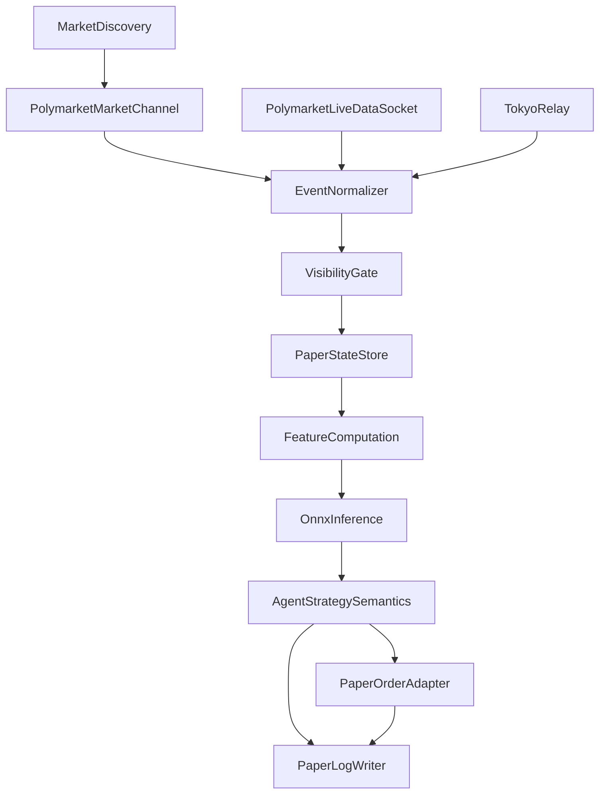

# M6 设计

> 面向 `M6 Paper Trading` 的实施设计稿。
> 目标是把 [开发计划.md](../开发计划.md) 中已经确认的 `M6` 计划，进一步收敛成可执行的运行时契约、部署边界、日志口径与验收落点。

---

## 1. 目标与非目标

### 1.1 目标

M6 的目标不是继续扩大离线搜索树，而是把已经在 `M5` 收口中确认过的离线候选：

`frozen signal head + signal_threshold=0.58 + force_order_type=limit + 默认 size`

搬到**实时事件流**上，验证以下事项：

1. 实时数据接入后，特征、推理、风控、执行语义是否仍与离线 `replay/evaluate` 一致
2. 实时链路的延迟、数据完整性、挂单生命周期、日志与遥测是否可解释
3. 在多日 paper 条件下，是否仍能维持对 `hold` 的优势与可接受的风险表现

### 1.2 非目标

M6 当前不做以下事情：

1. 不重开 `J1_C/J2/J3` 分支
2. 不把“继续扩展纯 offline IQL / K2 搜索矩阵”当作主线
3. 不直接下真实单；M6 只允许**模拟订单 / 模拟成交**
4. 不在本阶段引入第二套独立 execution 语义，避免与离线链路 drift

---

## 2. 输入契约

### 2.1 数据与特征

以 [数据集规范.md](../数据集规范.md) 和 [依赖环境说明.md](依赖环境说明.md) 为准：

1. 下游统一消费 `manifest.parquet + labels.parquet`
2. 当前特征帧的 canonical schema 为 `86` 列
3. `Phase 1` 监督训练输入为 `65` 维 `FEATURE_COLS`
4. `M5/M6` observation 输入为 `76` 维：`65 + 6 agent state + 5 long-term signal`
5. 原始事实层允许 `model/data-v*/<window_id>/...` 下的 raw 与
   `model/parquet-data/<dataset_version>/<window_id>/...` 下的 **typed parquet 原始镜像层** 双轨并存；
   mirror 是原始层同构镜像，不等同于 `M0` 导出表、`feature-engine` 特征 parquet 或 `tick_stream`

### 2.2 模型与导出

以 [training/export_onnx.py](../training/export_onnx.py) 和 [rust/onnx-inference/src/lib.rs](../rust/onnx-inference/src/lib.rs) 为准：

1. Rust runtime 直接消费 `agent_model*.onnx`
2. `InputNormalizer` / `state_normalizer` 已烘入 ONNX 图
3. `feature_stats.npz` / `feature_stats_76.npz` 不是 Rust runtime 的直接依赖，但必须与导出模型成套留存，作为训练 → 导出 → 追溯契约工件

---

## 3. 候选与重冻结策略

### 3.1 当前默认候选

当前默认进入 `M6` 的候选固定为：

- `signal_threshold=0.58`
- `force_order_type=limit`
- 默认 `size`

### 3.2 M6.0 重冻结策略

`M6.0` 只做以下刷新，不重开 `J1/K1`：

1. 用 `V1~V4` 做新一轮 `M3` 监督重训
2. 基于新 `M3` checkpoint 重跑 `K2-A1 signal_eval`
3. 重跑 `Execution/MarketEdge` 的 `E1`（阈值扫）与 `E2`（`order_type / size`）
4. 对比旧冻结候选与新重冻结候选：
   - 若阈值或 execution config 改变，则以新结果重冻结
   - 若没有明确优势，则继续沿用 `0.58 + limit + 默认 size`

### 3.3 superiority rule 的冻结位置

“新候选是否明确优于旧候选”的数值规则不在 `开发计划.md` 中硬编码，而是冻结在本文第 10 节的 shadow / Go-No-Go 配置中。首次 shadow 完成后，由一次正式文档更新写死数值。

---

## 4. 服务器与部署拓扑

以 [服务器信息.md](服务器信息.md) 为准：

1. 云 GPU：`ssh -p 40228 root@[REDACTED_TRAINING_HOST]`
2. AWS 日本：`ssh ubuntu@[REDACTED_IP]`
3. AWS 爱尔兰：`ssh ubuntu@[REDACTED_IP]`
4. 数据采集：`ssh ubuntu@[REDACTED_IP]`

### 4.1 角色分工

- **GPU 训练服务器**：`V1~V4` 监督重训、`signal_eval`、`Execution/MarketEdge` 重扫、候选重冻结
- **AWS 日本**：Binance 数据接收与中继
- **AWS 爱尔兰**：Polymarket 接入、paper runtime、结构化日志、监控与报告素材
- **数据采集服务器**：原始数据采集，BYPY 上传百度云
- **本地开发机**：代码维护、文档维护、远程任务编排、日志回收与人工监督

### 4.2 同步链路

1. 代码同步使用 GitHub
2. 数据与模型产物同步使用百度云（BYPY）
3. 数据采集服务器每日上传数据到百度云
4. GPU 服务器拉取新数据并纳入训练/回测
5. 爱尔兰 paper runtime 使用**已冻结**的模型与配置，不直接消费训练中的临时产物

---

## 5. 实时接入契约

### 5.1 Polymarket market channel

根据 [polymarket-docs/WebSocket Market Channel.md](../../polymarket-docs/WebSocket%20Market%20Channel.md)：

- 端点：`wss://ws-subscriptions-clob.polymarket.com/ws/market`
- 订阅对象：`asset_ids`
- `custom_feature_enabled=true` 时，可收到：
  - `best_bid_ask`
  - `new_market`
  - `market_resolved`
- 核心事件：
  - `book`
  - `price_change`
  - `last_trade_price`
  - `best_bid_ask`
  - `new_market`
  - `market_resolved`

### 5.2 Polymarket / Gamma market discovery

根据 [polymarket-docs/list markets.md](../../polymarket-docs/list%20markets.md) 与 [polymarket-docs/Get event by slug.md](../../polymarket-docs/Get%20event%20by%20slug.md)：

1. 运行时需要一个 `MarketDiscovery` 层，通过 `Gamma /markets` 拉取候选市场，再按本项目的 BTC UP/DOWN 5MIN 规则做本地筛选
2. 若已知事件 slug，可通过 `/events/slug/{slug}` 或 `/events/{id}` 补齐事件/市场元信息
3. runtime 必须缓存以下字段：
   - `market`
   - `conditionId`
   - `slug`
   - `startDate` / `endDate`
   - `enableOrderBook`
   - `clobTokenIds`
   - `outcomes`

### 5.3 Chainlink 实时源

根据 [polymarket-docs/Real-Time Data Socket.md](../../polymarket-docs/Real-Time%20Data%20Socket.md)：

- 端点：`wss://ws-live-data.polymarket.com`
- Binance 主题：`crypto_prices`
- Chainlink 主题：`crypto_prices_chainlink`
- BTC/USD 符号：`btc/usd`

因此 M6 默认实时链路使用：

1. `market channel` 提供盘口、trade、market lifecycle
2. `crypto_prices` 提供 Binance 参考价
3. `crypto_prices_chainlink` 提供 Chainlink `btc/usd`

### 5.4 事件时间戳与可见时间

所有实时源统一保留 3 份时间：

1. `payload_ts_ms`：消息里自带的 source timestamp
2. `rx_ts_ms`：爱尔兰机器收到消息的本地 UTC 毫秒
3. `visible_ts_ms`：runtime 真正允许进入特征与策略的时间

当前设计规定：

```text
visible_ts_ms = max(rx_ts_ms, payload_ts_ms + configured_delay_ms)
```

其中：

- Polymarket：`configured_delay_ms = 20`
- Chainlink：`configured_delay_ms = 20`
- Binance：`configured_delay_ms = 105`

设计意图：

1. 不让实时 runtime “比离线假设更乐观”
2. 若真实链路更慢，则按更慢的 `rx_ts_ms` 生效
3. shadow 阶段通过日志验证 `payload_ts_ms -> visible_ts_ms` 的实际分布

### 5.5 gap / staleness / 重连

1. 每条源都维护 `last_rx_ts_ms`
2. 若连续超过 `15s` 无有效更新，标记为 `gap`
3. `gap` 期间：
   - 不允许继续正常决策
   - 已有 paper 订单按“撤单并冻结该 market 后续动作”处理
4. 重连后必须重新拉 snapshot，并在日志中记录：
   - 断线开始时间
   - 重连成功时间
   - 是否发生 snapshot 重建
   - 该 market 是否被标记为 shadow-invalid

---

## 6. 运行时架构



### 6.1 复用原则

M6 不 fork 第二套离线语义。复用优先级如下：

1. 特征语义：复用 `feature-engine::compute_feature_frame`
2. 推理语义：复用 `onnx-inference`
3. 决策与解码：复用 `agent::strategy` 的 observation / decode / arbiter / risk path
4. 执行语义：复用 `ExecutionStateMachine + OutstandingOrderTracker`
5. 新增内容只放在最外层：
   - 实时接入客户端
   - 订单适配层
   - 结构化日志层
   - 进程管理与部署脚本

### 6.2 OrderAdapter 约定

为了保留现有 ESM 语义，paper 层只新增订单适配器，不重写 `ExecutionStateMachine`：

```text
trait OrderAdapter {
    submit(intent) -> PaperOrderId
    cancel(order_id) -> Ack
    poll() -> Vec<OrderEvent>
}
```

首版只实现：

1. `PaperOrderAdapter`：只记录、不下真实单

未来可扩展：

1. `ReplaySimAdapter`
2. `LiveAdapter`

但这两者不属于 M6 首版交付。

---

## 7. Artifact set

每次启动 paper runtime，必须写出完整的 run manifest，并锁定以下工件：

1. `agent_model*.onnx`
2. 对应训练 run 的 `feature_stats.npz` 或 `feature_stats_76.npz`
3. `runtime.json` 在线版本
4. `agent_config.json` / 运行参数覆盖
5. `split_info.json`（用于 shadow replay 对照）
6. model / config / runtime sha256

### 7.1 模型切换策略

首版只支持**market 边界冷切换**：

1. 新模型就绪
2. 当前 market 若存在 in-flight `limit` 单，先撤单并确认完成
3. 写出切换前 run manifest
4. 重启 runtime 加载新模型

禁止：

1. 同一进程热切换并继承旧挂单状态
2. 未撤单直接把旧挂单“移交”给新模型

A/B paper 只能通过独立 runtime 完成，不共享订单状态或日志目录。

---

## 8. 日志与落盘

### 8.1 落盘原则

1. 主日志采用**滚动 Parquet**
2. 字段语义尽量对齐 `tick_stream` / `reward_minimal`
3. 每个决策步都可追溯：
   - 特征输入
   - 模型输出
   - 仲裁结果
   - 风控结果
   - 订单状态
   - 模拟成交
   - NAV / cash / inventory

### 8.2 文件切片

默认切片方式：

1. 按 `window_id` 切片
2. 若单 window 文件过大，可退化为按小时切片

### 8.3 保留与回传

1. 爱尔兰侧保留最近 `14` 天日志
2. 每日固定回传一次到本地归档目录
3. 若运行中断，优先保证当前 `window` 的 Parquet 可恢复关闭

### 8.4 辅助日志

除主 Parquet 外，保留：

1. `runtime.log`：人类可读阶段日志
2. `health.jsonl`：断线、重连、gap、切换、异常事件
3. `run_manifest.json`：本次运行的 artifact set 与参数快照

---

## 9. 默认运行参数

首版默认参数：

- `starting_cash = 100 USDC`
- `step_ms = 250`
- `top_k = 5`
- `signal_threshold = 0.58`
- `force_order_type = limit`
- `size = default`
- `limit_order_ttl_ms = 250`

说明：

1. `100 USDC` 必须与离线 `evaluate --starting-cash 100` 对齐
2. 若未来加码资金规模，必须单独开新 run，不与默认 M6 结果混写

---

## 10. Shadow 与 Go/No-Go 门槛落点

### 10.1 shadow smoke 首次冻结的内容

在首轮 `shadow smoke` 完成后，必须回写本文并冻结以下数值：

1. observation 逐元素容差
2. `P_up` / 关键 logits 容差
3. 单 market `NAV` 容差
4. `max_drawdown_pct` 阈值
5. `churn_ratio` 阈值
6. `hit_ratio` 阈值
7. `limit fill/cancel/ttl_expiry` 健康度门槛
8. superiority rule（新候选 vs 旧候选）

A 路硬卡（dump_window_as_recording.py + paper-runtime run-recorded vs
replay-shadow，run_m6_shadow_gate.py 跑 frozen test window
data-v3/1775232000-1775246400）已通过 1e-6 byte-identical 验证（D.Gate.0
2026-04-28），冻结：

- `shadowCalibratedObsTolerance` = **1e-6**（feature 76 维 max_abs_diff）
- `shadowCalibratedModelTolerance` = **1e-6**（signal_logits / signal_ev max_abs_diff）
- `shadowCalibratedNavTolerance` = **1e-6**（决策行级 nav max_abs_diff，含末值 NAV）

剩余 5 个仍待首次多日 paper 跑完后冻结（见 §3.2 / §10.2）：

- `shadowCalibratedMaxDrawdown`
- `shadowCalibratedChurn`
- `shadowCalibratedHitRatio`
- `shadowCalibratedOrderHealth`
- `shadowCalibratedSuperiorityRule`

### 10.2 Go/No-Go 框架

最终 Go/No-Go 至少要求：

1. `weekly_total_pnl > hold`
2. `max_drawdown_pct < shadowCalibratedMaxDrawdown`
3. `churn_ratio < shadowCalibratedChurn`
4. `hit_ratio > shadowCalibratedHitRatio`
5. `limit fill/cancel/ttl_expiry` 健康度达标
6. runtime 稳定、日志完整、异常可解释
7. 若本轮未覆盖足够 regime，则延长 paper，而不是提前出结论

---

## 11. 失败模式

M6 首版重点覆盖以下 failure modes：

1. market discovery 漏掉下一个 market
2. market channel 断线后 snapshot 重建失败
3. Binance / Chainlink 数据 gap 超过 `15s`
4. `crypto_prices_chainlink` 的 `value/timestamp` 与离线 `rtds_chainlink` 语义不一致
5. observation 与离线 replay 不一致
6. 模型切换时挂单残留
7. Parquet 未正常关闭导致日志不可恢复

每个 failure mode 都必须在 `health.jsonl` 中有明确事件记录。

---

## 12. 实施顺序

1. 先完成本设计稿
2. 并行推进：
   - `V1~V4` 基线刷新线
   - 实时接入与 paper runtime 工程线
3. 在 shadow smoke 汇合点确定最终候选
4. 进入 multi-day paper
5. 回写本文中的 shadow / Go-No-Go 数值门槛
6. 输出正式报告

---

## 13. 当前 bring-up 记录（2026-04-19）

### 13.1 已完成的工程落地

1. 已新增 `paper-runtime` crate，并通过本地 `cargo test -p paper-runtime`
2. 已新增：
   - `run_m6_v1v4_refresh.py`
   - `run_m6_shadow_gate.py`
   - `run_m6_go_nogo.py`
   - `deploy_m6_runtime.sh`
3. 爱尔兰机已下发：
   - `paper-runtime` 二进制
   - `paper_runtime.json`
   - `agent_model.onnx`
   - `feature_stats.npz`
   - `split_info.json`
4. 爱尔兰机上的 `paper-runtime validate-config` 已通过
5. 数据采集机已安装 `bypy`
6. 爱尔兰机上的 `paper-runtime shadow-smoke` 已完成一次端到端 smoke，并成功落盘：
   - `run_manifest.json`
   - `discovered_markets.json`
   - `market_messages.json`
   - `live_messages.json`
   - `summary.json`

### 13.2 当前实测结果

1. **Gamma /markets 可访问**
   - 远端 `discover-markets` 能成功请求 Gamma
   - 但当前 `BTC UP/DOWN 5MIN` 过滤条件仍需进一步收敛，不能把 “返回空列表” 误判成 “接口不可用”
2. **Polymarket market channel 可收到消息**
   - `smoke-market` 已能落盘消息
   - 当前观察到的事件不一定只来自所请求 asset，说明还需进一步核对订阅粒度与事件过滤
3. **Polymarket live data socket 已打通首轮 smoke**
   - 爱尔兰机上的 `smoke-live-data` 已能收到：
     - `topic = crypto_prices`
     - `topic = crypto_prices_chainlink`
   - 当前实现为了绕过服务端 filter 校验，首版采用“**全量订阅、客户端再过滤**”策略；后续若需要再收紧到按 symbol 订阅，可在不影响主线的前提下单独优化
4. **首轮 end-to-end shadow smoke 已成功**
   - 当前固定输出目录：`[PRIVATE_HOME]/m6-paper/logs/shadow-smoke-latest`
   - 当前实测：
     - `market_message_count = 1`
     - `live_message_count = 8`
   - 说明：运行链路已经能完成 `discover -> market ws -> live ws -> run manifest -> summary` 的闭环，但尚未进入 observation / ONNX / paper order adapter 的完整决策循环

### 13.3 当前外部约束

1. 当前 GPU 服务器处于“无卡模式”，并且只有 `0.5 vCPU / 2G RAM`
2. 当前它的主要任务是同步 `DATA V4` 原始数据与产物
3. 本地 `DATA V4` 的 typed parquet 原始镜像层已完成 `verify_parquet_raw_coverage.py` 校验：
   `3016 -> 3016`，且 `missing/extra/row_mismatch = 0`；这证明文件覆盖与逐文件行数一致，但不等同于全链路全量等价
4. 已确认存在 tmux 任务：
   - `dl-v4-raw`
   - `dl-v4-tables`
5. 因此 `V1~V4` 的 `M3` 重训与 `K2` 重扫暂不应继续占用该机，需等待：
   - `DATA V4` 同步完成
   - 可训练环境恢复

---

> **执行计划见 `dev-docs/m6-0427实施计划.md`**（2026-04-27 起）。该文档已经过 9 轮 GPT/DeepSeek 审查并由用户批准，是 M6 paper runtime 工程线的 source of truth。本设计稿为契约 / 设计依据，实施细节以 m6-0427 为准。
