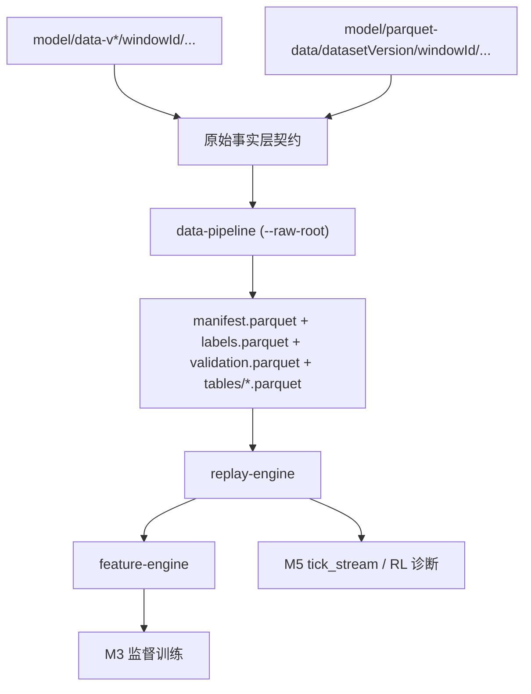

# Typed Parquet 说明文档

## 1. 文档目的

这份文档面向项目交接与新同事上手，专门说明本仓库里
`model/parquet-data/<dataset_version>/` 这套 **typed parquet 原始镜像层** 的业务角色、数据关系、实现入口、验证边界、命令范式与运维注意事项。

如果你只记住一句话，请记住：

- **typed parquet 原始镜像层是 raw 原始事实层的同构列式镜像，不是新的训练层表。**

它的目标是：

- 在不改变业务语义的前提下压缩原始数据体积
- 让 `data-pipeline`、`replay-engine`、`feature-engine` 可以直接读取 mirror
- 保留 raw 的审计价值，同时降低文本扫描成本

它不负责：

- 取代 `manifest.parquet + labels.parquet`
- 取代 `feature-engine` 产出的特征 parquet
- 取代 `tick_stream/*.parquet` 这类 RL/诊断样本层

## 2. 它在整个系统里的位置



业务上要把它理解成四层：

- **原始事实层**：`model/data-v*/...` 的 raw，和 `model/parquet-data/...` 的 mirror，二者表达同一批原始事实
- **M0 索引/验证层**：`manifest.parquet + labels.parquet + validation.parquet + tables/*.parquet`
- **M2 特征层**：`feature-engine/out/<dataset_version>/features_*.parquet`
- **M5 样本层**：`tick_stream/*.parquet` 或 `tick_stream/*_reward_minimal.parquet`

typed parquet 属于第一层，不属于后面三层。

## 3. 为什么要做这层 mirror

原始 `ndjson/csv/nojson` 很适合审计和还原真实事件语义，但不适合长期大体量扫描。引入 typed parquet mirror 主要是为了解决三个问题：

- **存储成本**：同样的事实层可以显著压缩体积
- **统一读取路径**：M0/M1/M2 可以直接消费 parquet mirror，而不是只能解析文本
- **长期运维**：更方便做覆盖校验、批量迁移、重放和目录级治理

这个设计的核心思想不是“把原始层变成训练层”，而是：

- raw 继续保留，承担审计与语义基准角色
- mirror 作为 raw 的列式镜像，承担压缩和读取性能角色
- 下游契约不变，仍通过 `manifest + labels` 串起系统

## 4. 什么是“无损”

这里的“无损”更准确地说是 **业务语义无损**，不是逐字节文本无损。

具体含义：

- 同一个 raw 文件会被迁移成一个同名 `.parquet` 镜像文件
- 关键事件语义、时间戳、价格、盘口、标签来源等信息必须可恢复
- 对 JSON 类源，mirror 同时保留 typed 列和 `raw_json`
- 对 aggtrades csv，则保留业务必需的 typed 列

因此：

- **不是**保证原始 JSON 文本的空格、字段顺序、格式细节完全逐字节一致
- **而是**保证系统继续能恢复同样的事件语义，并维持同样的 M0/M1/M2 契约

## 5. 数据格式与主键契约

### 5.1 目录形态

raw 正式目录：

```text
model/data-v*/<window_id>/
  btc-updown-5m/
  btcusdt-price/
  btcusdt-orderbook/
  rtds_chainlink/
```

mirror 正式目录：

```text
model/parquet-data/<dataset_version>/<window_id>/
  btc-updown-5m/
    btc-updown-5m-<market_start_ts>.parquet
  btcusdt-price/
    *_ms.parquet
    *_ms.metadata.parquet
  btcusdt-orderbook/
    *.parquet
  rtds_chainlink/
    *.parquet
```

### 5.2 主键与路径契约

全系统固定主键：

- `dataset_version`
- `window_id`
- `market_id`

当前实现中：

- `market_id` 与 `condition_id` 仍同源同值
- 下游 market 选择与标签消费必须联合使用 `manifest.parquet + labels.parquet`
- `manifest.parquet` 中的 `poly_path / aggtrades_path / orderbook_path / chainlink_path`
  现在既可以指向 raw 文件，也可以指向 mirror 文件

### 5.3 M0 产物边界

M0 至少产出：

- `manifest.parquet`
- `labels.parquet`
- `validation.parquet`
- `tables/polymarket_events.parquet`
- `tables/binance_aggtrades.parquet`
- `tables/chainlink_updates.parquet`
- `tables/binance_orderbook_index.parquet`
- `tables/binance_orderbook_summary.parquet`
- `summary.json`

正式消费口径：

- `manifest.parquet` 不直接包含 `p2b / resolution_price`
- `p2b / resolution_price / label_up` 位于 `labels.parquet`
- `manifest`、`labels`、`validation` 包含所有发现到的 market
- `tables/*.parquet` 只包含通过验证的 market

所以任何下游只读 `manifest.parquet` 都是不完整的。

## 6. mirror 内部编码方式

### 6.1 统一 schema 元信息

核心 schema 定义在：

- `poly-arb-ai/data-pipeline/parquet_raw.py`

这里定义了：

- `PARQUET_RAW_LAYOUT_VERSION = "v1"`
- `PARQUET_RAW_LAYOUT_VERSION_KEY`
- `PARQUET_RAW_SOURCE_KIND_KEY`
- `SOURCE_KIND_POLYMARKET`
- `SOURCE_KIND_AGGTRADES`
- `SOURCE_KIND_ORDERBOOK`
- `SOURCE_KIND_CHAINLINK`
- `SOURCE_KIND_AGGTRADES_METADATA`

也就是说，每个 mirror 文件除了列本身，还会带上“这是哪一类 source”的 schema metadata。

### 6.2 各 source 的编码策略

1. `Polymarket`
- 既保留 typed 列，也保留 `raw_json`
- 典型字段：`event_type`、`market`、`timestamp_ms`、`bids`、`asks`、`price_changes`

2. `Binance orderbook`
- 既保留 typed 列，也保留 `raw_json`
- 支持 `snapshot` 与 `delta`

3. `Chainlink`
- 既保留 typed 列，也保留 `raw_json`
- 可恢复 `payload_history`

4. `Binance aggtrades`
- 直接存业务 typed 列
- 不依赖 `raw_json`

5. `aggtrades metadata`
- `.metadata.json` 会镜像为 `*.metadata.parquet`

### 6.3 读取 mirror 时如何恢复事件语义

Python 侧关键入口：

- `poly-arb-ai/data-pipeline/common.py`
  - `_iter_json_lines_from_parquet()`
  - `iter_json_lines()`

规则是：

- JSON 类 source 从 `raw_json` 列恢复原始事件语义
- aggtrades 及 metadata 直接走 typed 列
- 目录扫描时只认 `.ndjson` / `.nojson` / `.parquet`
- `*.tmp-*` 这类文件不会被当作正式输入

## 7. 系统如何消费 mirror

### 7.1 M0：data-pipeline

入口文件：

- `poly-arb-ai/data-pipeline/cli.py`

关键点：

- `--raw-root` 可以指向 raw 根目录，也可以指向 `model/parquet-data`
- `discover_windows()` 会按 `dataset_version / window_id` 发现数据
- `manifest.py` 已支持通过 parquet source 快速读 market 信息

换句话说，M0 现在可以直接从 mirror 生成：

- `manifest`
- `labels`
- `validation`
- `tables/*`

### 7.2 M1：replay-engine

关键文件：

- `poly-arb-ai/rust/replay-engine/src/replay.rs`

关键能力：

- JSON 类 source 支持从 parquet 的 `raw_json` 列恢复事件
- aggtrades 支持 `ParquetAggTradeStream`
- 最终沿 `manifest` 中的 path 回到 raw 或 mirror 事实源

结论是：

- `replay-engine` 不关心 path 指向 raw 还是 mirror
- 只要 `manifest + labels` 契约成立，它就能回放

### 7.3 M2：feature-engine

关键关系：

- `feature-engine` 不单独实现 mirror reader
- 它通过 `ReplayEngine::run_with_strategy` 自动继承 mirror 输入能力

因此：

- M2 对 mirror 的支持来自 M1
- mirror 不改变 `feature-engine` 的输出契约，只改变底层事实源的存储形态

## 8. 当前验证边界

这里是最容易在交接中说过头的地方，必须严格区分。

### 8.1 已有强验证样本：`data-v1`

当前最强的强验证结论来自 `data-v1`，已验证：

- 文件覆盖：`584 -> 584`
- 逐源行数一致
- 单窗口 `manifest / labels / validation` 等价
- 单窗口 `replay-engine` 报告等价
- 单窗口 `feature-engine` 特征帧等价

### 8.2 最新全量 coverage 结论：`data-v4`

当前最新完成的全量 coverage 校验是 `data-v4`：

- `verify_parquet_raw_coverage.py`
- `raw_file_count = 3016`
- `parquet_file_count = 3016`
- `missing_count = 0`
- `extra_count = 0`
- `row_mismatch_count = 0`

这说明：

- `data-v4` mirror 在**文件覆盖与逐文件行数**层面通过

这**不**说明：

- `data-v4` 已完成全窗口 M0 等价
- `data-v4` 已完成全窗口 replay raw/parquet 等价
- `data-v4` 已完成全窗口 feature raw/parquet 等价

## 9. 可复用的代码文件

如果同事要复用、扩展或排查 typed parquet，优先看这些文件。

### 9.1 迁移与校验

- `model/migrate_raw_dataset_to_parquet.py`
  - raw -> mirror 迁移主入口
  - 支持并行 `workers`
  - 现在会在失败时清理本次 temp，并在迁移前后安全清理 stale temp

- `model/verify_parquet_raw_coverage.py`
  - 检查 raw 与 mirror 的文件覆盖和逐文件行数

- `model/compare_m0_outputs.py`
  - 对比 raw 与 parquet 输入下的 M0 产物

- `model/compare_replay_reports.py`
  - 对比 replay 报告

- `model/compare_parquet_tables.py`
  - 逐行对比两个 parquet 表

### 9.2 M0 读取适配

- `poly-arb-ai/data-pipeline/parquet_raw.py`
- `poly-arb-ai/data-pipeline/common.py`
- `poly-arb-ai/data-pipeline/manifest.py`
- `poly-arb-ai/data-pipeline/labels.py`
- `poly-arb-ai/data-pipeline/normalize.py`
- `poly-arb-ai/data-pipeline/orderbook.py`

### 9.3 M1 / M2 继承能力

- `poly-arb-ai/rust/replay-engine/src/replay.rs`
- `poly-arb-ai/rust/replay-engine/tests/parquet_source_tests.rs`
- `poly-arb-ai/rust/feature-engine/`

### 9.4 测试入口

- `poly-arb-ai/data-pipeline/test_parquet_sources.py`
- `poly-arb-ai/data-pipeline/test_parquet_pipeline.py`
- `model/test_migrate_raw_dataset_to_parquet.py`

## 10. 命令范式

以下命令都是交接时可以直接复用的范式。

### 10.1 迁移 raw -> mirror

```bash
python3 model/migrate_raw_dataset_to_parquet.py \
  --dataset-version data-v4 \
  --raw-root source://legacy/model \
  --output-root source://legacy/model/parquet-data \
  --compression zstd \
  --compression-level 3 \
  --workers 4
```

说明：

- `--raw-root` 指向包含 `data-v*` 的根目录
- `--output-root` 指向 `parquet-data` 根目录
- `workers > 1` 时是并行文件级转换
- 迁移脚本会输出进度条与阶段日志

### 10.2 coverage 校验

```bash
python3 model/verify_parquet_raw_coverage.py \
  --raw-root source://legacy/model \
  --parquet-root source://legacy/model/parquet-data \
  --dataset-version data-v4
```

通过条件：

- `status = pass`
- `missing_count = 0`
- `extra_count = 0`
- `row_mismatch_count = 0`

### 10.3 从 mirror 运行 M0

```bash
python3 poly-arb-ai/data-pipeline/cli.py export \
  --dataset-version data-v4 \
  --raw-root source://legacy/model/parquet-data \
  --out-root /tmp/data-v4-parquet-export
```

注意：

- `--raw-root` 指向的是包含 `data-v4/` 的根，而不是直接指到 `.../data-v4`

### 10.4 raw 正常 M0 验证 / 导出

```bash
python3 poly-arb-ai/data-pipeline/cli.py validate --dataset-version data-v4
python3 poly-arb-ai/data-pipeline/cli.py export --dataset-version data-v4
```

### 10.5 回放 smoke

```bash
cargo run --release --manifest-path poly-arb-ai/rust/Cargo.toml -p replay-engine -- \
  --dataset-version data-v4 --limit-markets 3
```

### 10.6 特征 smoke

```bash
cargo run --release --manifest-path poly-arb-ai/rust/Cargo.toml -p feature-engine -- \
  --dataset-version data-v4 --step-ms 250 --top-k 5 \
  --output-path poly-arb-ai/rust/feature-engine/out/data-v4/features_250ms_all.parquet
```

### 10.7 `data-v4` 创建标准流程

```bash
python3 model/backfill_binance_btcusdt_aggtrades_ms.py --dataset-version data-v4 --dry-run
python3 model/backfill_binance_btcusdt_aggtrades_ms.py --dataset-version data-v4
python3 poly-arb-ai/data-pipeline/cli.py validate --dataset-version data-v4
python3 poly-arb-ai/data-pipeline/cli.py export --dataset-version data-v4
```

## 11. 运维与排障注意事项

### 11.1 `.tmp` 文件是什么意思

迁移脚本不会直接把内容写到最终 `.parquet`，而是先写到：

- `*.parquet.tmp-<pid>-<uuid>`

成功后再原子替换成正式 `.parquet`。

这意味着：

- 正常成功结束后，`.tmp` 不应该保留
- 如果看到 `.tmp`，通常说明某次迁移在 `os.replace()` 前中断或失败

### 11.2 当前脚本怎么处理 `.tmp`

当前脚本已经支持：

- 单文件转换失败时清理本次 temp
- 迁移开始前清理“已有正式 `.parquet` 对应的 stale temp”
- 迁移结束后即使中途失败，也在 `finally` 里再做一次安全清理

### 11.3 哪些 `.tmp` 会被安全清理

当前策略只清理：

- 名字能映射回正式 `.parquet`
- 且该正式 `.parquet` 已经存在

这样做的原因是：

- 避免误删没有正式产物对应的 stray temp

### 11.4 当前不建议做的事

- **不要**对同一个 `dataset_version` 并发启动两份迁移任务
- **不要**把 mirror 当成训练层表
- **不要**只读 `manifest.parquet` 而不关联 `labels.parquet`
- **不要**把 `data-v4 coverage pass` 写成“全链路全量等价”
- **不要**在未完成更强等价验收前删除 raw

## 12. 推荐交接阅读顺序

如果是新同事第一次接手，建议按这个顺序读：

1. `poly-arb-ai/数据集规范.md`
2. `poly-arb-ai/dev-docs/依赖环境说明.md`
3. 本文 `poly-arb-ai/dev-docs/Typed Parquet说明文档.md`
4. `poly-arb-ai/data-pipeline/README.md`
5. `model/migrate_raw_dataset_to_parquet.py`
6. `poly-arb-ai/rust/replay-engine/src/replay.rs`

## 13. 一句话结论

typed parquet 原始镜像层的本质是：

- **让原始事实层在不改变业务契约的前提下拥有一套可压缩、可扫描、可直接接入 M0/M1/M2 的列式镜像。**

交接时最重要的边界只有两个：

- 它是 **原始层 mirror**，不是训练层
- 当前 `data-v4` 只确认了 **coverage/row-count 一致**，不是“已经对所有下游全量等价”
