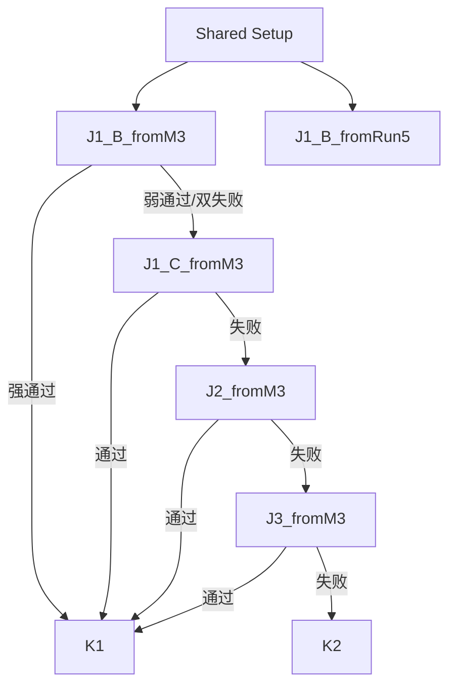
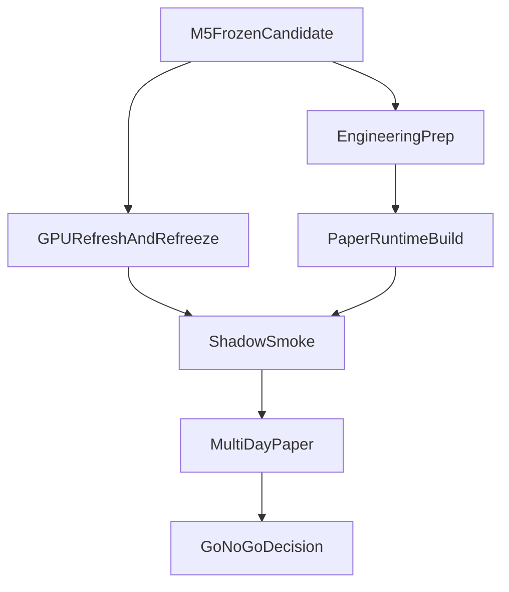
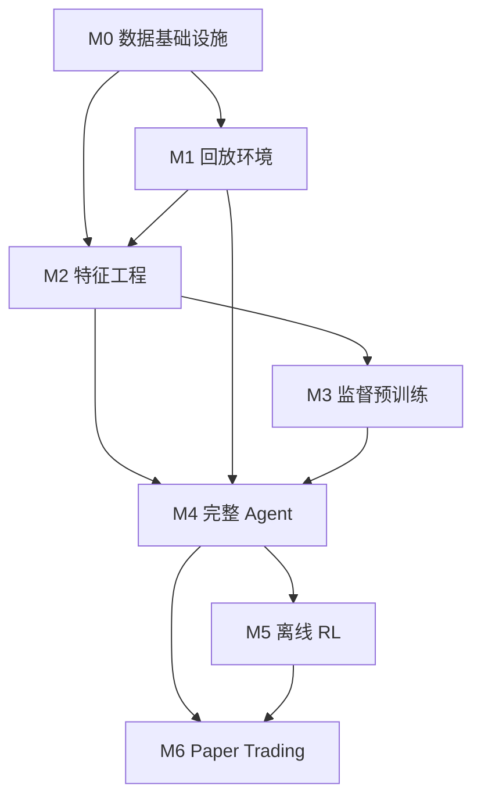

# 开发计划

> 基于 [prd.md](prd.md) 和 [技术构思v2.md](技术构思v2.md)
> 创建新数据集版本（如 `data-v4`）时，请同时参考 [数据集规范.md](数据集规范.md)。当旧文档中的目录示例、训练切分方式或 RL 数据默认口径与当前实现冲突时，以该规范和 `dev-docs/依赖环境说明.md` 的最新口径为准。

---

## 里程碑总览

| #   | 里程碑        | 核心交付物                               | 判定标准                                                     |
| --- | ------------- | ---------------------------------------- | ------------------------------------------------------------ |
| M0  | 数据基础设施  | 数据清洗 + 对齐 + 分层存储               | 可复现生成 parquet，输出通过/丢弃统计并保留 `drop_reason` |
| M1  | 回放环境      | Rust replay-engine + 延迟注入 + 撮合模拟 | 能回放单日数据，手动策略在回放中执行并输出正确 NAV           |
| M2  | 特征工程      | feature-engine + 标准化训练数据集        | Python 端可读取按 market 对齐的特征帧 + 标签                 |
| M3  | 监督预训练    | 骨干网络 + SignalHead                    | AUC > 基线，Brier score 合理，扣费后有 edge                  |
| M4  | 完整 Agent    | 全部输出头 + 执行状态机 + 风控           | 离线回放中完整交易闭环可运行                                 |
| M5  | 离线 RL 诊断与收口 | Oracle-guided BC 诊断 + Hybrid BC→IQL 验证 + Execution/MarketEdge 收口 | 冻结 `frozen signal head + signal_threshold=0.58 + force_order_type=limit + 默认 size` 为 M6 默认候选，并确认完整可交易 final policy 尚未解锁 |
| M6  | Paper Trading | 实时 paper runtime + 多日 shadow/paper 验证 | 完成 `V1~V4` 基线刷新与候选重冻结，paper runtime 稳定运行 ≥ 1 周，并通过 `M6.4` 的数值门槛框架，形成 Go/No-Go 报告 |

---

## M0：数据基础设施

### M0.1 数据清洗与对齐

- [√] 编写 market manifest 生成器：优先扫描 `model/data-v1/` 目录（后续兼容 `data-v*`，包括 `data-v4`），枚举所有 5 分钟 market。当前正式目录口径为 `model/data-v*/<window_id>/...`，窗口目录路径中两个时间戳分别是**首个和最后一个 market 的开始时刻**（非结束时刻），market 计数公式为 `(last_start - first_start) / 300 + 1`，例如 `data-v1/1774248000-1774334100/` 对应 `(1774334100 - 1774248000) / 300 + 1 = 288` 个 market
- [√] 对齐验证：每个 market 检查 4 类原始数据源（Polymarket / Binance aggtrades / Binance orderbook / Chainlink）是否完整，缺失 > 15s 则标记丢弃
- [√] 提取 Chainlink 结算标签（`resolution_price >= p2b → Up`），写入标签表
- [√] 先用 `data-v1` 数据跑通全流程，再扩展到 `data-v2` 和 `data-v3` 数据，执行全量验证，输出通过/丢弃统计

### M0.2 分层存储

- [√] 原始层：保留 `model/data-v*/` 下的 ndjson/csv，同时允许在 `model/parquet-data/<dataset_version>/` 下维护与 raw 同构的 **typed parquet 原始镜像层**
- [√] 训练层：按 market 对齐后的索引表 / 标签表 / 验证表 / 基础事件表 → parquet
- [√] 定义 parquet schema（字段名、类型、时间精度）

**产出**：`data-pipeline/` 目录，可复现地从 raw 原始数据或其 typed parquet mirror 生成训练用 parquet。

### M0 实施反馈（2026-04-03）

本次落地结果与开发反馈已整理到 `dev-docs/M0开发日志.md`。这里补充影响后续执行口径的关键结论。

#### 已确认的实现范围

- M0 已落地 `data-pipeline` CLI，包含 `build-manifest`、`validate`、`export`、`run-all`。
- 当前训练层产物包含 `manifest.parquet`、`labels.parquet`、`validation.parquet`、基础事件表、`binance_orderbook_index.parquet`、`binance_orderbook_summary.parquet` 以及各级 `summary.json`。
- `data-pipeline` 已新增 `--raw-root`，允许直接从 `model/parquet-data/<dataset_version>/` 读取 typed parquet 原始镜像层。
- `data-v3` 的增量更新流程已扩展为：同步 `btc-updown-5m/`、`btcusdt-orderbook/`、`rtds_chainlink/` 后，再单独回填 `btcusdt-price/`。
- 所有长时间运行的数据任务都应打印阶段日志与进度条，避免误判任务卡死。
- 新数据集版本的正式创建与验收流程统一见 `数据集规范.md`；`data-pipeline` 已支持自动发现 `data-v*`，但 `sync_polymarket_asset_map_overrides.py` 处理 `data-v4` 时仍需显式传 `--datasets data-v4`。

#### 与原计划不一致的地方

- `manifest.parquet` 当前没有直接写入 `p2b` 与 `resolution`；这两项实际落在 `labels.parquet`。如果要严格对齐 M0.1 文案，后续仍需补齐 schema 或调整计划口径。
- 里程碑总览中的“288 markets 全部通过对齐验证”不符合真实原始数据质量。实际应以“可复现生成 parquet、输出通过/丢弃统计、保留 `drop_reason`”作为 M0 验收口径。
- 原计划未显式包含 `btcusdt-price` 回填工具链；实际为了支持 `data-v3` 持续更新，已新增单窗口抓取器与批量回填器。
- 原计划未明确 orderbook 在 M0 的最终导出边界；当前正式范围为“保留 `orderbook_index.parquet`，新增 `orderbook_summary.parquet`，暂不导出全量 `price-level parquet`”。
- 当前实现中 `condition_id` 与 `market_id` 仍采用同一来源值，即 Polymarket 原始事件的 `market` 字段，尚未在数据层做语义拆分。
- 旧文档里出现过 `model/data-v*/<date>/<window_id>/...` 的路径示例；当前实现正式口径已统一为 `model/data-v*/<window_id>/...`。

---

## M1：回放环境

### M1.1 replay-engine 核心

- [√] Rust crate `replay-engine`：按事件时间驱动回放
- [√] 加载 Polymarket orderbook 事件流，重建盘口状态
- [√] 加载 Binance orderbook snapshot + delta，重建深度
- [√] 加载 Binance aggtrades 和 Chainlink 数据流

### M1.2 延迟注入

- [√] 因果对齐器（CausalAligner）：Polymarket 20ms，Binance 105ms，Chainlink 统一使用 Polymarket 转发，按 20ms 可见延迟建模，并显式保留 1Hz 更新频率与 `staleness`
- [√] 冷启动控制器：每个 episode 首个 market 禁止交易

### M1.3 撮合模拟

- [√] 模拟撮合：在 `t_exchange_arrival` 时刻的订单簿上逐档成交
- [√] market order 撮合 + 滑点计算
- [√] limit order 挂单 / 等待 / 部分成交 / 撤单 生命周期（当前以 TTL 失效构成最小闭环，下一决策步撤单重评估留待后续阶段）
- [√] 手续费计算：当前已落地买入侧 `fee = C × 0.072 × p² × (1-p)`、买单份额扣减与 maker rebate 20%；卖出侧 USDC 扣费留待后续阶段

### M1.4 会计系统

- [√] AccountState：cash / inventory / NAV 全量跟踪
- [√] `NAV_before_trade / NAV_after_fill / NAV_after_fee / terminal_settlement` 四阶段会计
- [√] 到期结算：按 Chainlink 结算结果兑付

### M1.5 验证

- [√] 编写集成测试：手动策略（如"always buy Up at market"）回放，验证 NAV 计算正确
- [√] 边界用例：无成交 / 部分成交 / 到期自动结算 / 冷启动跳过

**产出**：`replay-engine` crate，可接受策略回调并输出完整交易日志和 NAV 曲线。

### M1 实施反馈（2026-04-03）

本次落地结果与开发反馈已整理到 `dev-docs/M1开发日志.md`。这里补充影响后续执行口径的关键结论。

#### 已确认的实现范围

- `replay-engine` 已完成最小可用的事件驱动回放骨架，支持 Polymarket / Binance aggtrades / Binance orderbook / Chainlink 四路事件流、延迟注入、冷启动控制、保守立即平仓口径 `NAV` 和 terminal settlement。
- `limit order / maker rebate` 已补齐到最小闭环：支持 `market` 与 `limit` 两种订单类型、五档限价、挂单剩余量、TTL 失效、maker fill 与 rebate 入账。
- `Chainlink` 已显式保留 `visible_ts_ms` 与 `staleness`，结算日志已把原先易误导的 `terminal_settlement_nav` 改为 `cash_after_settlement`。
- 已补齐 `market_resolved` 缺口维护工具链：仓库内脚本可扫描 `data-v1 / data-v2 / data-v3`、在线查询 Gamma metadata、自动合并覆盖表并复验缺口清零。
- 已完成 `market order` 与五档 `limit order` 的首轮批量回放对比。当前数据上，`market` 成交率最高但总 `NAV` 最差，`limit/improve2-tick` 是最接近“高成交 + 较低亏损”的平衡点。
- 当前 M1 验收结论为：已满足“能回放单日数据，手动策略在回放中执行并输出正确 NAV”，可进入 M2。

#### 与原计划不一致的地方

- M1 实际多出了一条“数据缺口修复工具链”。原计划主要聚焦回放与撮合，但真实数据里存在 `249` 个唯一 market 缺失 `market_resolved`，因此必须补齐扫描、Gamma 拉取、覆盖表合并与复验工作流。
- 当前 `limit order` 已达到最小可用闭环，但还不是完整执行系统。现在仍是单策略、单方向、单挂单骨架，下一决策步撤单重评估、卖出侧执行、同 market 多挂单留待后续阶段。
- maker fill 当前基于公开市场事件近似推断，而不是私有订单回报；这属于当前 M1 的正式约束，不再视为实现遗漏。

---

## M2：特征工程

### M2.1 feature-engine

- [√] Rust crate `feature-engine`：从回放环境接收因果对齐后的数据，聚合为固定步长特征帧
- [√] **BLB 实时计算**：基于已接收的 Binance aggtrades 和 orderbook 实时计算 bps / levelCount / barrierUsdt（可见时刻 = Binance 延迟 + 计算耗时）
- [√] 时间粒度：第一版 250ms 或 500ms
- [√] 回看窗口：60s（可配置）

### M2.2 各分支特征提取

- [√] Polymarket 特征：Up/Down 双边 top-k 深度、点差、盘口失衡、最近成交方向/量
- [√] Binance 特征：top-k 深度、market_drift、短时波动、成交方向失衡、bps、levelCount、barrierUsdt
- [√] Chainlink 特征：可见值、与 P2B 偏离、短时变化、staleness
- [√] Agent 状态特征：持仓、浮盈亏、净值、剩余时间（time_to_expiry）

### M2.3 监督训练标签构建

- [√] `y_cls`：每个 market 的结算方向
- [√] `y_ev_up` / `y_ev_down`：在每个决策点执行标准化动作 `buy_up/down_market_small` 的事后净收益（含手续费）
- [√] 将特征帧 + 标签按 market 导出为训练用 parquet

### M2.4 Python DataLoader

- [√] 编写 PyTorch Dataset/DataLoader：读取 parquet，构造 `(obs_sequence, y_cls, y_ev_up, y_ev_down)` 批次
- [√] 支持时间前推的 train/val/test split（不随机打散）

**产出**：完整的训练数据管线，从原始数据到 PyTorch 可用的 batched tensors。

### M2 实施反馈（2026-04-05）

本次落地结果与开发反馈已整理到 `dev-docs/M2开发日志.md`。这里补充影响后续执行口径的关键结论。

#### 已确认的实现范围

- `feature-engine` crate 已完成，通过 `ReplayEngine::run_with_strategy` 驱动，每个 `step_ms` 边界输出一帧，共 **79 列**（7 索引 + 36 Polymarket + 20 Binance + 3 BLB + 4 Chainlink + 6 Agent + 3 标签）。全量产出：v1=294,834 帧 / v2=894,106 帧 / v3=1,420,307 帧（99.7% market 覆盖率；3 个 market 因原始 NDJSON 截断无法恢复）。
- `y_ev` 标签使用 pending_yev 队列精确回填到 `t_decision + 2 × delay` 时刻的盘口状态，并在 market 转换与 `take_all_frames()` 时兜底 flush。当前 3–5% nan 率为 market 末尾盘口流动性枯竭所致，非覆盖缺口。
- Python `FeatureDataset` 已实现，FEATURE_COLS = **65 列**（含 `time_to_expiry_ms` + `step_index`；6 个 `agent_*` 列因 feature-engine order_size=0 全为常数，Phase 1 移出 FEATURE_COLS，Phase 2 RL 再加入），`seq_len=240`（@250ms = 60s），支持跨 market 回看与时序 split。
- 测试覆盖已强化：feature-engine 集成测试从 1 个扩展到 4 个（新增 `top_k_above_5_does_not_panic`、`y_ev_coverage_acceptable`、`y_ev_penultimate_frame_always_filled`）；Python DataLoader 测试 18 个，重构为完全自包含（无需 Rust 二进制）；BLB depth 视图与导出列语义对称性已修复（`fill_k` 一致）。

#### 与原计划不一致的地方

- `y_ev` 不能用 `t_decision` 盘口近似——BTC 二元期权在 20ms 内盘口剧烈变化，误差不可接受。额外引入了 pending_yev 队列（`prev_polymarket` 精确分支）。
- 特征列从原计划预估的 72 列增加到 79 列：额外增加了 `binance_market_drift`（累计漂移，非滚动 return）、`binance_trade_imbalance`、`binance_volatility`、`chainlink_short_term_change`、`agent_position_value`、`agent_floating_pnl`、以及 `poly_*_last_trade_size`/`poly_*_last_trade_is_buy`（Up/Down 各 2 列）。
- `agent_floating_pnl` / `agent_position_value` 等 6 个 Agent 状态列在离线特征采集时恒为常数（`order_size=0`），在监督学习场景中无区分力；**已决定**：Phase 1 从 FEATURE_COLS 移除（71→65 列），Phase 2 RL 以真实仓位数据加入 StateBranch。

#### 下一阶段开始前的准备动作

- [√] 对 `data-v1 / data-v2 / data-v3` 执行全量 feature-engine 导出（已完成，v3 覆盖率 99.7%）
- [√] M3 DataLoader y_ev nan 帧通过 `y_ev_mask` 掩码处理（已实现）
- [√] Agent State 6 列已从 FEATURE_COLS 移除，FEATURE_COLS = 65 列
- [√] `StrategyCallback` 新增 `before_market` / `discard_market` hook，错误恢复粒度降至 per-market（v3 因此从 1115 market 恢复至 1185 market）

---

## M3：监督预训练

### M3.1 模型实现

- [√] PolymarketBranch（TCN，in=36, out=64）
- [√] BinanceBranch（TCN，in=23 Binance20+BLB3，out=64）
- [√] ChainlinkBranch（MLP，in=4，out=64）
- [√] TinyCausalTransformer 融合层（d_model=128，2层，4 heads，pre-LN）
- [√] SignalHead：`P_up / P_down` 分类 logits + `ev_up / ev_down` 回归
- [√] InputNormalizer（非可学习 buffer，set_stats() 初始化，NaN→0.0）
- ~~StateBranch（MLP）~~：Phase 1 不启用（feature-engine order_size=0，agent state 全为常数）；Phase 2 RL 加入

### M3.2 训练流程

- [√] 联合损失：分类 CE + EV 回归 masked MSE（lambda_cls=1.0, lambda_ev=0.5）
- [√] 特征归一化：compute_feature_stats() 从训练分区计算 per-feature mean/std
- [√] tqdm batch 级进度条 + epoch 级日志
- [√] 最佳 checkpoint 按 val top_decile_mean_ev_up 保存
- [√] 1 天数据（data-v1）验证流程可跑通（AUC=0.837 过拟合，符合预期）
- [√] 扩展至全部可用天数（data-v1 + v2 + v3，云端 RTX 5090 已完成）

### M3.3 评估

- [√] 方向分类（理智检查）：AUC / Brier score / ECE（概率校准）
- [√] EV 预测质量：EV 回归 MAE / RMSE / ev_rank_corr（Spearman，衡量 y_ev_up 排序能力）
- [√] 直接盈利代理：ev_up_sign_acc（正确识别"应买/不应买"比例）/ top_decile_mean_ev_up（P_up 前 10% 的条件均值 y_ev_up）
- [√] ev_up_conditional_mean_by_threshold：P_up 在各阈值 {0.50,0.52,0.55,0.60,0.65} 下的条件均值 y_ev_up + opportunity_rate
- [√] edge_by_decile：按 P_up 分 10 分位，各组 mean(y_ev_up)（单调递增为佳）

### M3.4 判定标准

**主判据（Phase 1 必须通过）：**
- [√] test top_decile_mean_ev_up > 0 → **+0.2451** ✅
- [√] test ev_up_sign_acc > 0.52 → **0.5805** ✅

**辅助指标（理智检查）：**
- [√] AUC > 0.52 → **0.7436** ✅
- [√] Brier < 0.25 → **0.2463** ✅
- [ ] ECE < 0.05 → 0.1900 ❌（辅助，非强制，根本原因为时间分布漂移）
- [ ] ev_rank_corr > 0.03 → 0.0255 ❌（辅助，非强制）

- [√] **主判据通过，M3 验收完成，进入 M4** ✅

**未达标处理：** 检查标签分布 / 特征重要性 / 是否存在泄漏，若均未达标返回 M2 修正

> **验收标准变更说明（2026-04-06）**：Phase 1 原以 AUC > 0.52 为主要判定指标，修订为以 y_ev 盈利代理为主。y_ev 标签已含手续费（taker fee 峰值约 1.80% @p=0.50），y_ev_up > 0 直接意味着扣费后正收益；AUC 是必要理智检查，但不是充分条件。

**产出**：预训练好的骨干权重 + SignalHead，含训练/验证指标报告。

### M3 实施反馈（2026-04-06）

本次落地结果与开发反馈已整理到 `dev-docs/M3开发日志.md`。这里补充影响后续执行口径的关键结论。

#### 已确认的实现范围

- 新建 6 个文件：`training/model.py`、`training/loss.py`、`training/evaluate.py`、`training/train.py`、`training/test_model.py`、`training/test_evaluate.py`
- 26 个单元测试全部通过（14 个模型测试 + 12 个评估指标测试）
- data-v1 快速验证（1 天数据）：端到端流程跑通，val AUC=0.837（过拟合，符合预期：1 天数据不足以泛化）

#### 与原计划不一致的地方

- 特征归一化为必要步骤：未归一化时 blb_barrier_usdt std=205,493，导致 loss 爆炸（cls≈1298）；增加了 InputNormalizer 模块，这在原计划中未提及
- 全量训练迁移至云端 GPU（RTX 5090），实测 batch=2048 + AMP + torch.compile 约 30 分钟完成 30 epoch（9x GPU 利用率提升关键：batch 大小）
- Run 1/2 发现跨数据集时间泄漏（各 parquet 独立切分后拼接，训练集包含比 val/test 晚 10.6 天的数据），修复后重训为 Run 3

#### 全量训练结果（2026-04-06，云端 RTX 5090）

**Run 1/2**（废弃）：存在跨数据集时间泄漏，指标不可作为验收依据。详见 `dev-docs/M3开发日志.md`。

**Run 3**（最终选用，全局时间前推切分）：
- 配置：batch=2048, lr=4e-4, dropout=0.1, epochs=30, --amp --compile
- 切分：train 03-23~04-02 / val 04-02~04-03 / test 04-03~04-05（严格时间前推，零重叠）
- best_epoch=1，val_top10_ev=+0.2452
- test：AUC=0.7436，Brier=0.2463，ECE=0.1900，ev_rank_corr=0.0255，ev_sign_acc=0.5805，top10_ev=+0.2451

**关键发现：** 三轮训练均表现为 best checkpoint 在第 1 epoch，根本原因是时间分布漂移（temporal non-stationarity）。修复时间泄漏后，主判据指标反而更好（top10_ev +0.15→+0.25，sign_acc 0.559→0.580），说明旧切分的混合时期数据稀释了学习信号。

**GPU 优化：** batch_size 128→2048 将 GPU 利用率从 10% 提升至 92%，epoch 时间从 ~7 分钟缩短到 ~61 秒。

**产出已保存**：`poly-arb-ai/training/checkpoints/m3_run3/`（best_model.pt + feature_stats.npz + test_metrics.json + train_history.json + m3_run3.log）

- [√] 将代码与 parquet 数据同步到云端 GPU（RTX 5090，CUDA 12.8，PyTorch 2.8.0）✅
- [√] 用 `--device=cuda --amp --compile --batch-size=2048` 完成全量训练 ✅
- [√] 取回 best_model.pt 与 test_metrics.json 到本地 ✅
- [√] 根据全量训练结果决定 M3.4 判定结论，主判据通过，进入 M4 ✅

---

## M4：完整 Agent ✅

### M4.1 输出头实现

- [√] PolicyHead(128→32→6)：hold / open_up / open_down / reduce / close / flip
- [√] SizeHead(128→32→3)：small(5) / medium(15) / large(30)（目标仓位档位）
- [√] OrderTypeHead(128→32→2)：market / limit
- [√] LimitPriceLevelHead(128→32→5)：join_best / improve_1~2tick / passive_1~2tick
- [√] RiskHead(128→32→1+sigmoid)：软风险约束输出 [0,1]
- [√] PolyArbAgentModel：共享骨干 + from_pretrained() 加载 M3 权重
- [√] ONNX 导出 export_onnx.py：InputNormalizer 烘入图，opset 17

### M4.2 执行层（Rust）

- [√] replay-engine 扩展：OrderSide + 卖出执行 + DecisionTick + NAV 快照
- [√] TargetPositionArbiter：PolicyAction + SizeLevel → TargetPositionVector + RiskHead soft clip
- [√] HardRiskGuard：6 条规则（cold_start / 强平 / 禁开仓 / per-leg max / drawdown / 连亏熔断）
- [√] ExecutionStateMachine + OutstandingOrderTracker：卖优先、每 tick 至多一单、ack 管线阻塞
- [√] feature-engine：to_model_input() + compute_feature_frame() 纯函数

### M4.3 ONNX 推理

- [√] PyTorch 模型导出 ONNX（7 个输出头，~2MB）
- [√] Rust crate `onnx-inference`：ort v2.0.0-rc.12 封装，MultiHeadOutput
- [√] Agent crate 集成推理：特征帧→flat f32 input→ONNX→DecodedActions

### M4.4 集成验证

- [√] 完整闭环回放：replay-engine → feature-engine → onnx-inference → agent（arbiter + risk_guard + ESM）
- [√] evaluation.rs：从 DecisionTick NAV 序列计算 Sharpe / 回撤 / 总收益
- [√] CLI：`cargo run -p agent -- --model-path ... --dataset-version ... --limit-markets N`
- [√] 验收：10 market 完整运行，325 笔交易（审查修复 risk_state 重置 bug 后），随机初始化头预期亏损

**产出**：完整的 Rust 交易闭环 + ONNX 推理。workspace 4 crates，56 通过 + 2 ignored（Rust），22 个 Python 模型测试，零 warning。

### M4 实施反馈

**与原计划不一致**：
- 原计划 6 个 crate（policy-runtime / position-arbiter / risk-guard / execution-engine / evaluator / onnx-inference），实际合并为 2 个：`onnx-inference` + `agent`（含 arbiter / risk_guard / execution / evaluation / strategy / config / model_output）
- 参数量 ~395K（M3 骨干 375K + 5 新头 ~20K），原技术构思预估 420K
- SizeHead = 目标仓位档位（非增量），已确认并实施
- Flip = 交换双腿持仓量（非"平旧开反向"）

---

## M5：离线 RL 诊断与收口（已完成，结论已冻结）

> 详细奖励函数设计见 `dev-docs/奖励函数思路.md`（经审核确认的 M5 实施规范）。
> 当前恢复推进顺序固定为 `Shared Setup -> J1/J1-run5 -> J1-Oracle-C -> J2 -> J3 -> K1 -> K2`。
> 运行细节与阶段结论统一见 `dev-docs/M5开发日志.md`、`dev-docs/M5待解决问题.md`、`dev-docs/依赖环境说明.md`。

### 已完成主线（按恢复计划收口）

| 顺序 | 阶段 | 目标 | 进入条件 | 当前状态 | 关键产物 |
| --- | --- | --- | --- | --- | --- |
| 1 | Shared Setup | 固定 split、统一 reward/data 口径、补齐 BC/Hybrid 评估链路 | 无 | [√] 已完成 | `source://legacy/poly-arb-ai/training/checkpoints/m5_run_bc_diag/split_info.frozen.json`；`oracle_bc_dataset.py`；`train_oracle_bc.py`；`summarize_dump_trades.py`；`evaluate --strategy random` |
| 2 | `J1_B_fromM3` | 验证现有 `backbone + policy head` 是否能学出方向性 | Shared Setup 完成 | [√] 已完成；命中强通过 | `val_acc=0.7098`，`test_acc=0.6799`，held-out `agent=-81.65%` |
| 3 | `J1_B_fromRun5` | 只做对照，判断 `run5` 初始化是否损伤表征 | Shared Setup 完成 | [√] 已完成；仅诊断不参与主判定 | `val_acc=0.7116`，`test_acc=0.6898`，held-out `agent=-89.56%` |
| 4 | `J1_C_fromM3` | 只在“容易市场”上验证方向语义是否更清晰 | 仅当 `J1_B_fromM3` 双层判定失败 | [ ] 当前不触发 | “容易市场”阈值固定由 train split 的 market 级 `abs((resolution_price - p2b) / p2b)` 前 30% 计算 |
| 5 | `J2_fromM3` | 放开 `fusion_proj + state_branch`，判断融合层是否是瓶颈 | 仅当 `J1_C_fromM3` 失败 | [ ] 当前不触发 | 可训练层：`policy_head + fusion_proj + state_branch` |
| 6 | `J3_fromM3` | 放开除 normalizer buffer 外全部层，判断是否需要全模型重训 | 仅当 `J2_fromM3` 失败 | [ ] 当前不触发 | 可训练层：除 normalizer buffer 外全部 |
| 7 | `K1` | 从最佳 J checkpoint warm-start，验证 Hybrid BC→IQL 是否解锁完整可交易 policy | `J1/J2/J3` 任一分支命中强/弱通过 | [√] 已完成；`K1_a/K1_b` 双失败 | `K1_a` best=`epoch 1`，probe 仅首轮过 gate 但 evaluate `agent=-874.29 < hold=-9.58`，且 `churn_ratio=72.5%`；`K1_b` 从 `epoch 1` 起 `hold=1.0 / dir=0.0`，未过 probe gate；结论固定为“Hybrid warm-start 未解锁完整可交易 policy” |
| 8 | `K2` | 若 Hybrid 仍失败，则做 observation / policy 语义 / execution economics 收口 | `J` 全失败判为 H2，或 `K1_a/K1_b` 双失败 | [√] `K2-A1 + Execution/MarketEdge` 已完成；确认性复跑已通过 | `E1` 最优 `signal@0.58=-23.9621` 已打过 `hold=-26.1318`；`E2` 确认 `force_order_type=limit => +66.0951`、`market => -43.8749`；确认性复跑 `signal_t058_limit_confirm=+66.0951` 与主 run 完全一致，当前锁定 M6 默认候选 `frozen signal head + signal_threshold=0.58 + force_order_type=limit + 默认 size` |

### 收口判定回顾（历史门控，仅作留档）

- `J1_B_fromM3` 强通过：`val acc > 52%` 且非方向类（`Hold/Reduce/Close/Flip`）argmax `< 20%`，直接进入 `K1`，结论记为 `H1`。
- `J1_B_fromM3` 弱通过：`val acc > 52%` 且 `Hold` argmax `< 50%`，先补 `Oracle-C`，结论记为 `H1-borderline`。
- `J1_B_fromM3` 双层都失败：按顺序进入 `J1_C_fromM3 -> J2_fromM3 -> J3_fromM3`；若三者仍失败，结论记为 `H2`。
- `J1_B_fromRun5` 只作诊断；若 `fromM3` 成功而 `fromRun5` 失败或更差，追加结论“`IQL` 可能腐蚀 `fusion/state`”。
- `K1` 共同设置固定为：`gamma=0.9995`、`tau=0.7`、`lr_q=3e-4`、`lr_v=3e-4`、`batch=2048`、`epochs=10`、数据固定 `reward_minimal`，冻结 `market branches + transformer + signal_head`，只训练 `fusion_proj + state_branch + policy_head + Q/V`。
- `K1` 启动前必须先过一条实现契约硬门控：在同一个 frozen split 的 matched ready rows 上，同时从 `oracle_bc_dataset.py` 与 `transition_dataset.py` dump 原始 76 维向量，做逐元素 diff；只有当差异能被浮点误差或样本集合差异解释，而非特征组装/清洗/排序不一致时，才允许正式启动 K1。不能只比较 `feature_stats_76.npz` 的 `mean/std`。
- `K1` 的 checkpoint 选择标准固定为最大化 `directional_argmax_share - hold_argmax_share`，若并列则取 `val_q` 更低者；只有通过 `probe gate`（`Hold < 70%` 且 `OpenUp + OpenDown > 20%`）的 checkpoint 才允许导 ONNX 并跑 Rust evaluate。
- `K1` 通过标准固定为：`agent total_pnl > hold total_pnl`、`agent total_pnl > random total_pnl`、`mean_flat_ratio < 0.95`、`mean_trades_per_market > 0.5`，且无显著“双边同开吃手续费”回归。
- `K1` 任一配置通过即停止 K1 并转 M5 收尾；两组都失败则进入 `K2`，结论固定写成“Hybrid warm-start 未解锁可交易 policy”。
- `K1` 当前执行结果：`K1_a` 的最佳 checkpoint 为 `epoch 1`，probe `hold=0.6180 / dir=0.3465 / gap=-0.2715`，但 test evaluate 为 `agent total_pnl=-874.2877`、`hold total_pnl=-9.5763`、`random total_pnl=-966.3884`，且 `churn_ratio=72.5%`；`K1_b` 在 `epoch 1..4` 全程 `hold=1.0 / dir=0.0 / gap=-1.0`，未过 probe gate，因此不跑导出/评估链。故 `K1_a/K1_b` 双失败，按固定门控进入 `K2`。

### 历史完成背景（按时间顺序留档）

### S0：replay-engine 接口补齐 ✅

- [√] `StrategyCallback` 新增 `on_fill_ack` / `on_settlement` 回调（默认 no-op）
- [√] `process_scheduled_events` 返回 `Vec<TradeLog>`，两处调用点均分发 `on_fill_ack`
- [√] 3 个新测试通过，现有 20+2 测试不受影响

### S1：特征扩展 65→76 ✅（对应原 M5.0）

- [√] feature-engine `to_model_input()` → `[f64; 76]`：65 原始 + 6 agent state + 5 长期信号
- [√] agent strategy.rs：76 维 buffer + episode 状态 + DecisionTrace + override_risk_score
- [√] onnx-inference：n_features 从 ONNX input shape 自动推断
- [√] model.py：StateBranch(11→32→64) + FusionProjection(192→128) + 后融合 _state_embedding()
- [√] dataloader.py：新增 M5_FEATURE_COLS(76)，原 FEATURE_COLS(65) 不变
- [√] export_onnx.py：`--mode collection|trained`，76 维输入，双 normalizer

### S2：Transition 采集 ✅（对应原 M5.1 前半）

- [√] RewardCalculator（α_loss=1.5, λ_turn=0.0005, λ_dd=0.5, λ_idle=0.0001）— 12 个单元测试
- [√] TransitionStrategy：包装 AgentStrategy + RewardCalculator，逐 tick 特征流（TickStreamRow 96 列），延迟 reward 写回
- [√] TickStreamParquetWriter：流式 parquet 写入
- [√] CLI `collect-transitions` 子命令：遍历 windows，每 window 独立 episode，硬编码 override_risk_score=1.0
- [√] 端到端验证：3 market 子集产出 3600 行 parquet → Python 正确加载 3361 transitions
- **决策变更**：RiskHead 不纳入 IQL（D2），保持随机初始化 + override_risk_score=1.0 旁路；record_trade_result() M5 不启用（D4 修订）

### S3：IQL 训练实现 ✅（对应原 M5.2）

- [√] TransitionDataset：从 tick_stream parquet 重建 [seq_len, 76] 观测，time_ordered_split 按 (window_start_ts_ms, dataset_version, window_id) 排序
- [√] IQL + 4-head Factored Q-learning：FactoredQNetwork(policy:6/size:3/order_type:2/limit_level:5) + ValueNetwork + IQLTrainer（twin-Q/EMA/AWR）
- [√] train_iql.py：完整训练 CLI（加载/split/统计/训练/checkpoint/ONNX导出）
- [√] 19 个测试通过（7 TransitionDataset + 6 IQL 组件 + 6 IQLTrainer）
- **决策变更**：仅训练 4 个离散头，RiskHead 冻结排除（D2）；骨干冻结在 IQLTrainer.__init__() 中执行

### S4：数据采集 + 训练执行 ✅（已完成，但结果未达验收）

- [√] S4-A：ONNX 重导出（76 维 collection 模式），`source://v2/agent_model_76_collection.onnx`
- [√] S4-B：全量 tick_stream 采集，`tick_stream/v{1,2,3}.parquet`，2.9M 行 / 2423 episode
- [√] S4-C：`training/validate_transitions.py`（Phase 11.4 扩展到 7 项 gate）
- [√] S4-D：IQL 训练执行（m5_run1/2/3/4/4b/5 多轮），γ=0.9995, τ=0.7, β=3.0, batch=2048, 50 epochs
- [√] 产出：tick_stream parquet + feature_stats_76.npz + best_model.pt + agent_model_m5.onnx

### S5：评估 + 收尾 ✅（已完成）

- [√] S5-A：`evaluate` 子命令 + `--split-info` / `--split test` / `--dump-trades` / `--override-risk-score`
- [√] S5-B：`evaluation.rs` 扩展（净 PnL / 每 market 交易数 / 持仓时长 / 止损频率 / 空仓比例 + `aggregate_reports()`）
- [√] S5-C：`baseline_strategies.rs`（HoldOnly + SignalHeuristic）+ random baseline
- [√] S5-D：消融开关（`--alpha-loss` / `--lambda-idle` / `--force-order-type` / `--fixed-size`）
- [√] S5-E：文档收尾（本次更新）

### Phase 11：诊断 + 修补循环（2026-04-08 ~ 2026-04-09，历史留档）

S4/S5 完成后首次 evaluate 发现 agent 亏损。随后进入长达 1 周的诊断 + 修补迭代；历史过程保留在这里，**当前执行顺序以上方“已完成主线”为准**，全部细节见 `dev-docs/M5开发日志.md` 的 “Phase 11 迭代记录” 与 `dev-docs/M5待解决问题.md`。

- [√] **Phase 11.1-11.3**：`size_mapping` 语义核对与现金校验修补（当前实现契约以目标股数档 `[5, 15, 30]` 为准）/ 采集探索多样化 / reward clipping + 固定基准 NAV
- [√] **Phase 11.4-11.6**：validate 7 项 gate / 重采集 v1/v2/v3 / m5_run3 重训
- [√] **Phase 11.7-A/B/C/C2/C3**：基线对比（HoldOnly 持平）/ 亏损 window 诊断 / 超参扫无改进 / `evaluate --dump-trades` / `probe_policy_dist.py` 发现 Q 差异 ~0.2，AWR 几乎平坦
- [√] **Phase 11.7-D**：ort v2 析构 SIGSEGV / `corrupted double-linked list` 已通过 `evaluate` 复用单个 `AgentStrategy`、每个 window fresh-state reset、以及命令结束后显式 exit 收口
- [√] **Phase 11.8-D/E/F**：数据增强对称翻转 / PolicyHead 去 agent state / m5_run4/4b（policy_loss 冻结）
- [√] **Phase 11.8-G → H 反转**：G 得出“数据无信号”系循环推理；H 用 Oracle 上限（+94%/笔）、M3 proxy 方向精度（54.1%）、`E[reward|action,label]` 三件独立诊断，反转为“数据有强信号，`reward_clip=Some(1.0)` 是 smoking gun”
- [√] **Phase 11.8-I**：`/tmp/rebuild_reward_minimal.py` 在 Python 里重建 reward（纯 ΔNAV，关 penalty 关 clip），产出 `tick_stream/v{1,2,3}_reward_minimal.parquet`；m5_run5 用新数据重训，policy 仍 100% Hold
- [√] **Shared Setup（原 Phase 11.8-J0）**：J/K 基础设施已落地（`oracle_bc_dataset.py`、`train_oracle_bc.py`、`train_iql.py --split-info/--init-agent-checkpoint/--checkpoint-metric`、`evaluate --strategy random --random-seed`、`summarize_dump_trades.py`、`scripts/run_phase_11_8_j.py`）；BC run 会复制 frozen split、记录 sha256、输出 `run_manifest.json`
- [√] **`J1_B_fromM3`**：在 frozen split 上命中强通过，证明 `backbone + policy head` 可学；当前 Hybrid 主线固定从该 best checkpoint warm-start
- [√] **`J1_B_fromRun5`（仅诊断）**：同样命中强通过，但 held-out `agent evaluate` 更差；只用于补充“`IQL` 可能腐蚀 `fusion/state`”的判断
- [ ] **`J1_C_fromM3`**：仅当 `J1_B_fromM3` 双层失败时触发；当前因 `fromM3` 已强通过，不进入
- [ ] **`J2_fromM3`**：仅当 `J1_C_fromM3` 失败时触发；当前不进入
- [ ] **`J3_fromM3`**：仅当 `J2_fromM3` 失败时触发；当前不进入
- [√] **`K1`**：已收口；`K1_a / K1_b` 双失败，固定结论为 `Hybrid warm-start 未解锁可交易 policy`
- [√] **`K2`**：`K2-A1` 与 `Execution/MarketEdge` 已完成；当前已拿到 baseline runtime 下的 hard-pass execution config，进入固化配置而不是继续开新诊断分支

### M5 收口结论

- `fromM3` 已命中强通过，当前 J 阶段结论记为 `H1`。
- `fromRun5` 分类指标略高但 held-out evaluate 更差，因此只保留诊断价值，不作为 Hybrid 主线起点。
- `Execution/MarketEdge` 已在 baseline runtime 下命中 hard-pass：当前冻结的 M6 默认候选为 `frozen signal head + signal_threshold=0.58 + force_order_type=limit + 默认 size`，其 held-out `test total_pnl=+66.0951`，显著优于 `hold=-26.1318`。
- 确认性复跑 `signal_t058_limit_confirm` 已完成，关键聚合指标与主 run 完全一致：`total_pnl=+66.0951`、`mean_trades_per_market=2.3095`、`churn_ratio=0.0`。
- 同一 frozen split 的 full-range 鲁棒性扫描给出：`signal full=+3252.9655`、`hold full=-16.1311`；但这是历史扫描而非新 held-out 结论，因为它包含 `train/val`。
- `val` 8 个窗口是当前最明确的非平稳性 caveat：离线 `signal_head` 在 `val` 仍健康（`selected_accuracy=0.7091`、`auc=0.7542`），但 replay 的 `avg_miss_pnl=-5.4566` 明显重于 `test=-4.1404`，因此问题更像 regime shift / market-level miss 成本，而不是信号彻底失效。
- 按 M5 里程碑的判定标准，当前已经完成 `H1` / `K1` / `K2` 收口，并明确验证结果为“完整可交易 final policy 尚未解锁，但 M6 默认候选已冻结”；因此 M5 可以判定为已完成。
- 当前默认进入 M6 的候选配置固定为 `frozen signal head + signal_threshold=0.58 + force_order_type=limit + 默认 size`；`limit + fixed_size=small` 以 `total_pnl=+65.6773 / mean_max_drawdown_pct=9.6841` 保留为低回撤备选。
- `J1_C/J2/J3` 仍保留为条件分支，不会因为本轮执行成功而被重新默认打开。

**产出**：最佳 J checkpoint、统一 frozen split、可复核的 `summary.md / run_manifest.json / eval_report.json / probe_policy.json`，以及后续 K1/K2 所需的 ONNX / evaluate / trade summary 产物约定。

---

## M6：Paper Trading

> M6 默认从 M5 已冻结的候选配置起步：`frozen signal head + signal_threshold=0.58 + force_order_type=limit + 默认 size`。M6 的重点不再是继续扩大离线搜索树，而是把已经在离线 `replay/evaluate` 中确认过的方向信号与 execution config 搬到实时事件流上，验证实时数据、延迟、成交、日志与分时段稳健性能否复现离线结论。
>
> **当前阶段（截至 2026-04-28）**：skeleton + smoke 已完成；完整 runtime 闭环（observation → ONNX → AgentStrategy → OrderIntent → paper 生命周期 → structured parquet/trades.jsonl）**未完成**；不能进入 multi-day paper，亦不能 Go/No-Go。完整执行计划见 `dev-docs/m6-0427实施计划.md`。
>
> 当前仓库已具备成熟的离线回放、特征提取、ONNX 推理、`evaluate` 与 execution 回放链路，但**尚未具备独立的实时 paper runtime**。因此 M6 的核心开发内容不是“再跑一次离线评估”，而是补齐实时接入、在线特征流、保留现有 execution 语义的 paper 订单适配与结构化遥测、多机部署。
>
> 当前设计与 bring-up 细节统一见 `dev-docs/M6设计.md` 与 `dev-docs/M6开发日志.md`。

### M6.0 前置基线刷新（V1~V4）

- [x] `data-v4` 已进入当前正式数据闭环：目录结构使用 `model/data-v4/<window_id>/...`，并已纳入 `validate/export`、`replay-engine`、`feature-engine` 与 `gen_data_v4_eval_split.py` 等流程；同时 `model/parquet-data/data-v4` 已完成 `verify_parquet_raw_coverage.py` 全量校验（`3016 -> 3016`，`missing/extra/row_mismatch = 0`）
- [ ] GPU 服务器当前应以 `V1~V4` 全量数据完成新一轮 `M3` 监督重训；M6 的数据线刷新目标不是重开 `J1/K1` 主线，而是基于新 `M3` checkpoint 重跑 `K2-A1 signal_eval` 与 `Execution/MarketEdge` 的 `E1/E2`，再重新冻结候选
- [x] 以 `数据集规范.md` 当前口径为准，已统一确认 `data-v4` 的训练/评估契约：`manifest + labels` 联合消费、特征帧 canonical schema 为 `86` 列、监督输入为 `65` 维、M5/M6 观察输入为 `76` 维；typed parquet 原始镜像层是 raw 原始层的同构镜像，不等同于“全链路全量等价”
- [ ] 待 `V1~V4` 重训与 `K2` 重扫完成后，必须对“旧冻结候选”与“新重冻结候选”做统一 replay/evaluate 对比；若阈值或执行配置发生变化，则以新结果重冻结；若新候选没有明确优于当前冻结配置，则 M6 继续沿用 `signal@0.58 + limit + 默认 size`
- [ ] M6 默认不重开 `J1_C/J2/J3` 分支，也不把“继续扩展纯 offline IQL / K2 搜索矩阵”当作主线；当前策略是：`M6.0` 的 GPU 基线刷新线与 `M6.1/M6.2` 的工程实现线并行推进，并在 `M6.3` 的 shadow smoke 汇合点统一收敛到重冻结候选后，再进入 multi-day paper

### M6 当前进展（2026-04-19）

- [x] 已补齐 `dev-docs/M6设计.md`，冻结实时接入契约、artifact set、日志规格、模型切换策略与 shadow / Go-No-Go 门槛落点
- [x] 已新增 `paper-runtime` crate，并完成本地 `cargo test -p paper-runtime`
- [x] 已新增 `gen_m6_v1v4_split.py`、`eval_signal_head_m3.py`、`run_m6_v1v4_refresh.py`、`run_m6_shadow_gate.py`、`run_m6_go_nogo.py` 与 `deploy_m6_runtime.sh`
- [x] 爱尔兰机已下发 `paper-runtime` 二进制、`paper_runtime.json`、`agent_model.onnx`、`feature_stats.npz` 与 `split_info.json`；`validate-config`、`discover-markets`、`smoke-market`、`smoke-live-data`、`shadow-smoke` 均已完成首轮 bring-up
- [x] 日本机已创建 `m6-relay` 目录骨架；数据采集机已创建 `m6-sync` 目录骨架并安装 `bypy`
- [ ] `V1~V4` 刷新链脚本已就绪，但当前 GPU 服务器处于无卡模式，且主要承担 `dl-v4-raw` / `dl-v4-tables` 数据同步任务；正式 `M3` 重训与 `K2` 重扫待可训练环境恢复后继续
- [ ] 完整实时决策闭环（`observation -> ONNX -> arbiter/risk_guard/ESM -> PaperOrderAdapter -> structured parquet`）尚未打通
- [ ] multi-day paper 与最终 Go/No-Go 尚未启动

### M6.1 部署与运行时准备

- [x] 已明确双机拓扑与职责：AWS 日本服务器负责 Binance 数据接收/中继，AWS 爱尔兰服务器负责 Polymarket 接入、paper runtime、日志与监控
- [ ] 两台 AWS 机器当前已完成首轮目录骨架与爱尔兰机 artifacts/二进制下发；完整的代码、模型、配置、运行目录、日志目录和启动脚本版本化仍需继续补齐
- [x] 已补齐 `M6` 设计文档中的实时接入契约，并完成首轮 spike：Polymarket `market channel`、`crypto_prices_chainlink`、日本-爱尔兰 Binance 中继、market discovery、事件时间戳、gap detection、断线重连与端到端延迟预算现已有文档落点
- [x] 已固化 M6 runtime 配置首版：数据源地址、延迟参数、`signal_threshold`、`force_order_type`、TTL、起始资金、日志目录与健康检查落点均已写入 `paper_runtime.json`
- [x] `paper` 起始资金固定为 `100 USDC`，与离线 `evaluate --starting-cash 100` 保持一致；若后续需要更大资金规模，必须作为单独 run 明确记录，不能与默认纸盘结果混写
- [x] 已固化 runtime artifact set：版本化 `agent_model*.onnx`（含 sha256）、配套 `feature_stats*.npz`、在线版 `runtime.json`/参数配置、`split_info.json` 与 `run_manifest` 的追溯链路已在 `M6设计.md` 与 `paper-runtime` 中落下
- [x] 已固化模型切换策略：默认仅允许在 market 边界冷切换；若存在 in-flight `limit` 挂单，先撤单并确认完成，再切换模型；若要做 A/B paper，必须启动独立 runtime，不共用挂单状态
- [ ] 准备时钟同步、断线重连、进程守护、磁盘空间、日志轮转与告警基础设施，避免 paper 运行期间因运维问题造成“看起来像策略问题”的假阳性
- [x] 已明确 paper 模式权限边界：M6 期间不下真实订单，只允许记录模拟订单与模拟成交，不与真实资金账户耦合

### M6.2 Paper runtime 实现

- [ ] 实现基于 Polymarket `market channel` 的实时 orderbook 订阅与 market 生命周期管理；按现有冷启动约束，market 开始前至少提前 1 分钟建连
- [ ] 实现 Binance 数据经东京中继转发到爱尔兰的实时链路，并保持与离线回放一致的 `105ms` 可见延迟建模
- [ ] 根据已验证的接入契约接入 Polymarket `crypto_prices_chainlink` 实时源，并与当前离线 `rtds_chainlink` 语义做一次 value/timestamp 对齐校验；若实测语义不一致，再在 `M6` 设计文档中显式切换替代源与延迟模型
- [ ] 复用 `feature-engine` 的现有语义，在实时流上构建在线特征帧与 observation buffer，确保与离线 `replay -> feature -> agent` 的输入契约一致
- [ ] 在实时 runtime 中接入当前冻结候选（或 `V1~V4` 重冻后的新候选），复用现有 `signal / arbiter / risk_guard / execution` 语义，而不是平行再写一套动作定义
- [ ] 保留现有 `ExecutionStateMachine + OutstandingOrderTracker` 语义，不平行重写第二套 paper ESM；paper 只在最外层新增订单适配/记录层，对每个决策步落下“理论下单意图 -> 挂单状态 -> 模拟成交/未成交 -> 撤单/重评估”全流程
- [ ] 建立结构化遥测：每个决策步落盘输入特征摘要、模型输出、阈值过滤结果、仲裁结果、风控裁剪、订单状态、模拟成交、NAV 与诊断字段
- [ ] 固化日志落盘规格：结构化遥测默认写滚动 Parquet，优先与 `tick_stream` / `reward_minimal` 的字段语义兼容；按 `window` 或小时切片，并约定爱尔兰侧保留期与回传本地节奏，便于未来并入 `data-v5` 或复盘分析

### M6.3 联调与 shadow/smoke 验证

- [ ] 先做 market 级、小时级 smoke，而不是一上来就跑整周：验证实时链路能稳定接入、推理、记账和落盘
- [ ] 对抽样 market 做“实时 paper 结果 vs 事后离线 replay”对照，重点核对延迟、盘口可见性、限价单生命周期、risk guard 与 NAV 语义是否一致
- [ ] 为“实时 paper vs 事后离线 replay”定义 observation / model output / market-level NAV 的数值容差框架；具体阈值在首轮 shadow smoke 完成后冻结到 `M6` 设计文档
- [ ] 强制覆盖关键异常场景：冷启动首 market 禁交易、断线重连、Binance/Chainlink 数据暂时中断、日志回放重建、限价单 TTL 失效、撤单再评估
- [ ] 监控 runtime 稳定性指标：数据 gap、staleness、决策步丢失、推理耗时、日志完整性、模拟订单状态一致性
- [ ] 只有在小时级和日级 smoke 全部通过后，才进入连续多日 paper 观察

### M6.4 多日 paper 验证与 Go/No-Go

- [ ] 连续运行时间不再只是“≥ 1 周”这一条，而是“在完成 smoke 后，稳定运行至少 1 周，并跨越多个真实 market regime”
- [ ] `Go/No-Go` 必须使用数值门槛框架，而不是只写“方向一致”：至少包括 `weekly_total_pnl > hold` 同期基线、`max_drawdown_pct < <shadow-calibrated-threshold>`、`churn_ratio < <shadow-calibrated-threshold>`、`hit_ratio > <shadow-calibrated-threshold>`，以及 `limit fill/cancel/ttl_expiry` 健康度门槛
- [ ] 核对 paper 期内的关键指标：总 PnL、每 market 交易数、空仓比例、未成交/撤单比例、maker/taker 分布、最大回撤、risk guard 触发频次、数据新鲜度与日志完备性
- [ ] 重点监控 M5 已暴露的非平稳性风险：即使离线 `signal_head` 仍健康，某些时间段也可能因 miss 成本更重而失效；M6 需要把这类 regime shift 单独写入运行报告
- [ ] `至少 1 周` 只是最低时长；若本轮 paper 未覆盖足够的 regime 切换（例如明显波动日、主要盘时切换等），则应延长观察窗口，而不是仓促出 Go/No-Go
- [ ] 若 `V1~V4` 重训后的新候选优于旧候选，则以新候选作为最终 paper 主配置；“明确优于”的具体 superiority rule 也必须数值化，并在首轮 shadow 后冻结
- [ ] 只有当 runtime 稳定、指标方向与离线一致、风险与日志链路都可解释时，才进入“是否准备实盘”的 Go/No-Go 决策；否则继续停留在 paper 并回补基础设施或候选校准

**产出**：`V1~V4` 基线刷新结果、重新冻结后的 M6 候选配置、可复用的 paper runtime、结构化运行日志、multi-day paper 报告，以及是否进入实盘的 Go/No-Go 结论。

---

## 依赖关系

---

## 技术栈

| 层         | 技术                                                        |
| ---------- | ----------------------------------------------------------- |
| 训练       | Python 3.11+ / PyTorch / parquet (pyarrow)                  |
| 推理       | Rust / ONNX Runtime                                         |
| 回放与执行 | Rust crate: replay-engine, feature-engine                   |
| 策略与风控 | Rust crate: agent（含 arbiter / risk_guard / execution / evaluation / strategy）, onnx-inference |
| 数据处理   | Python 脚本 + Rust 清洗工具                                 |
| 离线诊断与收口 | Python（Oracle BC / IQL 历史诊断 / Execution/MarketEdge 脚本） |

---

## 现有资源

- **数据**：含全部 4 类原始数据源（当前基线为 `model/data-v1/`、`model/data-v2/`、`model/data-v3/`、`model/data-v4/`；`data-v4` 为 M6 Paper Trading 准备的新数据集，涵盖 `2026-04-05T08:00 ~ 2026-04-15T12:00 UTC`，58 个 window；BLB 由 feature-engine 实时计算，不需要独立文件）
- **工具**：`fetch_binance_btcusdt_aggtrades_ms.py`（单窗口 Binance 数据采集）、`backfill_binance_btcusdt_aggtrades_ms.py`（批量回填 `btcusdt-price/`）
- **文档**：prd.md（精简规范）、技术构思v2.md（详细参考）、Polymarket 手续费文档
