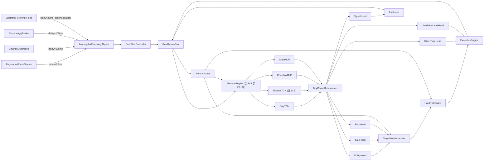

# 技术构思 v2.1

## 一页结论

这套方案在技术上可行，主线明确为：

1. 用 `Rust` 构建真实事件驱动的回放与执行环境，内置延迟注入、冷启动控制与统一会计口径。
2. 用 `Chainlink BTC/USD` 同时作为唯一结算标签与低频参考特征，但标签与特征的时间口径严格分离。
3. 用 `Polymarket` 盘口事件流、`Binance` 深度/成交、`BLB 技术指标` 和因果可见的 `Chainlink` 更新值共同构成状态特征。
4. 用 **`多分支 TCN + 小型因果 Transformer`** 作为交易 agent 的核心骨干。
5. 用 `策略头 + 仓位头 + 下单方式头 + 限价档位头 + 风险头 + 硬风控 + 执行状态机` 组成完整交易 agent。
6. 第一阶段先做 `结算方向分类 + 标准化动作 EV 回归` 的监督预训练；离线 RL 路线已在 `M5` 作为诊断与收口完成，当前 `M6` 默认候选为 `frozen signal head + signal_threshold=0.58 + force_order_type=limit + 默认 size`，后续重点是 paper trading 验证而不是继续扩大离线搜索树。

如果只给一个主推荐模型：

**`多分支 TCN + 小型因果 Transformer` 混合骨干**

这比纯 `TCN` 上限更高，又比纯 `Transformer` 更容易落地。

核心原则：**先把系统做对，再把模型做强。**

v2.1 的重点，不是改变主方向，而是统一 `Chainlink` 角色、执行延迟时间线、动作空间和奖励会计定义，让文档从“讨论稿”更接近“可实施规范”。

---

## 目标定义

目标不是训练一个只会判断 `Up/Down` 的分类器，而是训练一个完整交易 agent，在每个时间步都能做出以下决策：

- 是否交易
- 交易哪一边
- 仓位大小
- 是否继续持有
- 是否减仓
- 是否平仓
- 是否允许反手
- 用 `market` 还是 `limit`
- 如果是 `limit`，挂在哪一档/相对最优价偏移多少 tick

同时，这个 agent 必须在以下约束下工作：

- 结算按 `Chainlink BTC/USD`
- `Chainlink` 既作为唯一结算真值，也作为低频参考特征，但任何决策只能使用决策时刻之前因果可见的 `Chainlink` 更新值
- 交易成本按 `crypto_fees`（2026-03-30 新版费率）
- 成交价格按 `Polymarket` 真实盘口逐档模拟
- 风控不能完全依赖模型，必须有系统硬约束
- 训练和推理均须模拟真实网络延迟

---

## 数据资源与角色划分

当前数据闭环具备四类原始数据源，以及一个由模拟系统实时计算的衍生特征（BLB），各自职责清晰。

### Polymarket btc-updown-5m orderbook

`Polymarket` 是主交易场所，负责提供：

- `Up/Down` 双边盘口状态（`book` 事件）
- `best_bid_ask`
- `price_change`
- `last_trade_price`

它决定：

- 可执行价格
- 实际滑点
- 真实成交条件

数据格式：每个 5 分钟 market 一个 ndjson 文件，每行是一个事件（book / price_change 等），带毫秒级 `timestamp`。

### Chainlink BTC/USD（统一使用 Polymarket 转发）

`Chainlink` 在系统中同时承担两种职责：

- 作为唯一官方结算真值
- 作为低频参考特征源

这两个角色必须严格分离时间口径：

- **标签口径**：只使用 market 结束后的最终结算结果
- **特征口径**：只使用决策时刻之前因果可见的 `Chainlink` 更新值、与 `price_to_beat` 的偏离、短时变化和 `staleness`

结算规则固定为：

- `resolution_price >= price_to_beat` 记为 `Up`
- `resolution_price < price_to_beat` 记为 `Down`

`Chainlink` 不可被 `Binance` 替代。等于起始价判给 `Up`，这不是 50/50 对称结构。

训练、回测、仿真和实盘中，统一把 `Chainlink` 数据抽象为同一个 `Chainlink reference signal`，并统一使用 `Polymarket` 转发的 `Chainlink BTC/USD` 价格。该信号进入模型前按 `20ms` 可见延迟建模，原始更新频率约 `1Hz`，因此需要同时输入距上次更新的 `staleness`。

### Binance BTCUSDT aggtrades

`Binance` aggtrades 提供毫秒级价格和成交数据，职责：

- 更高频的价格变化节奏
- 成交方向（buyer/seller maker）
- 短时成交量

数据格式：CSV，每行一条聚合成交记录，包含 `timestamp_ms`、`price`、`quantity`、`is_buyer_maker` 等字段。

### Binance BTCUSDT orderbook

`Binance` orderbook 提供毫秒级深度数据，职责：

- 外部市场流动性结构
- 多档买卖盘深度
- 深度变化节奏

数据格式：ndjson，包含 snapshot（全量快照）和 delta（增量更新）两种记录类型。

### BLB 技术指标（实时计算的衍生特征）

BLB 不是独立的原始数据源，而是由模拟系统的 `feature-engine` 模块基于已接收的 Binance aggtrades 和 Binance orderbook **实时计算**的衍生特征。

无论训练/回测还是实盘，BLB 都由 `feature-engine` 在爱尔兰服务器上实时从 Binance 数据流构建，其可见时刻为 Binance 数据到达时刻加上本地计算耗时。

三个指标的含义：

- **bps**（基点偏移）：`(current_price - price_to_beat) / price_to_beat × 10000`。正值表示当前价格高于 P2B，负值表示低于 P2B。这里的 `current_price` 来自 Binance BTCUSDT 实时成交价，`price_to_beat` 是每个 5 分钟 market 开始时的 Binance BTCUSDT 价格。直接反映当前价格趋势强度。

- **levelCount**（价格档位数，有符号）：Binance 盘口中从 midpoint 到 P2B 之间的价格档位数。正值表示 midpoint > P2B（当前价格在 P2B 上方），负值表示 midpoint < P2B（当前价格在 P2B 下方）。反映价格回归 P2B 需要穿越的阻力档位。

- **barrierUsdt**（流动性障碍，有符号 USD）：上述档位上的美元总量。正值表示向下穿越到 P2B 的障碍（需要消耗 bid 侧流动性），负值表示向上穿越到 P2B 的障碍（需要消耗 ask 侧流动性）。反映回归方向上的真实流动性壁垒。

BLB 直接服务于核心判断："当前价格是否能在剩余时间内回归 P2B"，是交易 agent 的关键决策特征。

注意：BLB 中的 P2B 基于 Binance BTCUSDT 价格计算，而 Polymarket 的结算 P2B 来自 Chainlink。两者存在微小差异，但 Binance 的 BLB 指标作为预测特征（而非结算标签）是合理的。

### 数据角色总结

| 数据源                   | 角色                                                    | 用途                         |
| ------------------------ | ------------------------------------------------------- | ---------------------------- |
| Polymarket btc-updown-5m | 主交易场所                                              | 盘口状态、成交模拟、执行价格 |
| Chainlink BTC/USD        | 结算真值 + 参考特征                                     | 唯一标签源 + 低频参考特征    |
| Binance aggtrades        | 外部特征                                                | 高频价格、成交方向           |
| Binance orderbook        | 外部特征                                                | 深度结构、流动性             |
| BLB（实时计算）          | 衍生特征（由 feature-engine 基于 Binance 数据实时构建） | bps/levelCount/barrierUsdt   |

---

## 市场规则与手续费

### 市场基本参数

- 合约类型：二元结果市场（Up / Down）
- 撮合方式：CLOB 订单簿
- 最小价格跳动：`0.01`
- 最小下单量：`5`

### 结算规则

- 起始价格（price to beat）：市场时间窗开始时的 Chainlink BTC/USD 价格
- 结束价格（resolution price）：市场时间窗结束时的 Chainlink BTC/USD 价格
- `resolution_price >= price_to_beat` → Up 结算 $1，Down 结算 $0
- `resolution_price < price_to_beat` → Down 结算 $1，Up 结算 $0

### 手续费（2026-03-30 新版）

Crypto 市场新参数（2026-03-30 起生效）：

- `feeRate = 0.072`，`exponent = 1`
- 通用公式：`fee = C × p × feeRate × (p × (1 - p))^exponent`
- 代入后：`fee = C × p × 0.072 × p × (1 - p)` = `C × 0.072 × p² × (1 - p)`
- 其中 `C` 为成交份额数，`p` 为份额价格
- 费用以 USDC 计价，但**买单**以份额形式收取，**卖单**以 USDC 形式收取
- `100` 份额在 `p=0.50` 时，taker fee 为 **`$0.90`**

费率随价格变化参考（100 份额）：

| 价格  | 交易额 | 手续费 (USDC) | 有效费率 |
| ----- | ------ | ------------- | -------- |
| $0.05 | $5     | $0.02         | 0.34%    |
| $0.10 | $10    | $0.06         | 0.65%    |
| $0.20 | $20    | $0.23         | 1.15%    |
| $0.30 | $30    | $0.45         | 1.51%    |
| $0.40 | $40    | $0.69         | 1.73%    |
| $0.50 | $50    | $0.90         | 1.80%    |
| $0.60 | $60    | $1.04         | 1.73%    |
| $0.70 | $70    | $1.06         | 1.51%    |
| $0.80 | $80    | $0.92         | 1.15%    |
| $0.90 | $90    | $0.58         | 0.65%    |
| $0.95 | $95    | $0.32         | 0.34%    |

关键规则：

- **Taker fee**：按上述公式收取，买单以份额形式收取，卖单以 USDC 形式收取
- **Maker fee**：`takerOnly = true`，挂单不收手续费
- **Maker rebate**：`rebateRate = 0.2`，taker fee 的 20% 用于做市返利
- **Gas fee**：通过官方 relayer 路由的操作由平台代付
- **费用精度**：四舍五入到小数点后 `4` 位，最小 `0.0001` USDC，低于该值的费用直接为零

### 对策略的直接影响

- AI 可以选择 `market order` 或 `limit order`，但实际费用由成交角色决定：`market order` 默认按 taker 口径计费；`limit order` 若被动成交则不收 taker fee，若立即穿价成交则仍按 taker 口径计费
- 预期利润必须能覆盖手续费才值得交易
- Crypto 市场的峰值有效费率为交易额的 **1.80%**（在 `p=0.50` 附近），break-even 需根据 `fee = C × 0.072 × p² × (1 - p)` 公式实际计算
- 回测和仿真必须显式计入 taker fee
- 不可硬编码费率，应从配置读取

---

## 网络延迟与部署拓扑

### 部署架构

- **核心服务器**：AWS 爱尔兰（距 Polymarket 主服务器最近）
- **中继服务器**：AWS 东京（接收 Binance 数据，通过 AWS Inter-Region VPC Peering 转发给核心服务器）
- **连接模式**：核心服务器与东京服务器之间为单向长连接，核心服务器只接收

### 延迟参数

| 路径                  | 方向     | 延迟  | 说明                                                                                          |
| --------------------- | -------- | ----- | --------------------------------------------------------------------------------------------- |
| Polymarket → 核心                 | 接收数据 | 20ms  | WS orderbook 订阅，订阅建立后                                                                                     |
| 核心 → Polymarket                 | 下单     | 20ms  | `decision -> exchange_arrival`                                                                                    |
| Polymarket → 核心                 | 订单回推 | 20ms  | `exchange_event -> local_ack`                                                                                     |
| Binance → 东京 → 核心             | 接收数据 | 105ms | 单向长连接                                                                                                        |
| Polymarket（转发 Chainlink）→ 核心 | 接收数据 | 20ms  | 统一使用 Polymarket 转发的 `Chainlink BTC/USD`；原始更新频率约 `1Hz`，特征侧额外输入 `staleness` |

### 执行时间线

为避免把“交易发生时点”和“本地得知时点”混在一起，回放与仿真统一采用以下时间线：

- `t_decision`：模型在本地做出决策的时刻
- `t_exchange_arrival = t_decision + 20ms`：订单到达 `Polymarket` 撮合侧的时刻
- `t_local_ack = t_exchange_arrival + 20ms`：本地通过 user channel 或回执确认订单状态的时刻

执行语义固定为：

- 撮合与成交价格使用 `t_exchange_arrival` 时刻的 `Polymarket` 订单簿
- 本地账户状态、持仓状态和可见订单状态在 `t_local_ack` 才更新
- 任何后续成交、撤单、部分成交事件，也都按 `exchange_event_time + 20ms` 才对本地可见

### 冷启动

Polymarket orderbook 订阅首次建立时需要获取完整快照，延迟很高（800~1200ms），且与 Binance 数据存在约 1300ms 的对齐偏差。

因此：

- 实盘中应在 market 开始时间前 1 分钟建立连接
- 训练/回测数据集中没有提前 1 分钟的数据
- 解决方案：每次会话的**第一个 5 分钟 market 作为冷启动周期**，不允许交易。"会话"的边界定义：实盘中为每次程序启动或重连后的首个 market；训练/回测中为每个连续数据片段（episode）的起点 market
- 冷启动结束后的后续 market 才允许模拟交易

### 延迟注入要求

训练、回测、仿真环境均须模拟上述延迟：

- Polymarket 盘口数据输入给模型前延迟 20ms
- Binance 原始数据（aggtrades / orderbook）输入给模型前延迟 105ms
- BLB 技术指标由 `feature-engine` 基于已接收的 Binance 数据实时计算，其可见时刻 = Binance 数据到达延迟（105ms）+ 本地计算耗时。BLB 不是独立的数据流，而是 `feature-engine` 的输出，因此其可见时刻必然晚于原始 Binance 数据
- Chainlink 数据统一使用 Polymarket 转发链路，输入给模型前按 20ms 延迟建模；原始更新频率约 1Hz，并同时把距上次更新的 `staleness` 作为特征输入
- 模型输出的订单指令以 `t_decision` 产生，在 `t_exchange_arrival` 进入撮合，在 `t_local_ack` 回写本地状态
- 模拟撮合使用 `t_exchange_arrival` 时刻的 `Polymarket` 订单簿，而不是 `ack` 时刻的订单簿

---

## 数据清洗流程

### 数据切分

以 Polymarket btc-updown-5m orderbook 数据的时间为基准，将所有数据按 5 分钟一段切分。每段对应一个 market。

这里的 "`market` 严格切分" 指的是：

- 它是数据对齐、标签归属、费用归属和评估统计的基本单元
- 它不等于模型在某一决策时刻只能看到这 5 分钟内部的数据

### 对齐验证

每个 5 分钟 market 必须同时具备以下完整原始数据：

1. Polymarket btc-updown-5m orderbook 事件流
2. Binance BTCUSDT aggtrades
3. Binance BTCUSDT orderbook
4. Chainlink BTC/USD price

BLB 不在此列，它由 `feature-engine` 基于 Binance 数据实时计算，不需要独立的原始数据文件。

所有数据的时间范围须与 Polymarket market 的时间窗对齐。

构造 observation 时，允许模型在某个决策时刻向前回看连续历史窗口；这个窗口可以跨相邻 market 拼接历史上下文，但绝不能穿越未来时间。也就是说，`market` 决定样本归属，`context window` 决定模型可见历史，这两个概念需要严格分开。

### 丢弃规则

如果某个 5 分钟 market 内的上述数据不完整，或任何一种数据存在超过 15 秒的时间缺失，则丢弃该 market 的全部数据。

### 当前数据规模

首批数据集先使用 `model/data-v1/`（当前版本）。当前正式目录约定是：

```text
model/data-v*/<window_id>/
```

其中 1 天样本的窗口目录示例为：`model/data-v1/1774248000-1774334100/`

- btc-updown-5m：288 个 market 文件
- btcusdt-price：1 个 CSV（~160 万行 aggtrades）
- btcusdt-orderbook：1 个 ndjson（全天连续深度流）
- rtds_chainlink：1 个 ndjson（~8.5 万行 Chainlink 价格更新；若历史文件名仍沿用该命名，语义上统一视为来自 Polymarket 转发的 `Chainlink reference signal`，进入训练/回放前按 `20ms` 可见延迟建模，原始更新频率约 `1Hz`）
- （BLB 指标无需独立数据文件，由 `feature-engine` 基于上述 Binance aggtrades 和 orderbook 实时计算）

这里路径名中的两个时间戳表示**首个 market 的开始时刻**和**最后一个 market 的开始时刻**，不是结束时刻，因此 market 计数公式为：

- `market_count = (last_start - first_start) / 300 + 1`

在该路径下对应 `288` 个 5 分钟 market，这一点在文档中显式写明，避免把文件名误读成只有 `287` 个 market。

### 扩展计划

1. 先用 1 天数据验证整体流程（数据清洗 → 训练 → 评估）
2. 验证通过后扩展到更多连续窗口
3. 当前已落地的 `data-v4` 与后续新增版本统一按 `model/data-v*/<window_id>/...` 创建，不再额外套日期目录

### 数据分层与存储策略

不建议为了接入训练框架而把原始事实层粗暴改写成另一套训练专用表。更合适的方式是分层存储：保留 raw，并在需要时维护与 raw 同构的 typed parquet 原始镜像层：

- 原始事实层：canonical raw 保留 `ndjson/csv`，用于审计、事件回放、订单簿重建、延迟注入与冷启动模拟；同时允许在 `model/parquet-data/<dataset_version>/` 下维护 **typed parquet 原始镜像层**，作为列式压缩与统一读取路径，但它不是新的训练层表。
- 标准化训练层：将按 `market` 对齐后的特征表、标签表、索引表导出为 `parquet`，用于批量读取、统计分析和模型训练。当前正式索引层为 `manifest.parquet + labels.parquet + validation.parquet`，下游不得只消费 `manifest.parquet`。
- 离线 RL 样本层：将 `obs`、`action`、`reward`、`next_obs`、`done`、`market_id`、`timestamp_ms` 等 transition 样本导出为 `parquet`，供诊断使用。`M5` 之后的默认经验口径是优先使用 `reward_minimal`（纯 `ΔNAV`）而不是早期 clipped reward。
- 环境接口层：如果接入 `Gymnasium`，只在 Python 侧提供 `reset/step` 包装器，不要求底层原始数据契约统一改动。

优先转成 `parquet` 的对象：

- 按 `market` 对齐后的统一特征表（含 feature-engine 实时计算的 BLB 指标）
- 标签表
- `market manifest / index`
- 离线 RL transitions 数据集

优先保留原始事件语义的对象（以 raw 或与之同构的 mirror 落盘）：

- `Polymarket` orderbook 事件流
- `Binance` orderbook snapshot / delta
- 原始 `Chainlink` 价格流
- 原始 `Binance aggtrades`

这样做的目的，是同时保留真实事件语义与可审计性，并降低训练阶段的文本解析成本与批量读取开销，避免为了接入 `Gymnasium` 而重写整条数据链路。

### 新数据集版本约束

创建 `data-v4` 及后续新版本时，必须额外满足以下当前实现约束：

- 目录必须使用 `model/data-v*/<window_id>/...`
- 若维护 mirror，则目录必须使用 `model/parquet-data/<dataset_version>/<window_id>/...`，并保持与 raw 同构
- `data-pipeline`、`replay-engine`、`feature-engine`、`training` 相关流程都以 `dataset_version / window_id / market_id` 为固定主键
- 多数据集联合训练必须先全局合并 parquet，再统一做严格时间前推切分；禁止“各 parquet 各自切分后再拼接”
- `sync_polymarket_asset_map_overrides.py` 的默认扫描集合仍是 `data-v1/v2/v3`；处理 `data-v4` 时必须显式传 `--datasets data-v4`
- 当前 `data-v4` 的 typed parquet mirror 已完成 `verify_parquet_raw_coverage.py` 校验：`3016 -> 3016`，且 `missing/extra/row_mismatch` 全为 `0`；这证明文件覆盖与逐文件行数一致，但不等同于全链路全量等价
- 详细执行清单统一见 `数据集规范.md`

---

## 主推荐模型：多分支 TCN + 小型因果 Transformer

### 这套骨干的职责

这套骨干不直接等于完整策略，而是完整交易 agent 的核心状态建模层。

它负责：

- 抽取局部微观结构模式
- 融合多源时序特征
- 建立更长上下文依赖
- 输出统一市场状态表示，供多个 head 使用

### 为什么不是纯 TCN

纯 `TCN` 的优点是：

- 快
- 稳
- CPU 友好
- 对局部微结构信号很有效

但纯 `TCN` 的局限是：

- 跨市场信息融合能力有限
- 对更长依赖建模能力有限
- 对多源异步事件之间的复杂关系表达力不如注意力结构

### 为什么不是纯 Transformer

纯 `Transformer` 的优点是：

- 表达能力更强
- 长依赖建模更自然
- 多流融合更灵活

但纯 `Transformer` 的问题是：

- 更吃数据
- 更容易过拟合
- 推理更重
- 在这个项目里工程性价比不如混合方案

### 为什么混合方案更合适

推荐的混合方式是：

- `TCN` 负责局部短时模式提取
- 小型因果 `Transformer` 负责跨流融合和较长上下文建模

这样得到的效果通常是：

- 比纯 `TCN` 上限更高
- 比纯 `Transformer` 更稳、更快
- 更适合 `Rust + ONNX` 本地推理

---

## 模型结构

### 分支编码层

拆成四个输入分支：

1. **PolymarketBranch**（TCN / 1D CNN + TCN）
   - Up/Down 双边 top-k 深度
   - 点差、盘口失衡
   - 最近成交方向和成交量

2. **BinanceBranch**（TCN / 1D CNN + TCN）
   - top-k 深度
   - `binance_market_drift`（相对 market 开盘价的累计漂移）和短时波动
   - 微成交方向失衡
   - **bps**（基点偏移）
   - **levelCount**（价格档位阻力）
   - **barrierUsdt**（流动性障碍）

3. **ChainlinkBranch**（轻量 MLP）
   - 当前可见值
   - 与当前 market `price_to_beat` 的偏离
   - 短时变化
   - 距上次更新的 `staleness / age`
   - 仅使用决策时刻之前因果可见的更新

4. **StateBranch**（轻量 MLP）
   - 当前持仓
   - 当前浮盈亏
   - 账户净值
   - 剩余时间
   - 当前 episode 进度
   - **注**：Phase 1 监督预训练阶段不启用此分支。feature-engine 以 order_size=0 运行，所有 agent state 列全为常数（零梯度信号），从 FEATURE_COLS 移除；Phase 2 RL 阶段使用真实交互数据后再加入。

### 融合层

将分支编码后的时间步表示送入一个小型因果 `Transformer` 做融合。

第一版规模保持保守：

- `2-4` 层
- hidden dim `64-128`
- attention heads `2-4`
- 序列长度控制在聚合后的 `60-240` 步以内

目标不是堆大模型，而是：

- 保持低延迟
- 保持可训练性
- 保持本地部署稳定

### 共享状态输出

融合层输出统一状态向量 `state_embedding`，供多个任务头共享：

- `SignalHead`
- `PolicyHead`
- `SizeHead`
- `OrderTypeHead`
- `LimitPriceLevelHead`
- `RiskHead`

### 推荐系统结构



---

## 完整交易 agent 的职责划分

### SignalHead

负责发现交易 edge，输出：

- `P_up`
- `P_down`
- `EV_buy_up_after_cost`
- `EV_buy_down_after_cost`
- `confidence_proxy / uncertainty_proxy`

它的职责是发现"哪里值得交易"，不是直接完成所有执行决策。

第一版中，`SignalHead` 作为辅助监督与分析头存在，不直接把 `P_up / P_down / EV / confidence_proxy` 再喂回 `PolicyHead`；`PolicyHead` 通过共享的 `state_embedding` 间接受益，而 `SignalHead` 的输出主要用于预训练、评估和诊断。`confidence_proxy` 更适合作为由校准概率边际、EV 边际或模型分歧派生出的诊断量，而不是必须单独监督的原生标签。

### PolicyHead

负责在每个时间步选择完整的仓位管理意图，统一覆盖开仓、持仓管理和退出决策：

- `hold`：继续观望或维持当前持仓
- `open_up`：开 Up 方向仓位
- `open_down`：开 Down 方向仓位
- `reduce`：主动减仓意图（幅度由 `SizeHead` 决定）
- `close`：主动全平意图
- `flip`：反手意图（双腿模式下交换 Up/Down 持仓量，ESM 分多 tick 完成：先卖后买）

第一版采用因子化动作参数化：`PolicyHead` 负责方向性意图与退出决策，`SizeHead` 负责目标仓位档位（不是增量调仓幅度）。两者先组合成 `candidate_target_position`，再交由 `RiskHead`（软约束）和 `HardRiskGuard`（硬约束）仲裁，不直接等于最终下单动作。

`PolicyHead` 统一承担开仓与退出的决策职责，当模型认为应该退出或部分减仓时，直接通过 `reduce` / `close` / `flip` 表达，不需要额外的退出约束头。

### SizeHead

负责确定仓位大小。

第一版建议用离散仓位档位：

- `small`
- `medium`
- `large`

后续稳定后再切换到连续仓位。

它与 `PolicyHead` 联合定义目标仓位。`SizeHead` 的输出统一解释为**目标仓位档位**：当 `PolicyHead=open_*` 时表示开仓的目标仓位；当 `PolicyHead=reduce` 时表示减仓后的目标仓位。

### OrderTypeHead

负责确定执行风格：

- `market`
- `limit`

它不决定方向和仓位，只决定“如何去逼近最终目标仓位”。第一版同时保留 `market` 和 `limit` 两类动作，以免文档中的执行空间与实际成交模拟脱节。

### LimitPriceLevelHead

只在 `OrderTypeHead=limit` 时生效，负责确定限价单挂在哪一档。推荐第一版使用离散 `price_level` 而非绝对价格：

- `join_best`
- `improve_1tick`
- `improve_2tick`
- `passive_1tick`
- `passive_2tick`

其中：

- `join_best`：挂在当前同侧最优价
- `improve_*`：相对当前同侧最优价更激进，提升更快成交概率
- `passive_*`：相对当前同侧最优价更保守，优先争取 maker 身份

这里也可以实现成 `limit_offset_ticks`，但文档层建议统一用相对最优价的离散价位档表达，便于跨 market 训练与泛化。


### RiskHead

负责根据当前环境估计风险水平，例如：

- 当前状态是否过热
- 是否应减少仓位
- 是否应暂停开新仓

它更适合作为**软风险约束**来源，例如输出建议仓位上限、是否暂停新开仓、是否只允许被动成交等，不直接替代 `HardRiskGuard`。

### TargetPositionArbiter

这是执行层中的系统模块，不是新的学习头。它的职责是把多头输出转换成一个明确的目标仓位：

- `PolicyHead + SizeHead` 先生成 `candidate_target_position`
- `RiskHead` 施加软风险上限，得到 `final_target_position_pre_hard`

这样做的好处，是保持职责单一：`PolicyHead` 统一负责开仓、持仓、退出和反手的意图表达，`RiskHead` 负责软风险约束，`HardRiskGuard` 负责硬风控。

### HardRiskGuard

独立于模型存在，负责执行不可违反的系统级规则：

- 单市场最大仓位
- 单市场最大亏损
- 日内最大回撤
- 连续亏损熔断
- 距离到期太近时禁止新开仓
- 剩余时间过短时强制减仓或平仓

执行顺序固定为：

- `PolicyHead + SizeHead` 生成 `candidate_target_position`
- `RiskHead` 施加软风险约束
- `HardRiskGuard` 再施加硬约束，输出 `final_target_position`

### ExecutionStateMachine

负责把 agent 动作变成真实可执行订单与账户更新。

它管理：

- 吃单 / 挂单
- 部分成交
- 未成交
- 挂单生命周期（下单、等待、撤单、重挂）
- 手续费（按 2026-03-30 新版 crypto_fees 公式计算）
- 滑点
- 持仓变化
- 账户净值
- 到期结算兑付

`ExecutionStateMachine` 的职责不是再做一次策略判断，而是把 `final_target_position` 与当前持仓的差额，结合 `OrderTypeHead` 和 `LimitPriceLevelHead`，转换成具体订单。第一版建议采用简单而闭合的挂单规则：如果限价单在下一次决策步到来前仍未完全成交，则先撤单，再根据新的 `final_target_position` 重新评估是否重挂。

---

## 输入表示建议

### 时间粒度

原始事件流不建议直接整段喂给模型。

建议先聚合成固定步长特征帧，例如：

- `100ms`
- `250ms`
- `500ms`

第一版建议从 `250ms` 或 `500ms` 开始，先降低复杂度。

### 回看窗口

建议每次推理回看最近：

- `30s`
- `60s`

这样可以让模型同时看到：

- 足够多的局部盘口变化
- 临近结算的时间压力
- 跨市场短时领先/滞后结构

### 决策上下文与 market 边界

`market` 是样本归属单元，`context window` 是模型决策时可见的历史上下文，两者不是同一个概念。

- `Polymarket` 的 market 边界决定当前 `price_to_beat`、`time_to_expiry`、结算标签和费用归属
- `Binance` 与 `Chainlink` 这类连续流在构造 observation 时可跨相邻 market 向前拼接历史上下文
- 任何上下文拼接都必须严格因果，只能看当前决策时刻之前的数据
- 冷启动问题是“刚连上时数据还不稳定”，与“模型需要 30s-60s 的回看窗口”是两个不同问题，不能混写

### 特征类型

建议优先保留这些特征：

**Polymarket 特征**：
- Up/Down 双边 top-k 深度
- 点差、盘口失衡
- 最近成交方向和成交量

**Binance 特征**：
- top-k 深度
- `binance_market_drift`（相对 market 开盘价的累计漂移）和短时波动
- 成交方向失衡
- bps（基点偏移）
- levelCount（价格档位阻力）
- barrierUsdt（流动性障碍）

**Chainlink 特征**：
- 当前可见值、与当前 market `price_to_beat` 的偏离、短时变化、距上次更新的 `staleness`

**Agent 状态特征**：
- 剩余时间 `time_to_expiry`
- 当前持仓、浮盈亏、净值

---

## 建议动作空间

第一版明确采用"多头分离输出 + 目标仓位仲裁 + 执行层组合映射"，而不是把方向、仓位和下单方式直接压平成单一离散动作空间。

模型输出层级如下：

- `PolicyHead`：`hold` / `open_up` / `open_down` / `reduce` / `close` / `flip`
- `SizeHead`：`small` / `medium` / `large`
- `OrderTypeHead`：`market` / `limit`
- `LimitPriceLevelHead`：`join_best` / `improve_1tick` / `improve_2tick` / `passive_1tick` / `passive_2tick`
- `RiskHead`：负责输出软风险约束

执行层的组合逻辑分三步：

1. `PolicyHead + SizeHead` 生成 `candidate_target_position`
2. `RiskHead + HardRiskGuard` 将其投影为 `final_target_position`
3. `OrderTypeHead + LimitPriceLevelHead` 决定如何从当前仓位移动到 `final_target_position`

典型执行语义例如：

- `buy_up_to_medium_market`
- `buy_down_to_small_limit_join_best`
- `reduce_to_small_limit_passive_1tick`
- `flatten_market`

这样文档中的"动作语义集合"与"多头模型结构"是同一件事的两个层次：前者描述执行接口，后者描述策略网络的参数化方式。

第一版执行逻辑建议保持简单但闭合：

- 同时支持 `market` 和 `limit`
- `market order` 默认按 taker 口径计费；`limit order` 的实际费用取决于它最终以 maker 还是 taker 身份成交
- 预期利润必须覆盖手续费
- 限价单若在下一决策步前未完全成交，默认先撤后重评估
- 先把真实成本、挂单生命周期和成交模拟做好

第一版即纳入 maker rebate 计算，maker 成交时按 `rebateRate = 0.2` 计入返利。

### M4 实施注记

M4 实际实现与本节设计一致，补充以下实施细节：

- **SizeHead 档位映射**：`small=5, medium=15, large=30` shares
- **OpenUp/Down + SizeLevel = 设置该腿目标到 S**（非增量加仓）。例如 `OpenUp + small(5)` 当 `cur_up=20` 时实际减仓
- **Reduce + SizeLevel = 两腿各自 min(cur, S)**，保证只减不增
- **Flip = 交换 Up/Down 持仓量**：`(20, 5)` → `(5, 20)`，ESM 分多 tick 完成（先卖后买）
- **动作空间受限子集**：6 个 PolicyAction 只覆盖组合动作的子集（如不能同时设双腿为不同档位），引擎层支持任意操作，M5 RL 可扩展
- **crate 组织**：原计划 6 个 crate 合并为 `onnx-inference` + `agent`
- **ESM 每 tick 至多一单**，优先卖出（释放资金），OutstandingOrderTracker 阻塞 ack 管线中的订单
- **HardRiskGuard 6 条规则**：cold_start / force_close / min_open_ms / per_leg_max / drawdown / consecutive_loss_breaker

---

## 止盈止损

止盈止损不建议只靠固定价格阈值。

更合理的做法是"两层结构"：

### 模型软决策

由 `PolicyHead` 动态决定：

- 继续持有（`hold`）
- 部分减仓（`reduce`）
- 全部平仓（`close`）
- 反手（`flip`）

### 系统硬保护

由 `HardRiskGuard` 强制执行：

- 单市场亏损阈值强平
- 日内回撤阈值停机
- 到期前窗口禁止开新仓
- 结算前最后阶段强制平仓或限制仓位

**止盈止损可以部分由模型学习，但永远不能没有系统级硬保护。**

---

## 奖励函数建议

奖励函数围绕净值变化设计，而不是只奖励方向猜对。

### 唯一会计定义

- `cash_t`：时刻 `t` 在账户中的现金余额（USDC），已计入历史成交、费用与返利
- `inventory_mark_to_market_t`：时刻 `t` 对当前持仓按**当前可见 `Polymarket` 订单簿上立即可平仓的保守变现价值**做的市值估计
- `NAV_before_trade(t) = cash_{t^-} + inventory_mark_to_market_{t^-}`
- `NAV_after_fill(t)`：在 `t_exchange_arrival` 按真实成交价与成交数量更新现金和持仓后的净值，但尚未计入平台 fee / rebate
- `NAV_after_fee(t)`：在 `NAV_after_fill(t)` 基础上计入平台费用与返利后的净值。买单以份额收取的 fee 体现在**净持仓减少**；卖单以 USDC 收取的 fee 体现在 **cash 减少**；maker rebate 则体现在 **cash 增加**
- `terminal_settlement(T)`：到期后，按 `Chainlink` 最终结算结果将剩余 `Up/Down` 份额兑付成现金后的最终账户价值

这组定义的目的，是把“成交价影响”“费用影响”“最终结算影响”拆开，但在奖励里只使用**唯一净值口径**，避免重复扣费。

### 单步奖励

> 详细设计见 `dev-docs/奖励函数思路.md`。

核心形式（不对称 ΔNAV + 主动/被动亏损区分）：

```
if ΔNAV(t) >= 0:         reward_nav = ΔNAV(t)              # 盈利：全额计入
elif has_trade_this_tick: reward_nav = ΔNAV(t)              # 主动纠错：不放大
else:                     reward_nav = α_loss × ΔNAV(t)     # 被动承受：放大（α_loss=1.5）

reward_t = reward_nav - turnover_penalty - drawdown_penalty - idle_penalty
```

其中：

- `slippage` 已体现在实际 `fill price` 中，因此作为分析归因指标记录，不再在奖励中重复扣减
- `crypto_fees` 和 maker rebate 已体现在 `NAV_after_fee` 中，不再额外减一次
- 到期时，最后一步奖励通过 `terminal_settlement(T)` 与前一时刻 `NAV_after_fee` 的差额体现最终兑付结果
- **无 inventory penalty**：双侧持仓是合法套利（`price_up + price_down < 1` 时确定性盈利），仓位已由 SizeHead + HardRiskGuard 约束
- **idle_penalty**：空仓且非冷启动时每 tick 收取 λ_idle（惩罚躺平不交易）
- **drawdown_penalty**：仅对增量回撤（创新低）收费，不对存量回撤重复收费
- **主动/被动区分**：α_loss 仅放大无交易 tick 的被动亏损，止损等主动纠错不放大——避免模型学到"买错不动"

默认超参数：α_loss=1.5, λ_turn=0.0005, λ_dd=0.5, λ_idle=0.0001, γ=0.9995

---

## 训练路线

### 第一阶段：监督预训练

目标是让混合骨干先学会发现交易 edge。

训练对象：

- `PolyTCN`
- `BinanceTCN`（含 BLB 特征）
- `ChainlinkBranch`
- `TinyCausalTransformer`
- `SignalHead`

> `StateBranch` 不参与 Phase 1。feature-engine 以 order_size=0 采集特征，agent state 全为常数，不携带梯度信号。该分支在 Phase 2 RL 阶段引入真实仓位数据后再加入。

监督目标定义：

- `y_cls`：当前决策时刻所属 market 的最终结算方向（`Up/Down`）
- `y_ev_up`：标准化动作模板 `buy_up_market_small` 在当前决策点执行后的事后净收益。执行口径固定为：订单在 `t_exchange_arrival` 到达、按真实订单簿撮合、按统一会计规则扣费，并持有到最终结算
- `y_ev_down`：标准化动作模板 `buy_down_market_small` 在同样口径下的事后净收益
- `confidence_proxy`：第一阶段不作为独立监督标签，而是由校准后的概率边际、EV 边际或模型分歧派生，用于诊断和过滤

验证重点：

**主判据（Phase 1 必须通过）：**
- `top_decile_mean_ev_up`：按 P_up 降序取前 10%，计算 mean(y_ev_up)；须 > 0（y_ev 标签已含手续费，taker fee 峰值 1.80% @p=0.50）
- `ev_up_sign_acc`：在 mask 有效样本中，(ev_up_pred > 0) == (y_ev_up > 0) 的比例；基线 50%，须 > 0.52

**辅助指标（理智检查，必要但非充分）：**
- `AUC`（随机基线 0.50，须 > 0.52；市场盘口已隐含 P_up 共识，AUC 不能直接衡量盈利能力）
- `Brier score`（须 < 0.25）
- 概率校准（`ECE`，须 < 0.05）
- EV 排序能力：`ev_rank_corr`（Spearman，须 > 0.03）

**诊断分析：**
- `ev_up_conditional_mean_by_threshold`：P_up > {0.50, 0.52, 0.55, 0.60, 0.65} 各阈值的条件均值 y_ev_up + opportunity_rate
- `edge_by_decile`：按 P_up 分 10 分位，各组 mean(y_ev_up)；单调递增表示排序与实际 EV 一致

数据规模：

- 先用 1 天数据（data-v1，288 个 5 分钟 market）验证整体流程
- 历史已验证的全量监督基线使用 3 个数据集（data-v1 + v2 + v3，共 `2,609,247` 帧，约 10 天）
- 当前工程数据线已扩展到 `V1~V4`；新增版本继续按周滚动扩展，但训练切分与 mirror 规则仍统一遵循 `数据集规范.md`

训练算力需求：

- 模型规模约 395K 参数（M3 骨干 375K + M4 五个新头 ~20K），VRAM 峰值 < 10GB（batch_size=2048, seq_len=240）
- 全量训练（2.6M 帧，30 epoch，seq_len=240）需云端 CUDA GPU；实测 RTX 5090 + batch=2048 + AMP + torch.compile 约 61s/epoch（含 eval），30 epoch 约 30 分钟
- batch_size 是 GPU 利用率的首要决定因素：batch=128 → GPU 10%；batch=2048 → GPU 92%；须根据可用 VRAM 尽量放大
- 推荐云端方案：AutoDL / RunPod / Vast.ai，RTX 4090 / RTX 5090，单次训练成本约 $1-5

### 第二阶段：离线 RL 策略优化

在第一阶段已经证明有稳定 edge 后，再做完整策略优化。

优化目标包括：

- 主动作选择
- 入场时机
- 仓位大小
- `market / limit` 选择
- 限价档位选择
- 提前平仓
- 是否持有到结算
- 动态止盈止损
- 是否反手

最初曾优先考虑保守离线 RL，例如：

- `IQL`
- `CQL`

不建议直接从在线 `PPO` 一类方法起步。以上仅保留为历史背景；M5 收口后，纯 offline IQL 已不再被视为当前主线。

**2026-04-09 修订**：M5 实施阶段发现纯 offline IQL 在本问题上结构性不适用。核心矛盾是：

1. 稀疏长时回报：settlement 在大约 1200 decision tick 之后才发生，`γ=0.9995` 下 `γ^1200 ≈ 0.549`，TD 把 terminal signal 衰减掉一半以上
2. 行为策略动作分布偏置：采集阶段 Hold 动作占 58% 左右，这意味着 `Q(s, Hold)` 被学得最精细，方向动作的 Q 差异在 `~0.2` 量级上
3. AWR 权重退化：在 β=3.0 下 Q 差异 0.2 对应 `exp(0.2/3) ≈ 1.07`，AWR 权重几乎均匀，policy update 蜕化成"按动作出现频率做无权重 BC" → 众数 Hold

Phase 11.8-H 独立诊断（`/tmp/diag_phase_11_8_h.py`）证实：Oracle 上限每笔 +94%，M3 信号头 proxy 方向精度 54.1% vs 基线 48.9%，数据本身有稳定可学信号。但 Phase 11.3 的 `reward_clip=Some(1.0)` 把 ±20 USDC 的 settlement 差额斩断成 ±1，是让 Q-head 看不到方向性差异、进一步放大上述结构性问题的"smoking gun"。

2026-04-09 修订后的历史执行路径为（现已全部执行完毕，不再作为 M6 当前主线）：

- **Phase 11.8-J**：先做 Oracle-guided 行为克隆诊断——在每个 ready tick 按 label_up 选 OpenUp/OpenDown，纯 CE 训练当前 `PolyArbAgentModel`，验证 PolicyHead 架构是否能学出非均匀分布
- **Phase 11.8-K1**：在 `J1_B_fromM3` 强通过后，执行 `Hybrid BC→IQL` 验证；最终 `K1_a/K1_b` 双失败，未解锁完整可交易 policy
- **Phase 11.8-K2**：转入 `Execution/MarketEdge` 收口，最终冻结 `frozen signal head + signal_threshold=0.58 + force_order_type=limit + 默认 size` 为 M6 默认候选

详见 `dev-docs/M5待解决问题.md` 与 `dev-docs/M5开发日志.md` 的 "Phase 11 迭代记录" 章节。

**2026-04-15 收口说明**：

- `J1_B_fromM3` 已验证当前 `backbone + policy head` 可学，`fromRun5` 仅保留为“初始化可能腐蚀表征”的诊断对照
- `K1_a/K1_b` 双失败，说明在当前 offline 设定下，`Hybrid BC→IQL` 仍未收敛为可交易 policy
- `K2-A1` 证明问题不在“信号完全不存在”，而更多落在 replay 语义 / execution economics
- 最终冻结的 M5 运行候选不是 6-class 学得的完整 policy，而是 `frozen signal head + signal_threshold=0.58 + force_order_type=limit + 默认 size`
- 该候选在 held-out `test` 上为 `total_pnl=+66.0951`，但在 `val` 8 窗口上存在明显 regime shift；因此 M6 应以这条 execution config 为默认候选，并重点核对实时延迟、成交与分时段稳健性

训练环境要求：

- 必须注入网络延迟（Polymarket 可见 20ms，下单 `decision -> exchange_arrival = 20ms`、`exchange_arrival -> local_ack = 20ms`，Binance 原始数据 105ms，BLB 指标 105ms + 计算耗时，Chainlink 使用 Polymarket 转发链路并按 20ms 建模，原始更新频率约 1Hz）
- 必须使用 2026-03-30 新版手续费
- 必须使用统一会计定义（`NAV_before_trade / NAV_after_fill / NAV_after_fee / terminal_settlement`）
- 第一个 market 为冷启动，不允许交易

### 第三阶段：paper trading

只有离线回放稳定后，才进入实时纸交易验证。

重点验证：

- 是否能复现离线表现
- 是否受实时延迟影响
- 是否在真实事件密度下保持稳定
- 各项风控指标是否正常

### 后续工作流

形成按周滚动的工作流：

数据采集 → 训练 → 评估回测 → 模拟盘 → 实盘上线

---

## 评估标准

评价这套 agent，不能只看"方向猜对率"。

必须同时看：

- 扣费后净收益
- Sharpe
- 最大回撤
- 胜率
- 换手率
- 平均持仓时长
- 单市场容量

所有验证都应使用严格时间前推，而不是随机打散。

---

## Rust 部署方案

### 训练与部署分工

推荐模式：

1. 在 Python 中训练模型
2. 导出为 `ONNX`
3. 在 `Rust` 中做本地推理

这条路径的好处是：

- 训练生态成熟
- 推理部署稳定
- 模型版本替换方便
- 延迟容易控制

### Rust 侧核心模块

建议拆成以下模块：

- `replay-engine`：事件回放与延迟注入
- `feature-engine`：特征聚合（含 BLB 特征）
- `policy-runtime`：模型推理
- `position-arbiter`：将多头输出仲裁为 `final_target_position`
- `risk-guard`：硬风控
- `execution-engine`：订单执行与撮合模拟
- `evaluator`：评估与指标计算
- `onnx-inference`：ONNX 运行时封装

### 延迟判断

只要满足以下条件，推理延迟通常足够：

- 序列长度控制在合理范围
- `Transformer` 保持很小
- 特征先聚合再推理
- 本地 CPU 推理

这时延迟目标做到：

- 亚毫秒到数毫秒级推理

对 `BTC UP/DOWN 5MIN` 这类短周期事件驱动市场已经足够。

---

## 最终判断

### 技术逻辑是否可行

**可行。**

### 推荐模型

**`多分支 TCN + 小型因果 Transformer` 混合骨干。**

### 这套混合骨干能否支撑完整交易 agent

**可以，只要它与多 head、硬风控和执行状态机一起工作。**

### Rust 是否仍然适合作为环境与执行底座

**适合，而且非常适合。**

### 成功的前提条件

成功顺序依次是：

1. 环境真实性（含延迟注入与冷启动）
2. `Chainlink` 标签口径与特征口径严格分离，但都保持因果一致
3. 成本与会计建模正确（2026-03-30 新版 `crypto_fees` + 唯一 `NAV` 定义）
4. 特征对齐正确（五类数据源按 market 对齐，按决策时刻构造连续上下文）
5. 动作语义闭合（目标仓位、订单类型、限价档位、挂单生命周期都定义清楚）
6. 模型结构合理（TCN + Transformer + BLB 特征）

**先把系统做对，再把模型做强。**
