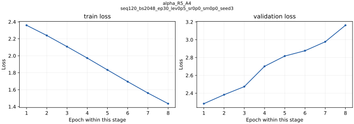

# alpha_primary_R5_A4_seq120_bs2048_ep30_lev0p5_sr0p0_sm0p0_seed3

[English / 中文](../../README.md) · [Structured model record / 结构化记录](../../catalog/alpha_primary_R5_A4_seq120_bs2048_ep30_lev0p5_sr0p0_sm0p0_seed3.json)

**Architecture / 架构:** Input normalization → linear projection → 2-layer causal GRU (128 hidden) → classification and EV heads.

原始160维特征先归一化和线性投影，再由两层128维因果GRU编码，输出分类信号和EV。

**Parameters / 参数量:** 227268. Counts exclude non-trainable normalization/position buffers; ONNX-only counts derive from the preserved architecture and configuration. / 不含归一化及位置缓冲，ONNX-only参数量按原架构和配置计算。

**Weight version and gaps / 权重版本与缺口:** Historical ONNX retained only for R1 seed2. Other Alpha checkpoints remain PyTorch originals; no replacement exports were created. / 仅R1 seed2留存历史ONNX，其余保留PyTorch原权重，未重新导出冒充历史原件。

**Feature order / 特征顺序:** [contract](../../models/mpv2_r1_a3_seq120_seed2/alpha/feature_spec.json). Normalization is inside the forward graph; use raw ordered features, do not normalize twice. See the colocated NPZ and graph buffers. / 前向内部执行归一化，应输入按顺序排列的原始特征，不要重复归一化，参见同目录NPZ和图缓冲。

**Runtime use / 实际输出使用:** Signal logits and EV feed the paired policy only where that deployment is retained. No standalone Alpha strategy PnL. / 信号与EV在留存组合中输入Policy，没有Alpha单体策略收益。

**Training parameters, data and split / 训练参数、数据及切分**

Raw market observations come from Polymarket, Binance and Chainlink. Data files are not redistributed. Published split/config manifests describe the historical train/validation/test boundaries; a retained manifest does not make the raw dataset downloadable. M3 checkpoints have data paths and historical split rules, but their referenced exact split manifests were not found locally: N/A. / 原始数据来自Polymarket、Binance、Chainlink，本包不分发数据集。M3权重保留数据路径和历史切分规则，但旧路径引用的精确切分清单未找到，为N/A。

```json
{
  "model_kind": "alpha_v2",
  "feature_order_version": "v2_maker_160",
  "n_features": 160,
  "target_contract_version": "tick_stream_v2_targets_v1",
  "data_root": "source://v2/poly-arb-ai/training/alpha_v2_phase5_7_full_history/data_index_trainval",
  "market_quality_path": "source://v2/poly-arb-ai/training/alpha_v2_phase5_7_full_history/market_quality_trainval_20260511_12.parquet",
  "split_info_path": "source://v2/poly-arb-ai/training/alpha_v2_phase5_8_signal_gate_runs/splits/phase58_trainfull_val20260511_12_no_test_split.json",
  "split_sha256": "54a9eb27a2912d9020a109fda77bafe33792a06f1ac3d67960ffca48662c9e5f",
  "normalization_source_split": "train",
  "normalization_sha256": "aa6b11c14d894789e8ccfef5ca3913972ec5ff14ba7978c5c5813577cfa2ffa7",
  "seed": 3,
  "num_workers": 4,
  "amp": false,
  "fp32": true,
  "model_config": {
    "seq_len": 120,
    "n_features": 160,
    "d_model": 128,
    "n_layers": 2,
    "dropout": 0.1
  },
  "training_config": {
    "batch_size": 2048,
    "epochs": 30,
    "lr": 0.0001,
    "lambda_ev": 0.5,
    "ev_loss_fn": "mse",
    "side_margin_lambda": 0.0,
    "side_rank_lambda": 0.0,
    "side_rank_margin": 0.02,
    "side_rank_min_abs_true_margin": 0.02,
    "log_every_batches": 50
  },
  "loader_config": {
    "batch_size": 2048,
    "eval_batch_size": 4096,
    "num_workers": 4,
    "pin_memory": true,
    "persistent_workers": true,
    "non_blocking_transfer": true
  },
  "evaluation_config": {
    "skip_test_eval": true,
    "best_checkpoint_metric": "signal_quality_gate",
    "min_epochs": 8,
    "early_stop_patience": 5,
    "min_delta": 0.0
  }
}
```

**Training / offline / paper / live results / 分层成绩**

```json
{
  "best_epoch": 1,
  "train_loss": 2.359265388192649,
  "val.auc": 0.8673859677211441,
  "true_best_side_auc": 0.5904646094074221,
  "selected_side_top_decile_ev": 0.026659717505634967,
  "independent_test": "N/A — terminal evaluation not executed / 未执行独立终态测试",
  "paper": "N/A — no standalone corresponding report / 无单体对应报告",
  "live": "N/A — no standalone corresponding run evidence / 未找到单体对应实盘证据"
}
```

[All run-specific results, offline comparisons and failure criteria / 全部逐次结果、离线对照与失败判据](../../RESULTS.md) · [中文完整结果](../../RESULTS.zh-CN.md). Maker Phase 6.5/6.6: `FAIL_NO_MAKER_EDGE`; Phase 6.7: `FAIL_CONTROL_AMPLIFICATION`. Offline replay PnL is never substituted for test loss. / 离线回放收益不能代替测试损失。

**Evidence and files / 证据与文件**

- [best_model.pt](https://huggingface.co/slowchillchill/failed-market-maker/resolve/main/models/alpha_primary_R5_A4_seq120_bs2048_ep30_lev0p5_sr0p0_sm0p0_seed3/best_model.pt)
- [exit.json](exit.json)
- [metrics.json](metrics.json)
- [naive_baselines.json](naive_baselines.json)
- [normalization.npz](https://huggingface.co/slowchillchill/failed-market-maker/resolve/main/models/alpha_primary_R5_A4_seq120_bs2048_ep30_lev0p5_sr0p0_sm0p0_seed3/normalization.npz)
- [run_manifest.json](run_manifest.json)
- [split_info.json](split_info.json)
- [train_config.json](train_config.json)
- [window_metrics.json](window_metrics.json)

[Unified file/source/license manifest / 统一来源许可证清单](../../manifest.json). Original code/weights: Apache-2.0. Curated card/reports: CC-BY-4.0. Synthetic-forward success proves executability only, not learned profitability. / 原创代码权重Apache-2.0，整理模型卡及报告CC-BY-4.0，构造输入只证明可运行。

**Complete retained loss traces / 全部留存损失曲线**

Separate panels keep different objectives on their own scales; BC and RL epoch counters restart by stage. / 不同目标分别展示，BC与RL轮次在各阶段重新计数。


