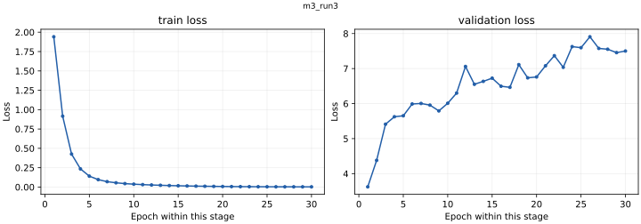

# m3_run3

<!-- scorecard:start -->
| Metric / 指标 | Result / 成绩 |
| --- | --- |
| Best epoch / 最佳轮次 | 1 |
| Train loss / 训练损失 | 1.941012 |
| Val AUC / 验证 AUC | 0.773355 |
| Test AUC / 测试 AUC | 0.743551 |
| Test top-decile EV / 测试最高十分位 EV | +0.245144 |

Standalone paper/live **N/A — no corresponding standalone reports**. / 单体模拟盘与实盘 **N/A：无对应独立报告**。

[All results and limitations / 全部成绩与限制](../../RESULTS.md) · [完整中文](../../RESULTS.zh-CN.md)

<!-- scorecard:end -->

[English / 中文](../../README.md) · [Structured model record / 结构化记录](../../catalog/m3_run3.json)

**Architecture / 架构:** Causal TCN market branches + Chainlink MLP + causal Transformer (128 hidden, 2 layers, 4 heads) + classification / EV heads.

市场特征由因果TCN分支和Chainlink逐时刻MLP编码，再由两层因果Transformer融合，输出分类logits和EV。

**Parameters / 参数量:** 419556. Counts exclude non-trainable normalization/position buffers; ONNX-only counts derive from the preserved architecture and configuration. / 不含归一化及位置缓冲，ONNX-only参数量按原架构和配置计算。

**Weight version and gaps / 权重版本与缺口:** Paper/live: N/A — no independent report found. / 未找到独立对应运行报告。

**Feature order / 特征顺序:** [contract](../../contracts/feature_cols.json). Normalization is inside the forward graph; use raw ordered features, do not normalize twice. See the colocated NPZ and graph buffers. / 前向内部执行归一化，应输入按顺序排列的原始特征，不要重复归一化，参见同目录NPZ和图缓冲。

**Runtime use / 实际输出使用:** B1/B2/M5 BC paper uses signal outputs with external execution and risk rules; not evidence that every execution head influenced actions. / B1、B2、M5 BC 模拟盘使用 signal 输出和外部执行风控规则，不证明全部执行头有效参与。

**Training parameters, data and split / 训练参数、数据及切分**

Raw market observations come from Polymarket, Binance and Chainlink. Data files are not redistributed. Published split/config manifests describe the historical train/validation/test boundaries; a retained manifest does not make the raw dataset downloadable. M3 checkpoints have data paths and historical split rules, but their referenced exact split manifests were not found locally: N/A. / 原始数据来自Polymarket、Binance、Chainlink，本包不分发数据集。M3权重保留数据路径和历史切分规则，但旧路径引用的精确切分清单未找到，为N/A。

<details>
<summary>Exact retained record / 完整留存记录</summary>

```json
{
  "seq_len": 240,
  "batch_size": 2048,
  "lr": 0.0004,
  "epochs": 30,
  "lambda_cls": 1.0,
  "lambda_ev": 0.5,
  "d_model": 128,
  "n_transformer_layers": 2,
  "dropout": 0.1,
  "output_dir": "[PRIVATE_ROOT]/m3_run3",
  "device": "cuda",
  "num_workers": 8,
  "amp": true,
  "compile": true,
  "patience": 0
}
```

</details>

**Training / offline / paper / live results / 分层成绩**

<details>
<summary>Exact retained record / 完整留存记录</summary>

```json
{
  "best_epoch": 1,
  "train_loss": 1.9410120229611452,
  "val_auc": 0.7733549941118774,
  "test": {
    "auc": 0.7435512577566268,
    "brier": 0.24634604748089936,
    "ece": 0.1899592175005293,
    "ev_up_mae": 1.7039820337696627,
    "ev_up_rmse": 2.421108425007587,
    "ev_rank_corr": 0.02551134507327181,
    "ev_down_mae": 1.709585353537305,
    "ev_down_rmse": 2.4214725727774313,
    "ev_up_sign_acc": 0.5804952696725035,
    "top_decile_mean_ev_up": 0.24514416849096704,
    "ev_up_conditional_mean_by_threshold": {
      "0.50": 0.24491821771532712,
      "0.52": 0.24669631173621048,
      "0.55": 0.24837781264595699,
      "0.60": 0.24997801116250934,
      "0.65": 0.2522521900972247
    },
    "ev_up_opportunity_rate_by_threshold": {
      "0.50": 0.4015267814411582,
      "0.52": 0.3955770935709373,
      "0.55": 0.3861831248545269,
      "0.60": 0.3699659756311246,
      "0.65": 0.3519861496496876
    },
    "edge_by_decile": [
      0.0037132119252683135,
      -0.045906512741698165,
      -0.043697881897361006,
      -0.11883916773380916,
      -0.06744631313024656,
      0.08853558534901632,
      0.24332888901282765,
      0.2529513811142387,
      0.2374729272006344,
      0.24488749357190193
    ],
    "loss": 3.76262791930361
  },
  "paper": "N/A — no standalone corresponding report / 无单体对应报告",
  "live": "N/A — no standalone corresponding run evidence / 未找到单体对应实盘证据"
}
```

</details>

[All run-specific results, offline comparisons and failure criteria / 全部逐次结果、离线对照与失败判据](../../RESULTS.md) · [中文完整结果](../../RESULTS.zh-CN.md). Maker Phase 6.5/6.6: `FAIL_NO_MAKER_EDGE`; Phase 6.7: `FAIL_CONTROL_AMPLIFICATION`. Offline replay PnL is never substituted for test loss. / 离线回放收益不能代替测试损失。

**Evidence and files / 证据与文件**

- [best_model.pt](https://huggingface.co/slowchillchill/failed-market-maker/resolve/main/models/m3_run3/best_model.pt)
- [feature_stats.npz](https://huggingface.co/slowchillchill/failed-market-maker/resolve/main/models/m3_run3/feature_stats.npz)
- [m3_run3.log](m3_run3.log)
- [test_metrics.json](test_metrics.json)
- [train_history.json](train_history.json)

[Unified file/source/license manifest / 统一来源许可证清单](../../manifest.json). Original code/weights: Apache-2.0. Curated card/reports: CC-BY-4.0. Synthetic-forward success proves executability only, not learned profitability. / 原创代码权重Apache-2.0，整理模型卡及报告CC-BY-4.0，构造输入只证明可运行。

**Complete retained loss traces / 全部留存损失曲线**

Separate panels keep different objectives on their own scales; BC and RL epoch counters restart by stage. / 不同目标分别展示，BC与RL轮次在各阶段重新计数。


