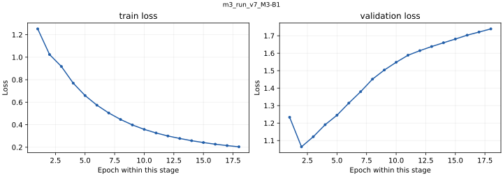

# m3_run_v7_M3-B1

<!-- scorecard:start -->
| Metric / 指标 | Result / 成绩 |
| --- | --- |
| Best epoch / 最佳轮次 | 13 |
| Train loss / 训练损失 | 0.277852 |
| Val AUC / 验证 AUC | 0.735678 |
| Test AUC / 测试 AUC | 0.713834 |
| Test top-decile EV / 测试最高十分位 EV | -0.105901 |

**Paper / 模拟盘 — all five runs / 全部五轮（USDC）**

| UTC run / 运行 | Metric / 口径 | PnL |
| --- | --- | --- |
| [20260517T022156Z](../../evidence/paper/run-p22-three-profile-72h-20260517T022156Z/reports/report-20260517T083623Z.json) | nav_delta_total | +100.0507 |
| [20260517T223411Z](../../evidence/paper/run-tpsl-three-profile-72h-no-raw-tp30-20260517T223411Z/final-reports/report-20260519T135915Z.json) | adjusted_total_pnl_usdc | -55.7933 |
| [20260519T141035Z](../../evidence/paper/run-tpsl-three-profile-72h-no-raw-v2merge-tp30-20260519T141035Z/codex_reports/report-20260522T234126Z.json) | adjusted_total_pnl_usdc | -104.6874 |
| [20260527T161918Z](../../evidence/paper/run-four-profile-72h-mpv2-restart-20260527T161918Z/reports/report-20260530T162518Z.json) | adjusted_total_pnl_usdc | -127.7975 |
| [20260602T135518Z](../../evidence/paper/run-four-profile-7d-direct-official-20260602T135518Z/reports/standard/report-terminated-20260607T122104Z.json) | adjusted_total_pnl_usdc | -298.0387 |

Signal outputs plus external execution/risk rules; June 2 run stopped early. Live N/A — no corresponding evidence. / 使用 signal 输出和外部执行风控；6 月 2 日运行提前结束。实盘 N/A：无对应证据。

[All results and limitations / 全部成绩与限制](../../RESULTS.md) · [完整中文](../../RESULTS.zh-CN.md)

<!-- scorecard:end -->

[English / 中文](../../README.md) · [Structured model record / 结构化记录](../../catalog/m3_run_v7_M3-B1.json)

**Architecture / 架构:** Causal TCN market branches + Chainlink MLP + causal Transformer (128 hidden, 2 layers, 4 heads) + classification / EV heads.

市场特征由因果TCN分支和Chainlink逐时刻MLP编码，再由两层因果Transformer融合，输出分类logits和EV。

**Parameters / 参数量:** 419556. Counts exclude non-trainable normalization/position buffers; ONNX-only counts derive from the preserved architecture and configuration. / 不含归一化及位置缓冲，ONNX-only参数量按原架构和配置计算。

**Weight version and gaps / 权重版本与缺口:** Original checkpoint: 65 features. Collection exports: 76 features, with added state/fusion and execution heads. Added-head training scores are N/A (no corresponding training evidence). Train-tree and paper-tree exports are distinct. / 原始权重为65维；collection为76维，新增头无对应训练成绩，训练侧与paper侧分别保留。

**Feature order / 特征顺序:** [contract](../../contracts/feature_cols.json). Normalization is inside the forward graph; use raw ordered features, do not normalize twice. See the colocated NPZ and graph buffers. / 前向内部执行归一化，应输入按顺序排列的原始特征，不要重复归一化，参见同目录NPZ和图缓冲。

**Runtime use / 实际输出使用:** B1/B2/M5 BC paper uses signal outputs with external execution and risk rules; not evidence that every execution head influenced actions. / B1、B2、M5 BC 模拟盘使用 signal 输出和外部执行风控规则，不证明全部执行头有效参与。

**Training parameters, data and split / 训练参数、数据及切分**

Raw market observations come from Polymarket, Binance and Chainlink. Data files are not redistributed. Published split/config manifests describe the historical train/validation/test boundaries; a retained manifest does not make the raw dataset downloadable. M3 checkpoints have data paths and historical split rules, but their referenced exact split manifests were not found locally: N/A. / 原始数据来自Polymarket、Binance、Chainlink，本包不分发数据集。M3权重保留数据路径和历史切分规则，但旧路径引用的精确切分清单未找到，为N/A。

<details>
<summary>Exact retained record / 完整留存记录</summary>

```json
{
  "seq_len": 100,
  "batch_size": 4096,
  "lr": 0.00056,
  "epochs": 30,
  "lambda_cls": 1.0,
  "lambda_ev": 0.5,
  "d_model": 128,
  "n_transformer_layers": 2,
  "dropout": 0.1,
  "output_dir": "poly-arb-ai/training/checkpoints/m3_run_v7_M3-B1",
  "device": "cuda",
  "num_workers": 8,
  "amp": true,
  "compile": true,
  "patience": 5,
  "weight_decay": 0.0001,
  "label_smoothing": 0.05,
  "warmup_epochs": 2,
  "ev_loss_fn": "huber",
  "nhead": 4,
  "split_info": "poly-arb-ai/training/split/split_info.v6expanded.json",
  "seed": 42,
  "ema_decay": 0.999,
  "feature_noise": 0.0,
  "focal_gamma": 0.0,
  "snapshot_epochs": ""
}
```

</details>

**Training / offline / paper / live results / 分层成绩**

<details>
<summary>Exact retained record / 完整留存记录</summary>

```json
{
  "best_epoch": 13,
  "train_loss": 0.27785223202440074,
  "val_auc": 0.7356779057335743,
  "test": {
    "auc": 0.7138343763426063,
    "brier": 0.27433292771213275,
    "ece": 0.2453187729507595,
    "ev_up_mae": 1.649713562579013,
    "ev_up_rmse": 2.7454955030233825,
    "ev_rank_corr": 0.001625348898724264,
    "ev_down_mae": 1.6478907900762243,
    "ev_down_rmse": 2.7441564827237515,
    "ev_up_sign_acc": 0.6416368803283865,
    "top_decile_mean_ev_up": -0.10590084646668774,
    "ev_up_conditional_mean_by_threshold": {
      "0.50": -0.025394433102018544,
      "0.52": -0.025056136659574332,
      "0.55": -0.02450022700795206,
      "0.60": -0.024704309188367704,
      "0.65": -0.024235505763070972
    },
    "ev_up_opportunity_rate_by_threshold": {
      "0.50": 0.3497062188991739,
      "0.52": 0.34754069106382157,
      "0.55": 0.3442212600333511,
      "0.60": 0.33843486355124863,
      "0.65": 0.33170798170635396
    },
    "edge_by_decile": [
      0.10581411723103301,
      -0.02375588395061728,
      -0.08507996697655919,
      -0.015667843787011755,
      -0.06876127336598632,
      -0.06257865615352626,
      -0.0030152769401582086,
      0.02391044841975218,
      0.0097339139860227,
      -0.10567582545266559
    ],
    "loss": 1.7283043586740308
  },
  "paper": "See run-specific paper table / 见逐次模拟盘表",
  "live": "N/A — no standalone corresponding run evidence / 未找到单体对应实盘证据"
}
```

</details>

[All run-specific results, offline comparisons and failure criteria / 全部逐次结果、离线对照与失败判据](../../RESULTS.md) · [中文完整结果](../../RESULTS.zh-CN.md). Maker Phase 6.5/6.6: `FAIL_NO_MAKER_EDGE`; Phase 6.7: `FAIL_CONTROL_AMPLIFICATION`. Offline replay PnL is never substituted for test loss. / 离线回放收益不能代替测试损失。

**Evidence and files / 证据与文件**

- [best_model.pt](https://huggingface.co/slowchillchill/failed-market-maker/resolve/main/models/m3_run_v7_M3-B1/best_model.pt)
- [feature_stats.npz](https://huggingface.co/slowchillchill/failed-market-maker/resolve/main/models/m3_run_v7_M3-B1/feature_stats.npz)
- [run_metadata.json](run_metadata.json)
- [test_metrics.json](test_metrics.json)
- [train_history.json](train_history.json)

[Unified file/source/license manifest / 统一来源许可证清单](../../manifest.json). Original code/weights: Apache-2.0. Curated card/reports: CC-BY-4.0. Synthetic-forward success proves executability only, not learned profitability. / 原创代码权重Apache-2.0，整理模型卡及报告CC-BY-4.0，构造输入只证明可运行。

**Complete retained loss traces / 全部留存损失曲线**

Separate panels keep different objectives on their own scales; BC and RL epoch counters restart by stage. / 不同目标分别展示，BC与RL轮次在各阶段重新计数。


