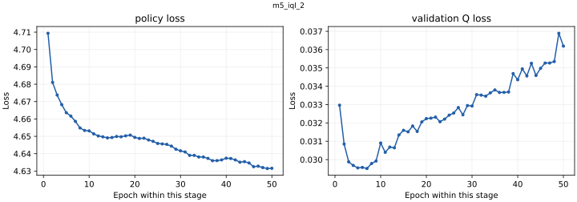

# m5_iql_2

<!-- scorecard:start -->
| Metric / 指标 | Result / 成绩 |
| --- | --- |
| Best epoch / 最佳轮次 | 43 |
| Policy loss / 策略损失 | 4.635094 |
| Val Q loss / 验证 Q 损失 | 0.035254 |
| Hold best/final / Hold 最佳／末轮 | 94.25% / 95.30% |
| Fixed return / 固定执行收益率 | +5.2949% |
| Native return / 原生执行收益率 | -2.1522% |

Returns: mean of 24 offline validation windows. ONNX = best checkpoint; final = epoch 50. / 收益率为 24 个离线验证窗口均值；ONNX 来自最佳权重，末轮为第 50 轮。


Standalone paper/live **N/A — no corresponding standalone reports**. / 单体模拟盘与实盘 **N/A：无对应独立报告**。

[All results and limitations / 全部成绩与限制](../../RESULTS.md) · [完整中文](../../RESULTS.zh-CN.md)

<!-- scorecard:end -->

[English / 中文](../../README.md) · [Structured model record / 结构化记录](../../catalog/m5_iql_2.json)

**Architecture / 架构:** Causal TCN market branches + Chainlink MLP + causal Transformer (128 hidden, 2 layers, 4 heads) + 11-state late fusion and execution heads.

沿用M3的TCN与Transformer市场骨干，额外处理11维代理状态，晚期融合后输出仓位大小、委托类型、限价与风险；方向头读取市场骨干。

**Parameters / 参数量:** 467957. Counts exclude non-trainable normalization/position buffers; ONNX-only counts derive from the preserved architecture and configuration. / 不含归一化及位置缓冲，ONNX-only参数量按原架构和配置计算。

**Weight version and gaps / 权重版本与缺口:** ONNX exports the best checkpoint. final_model.pt and last_checkpoint.pt are epoch 50; they are not the best-checkpoint result. Independent test loss, paper and live: N/A — no corresponding independent reports. / ONNX 来自最佳轮；final和last为第50轮，不能互换成绩。

**Feature order / 特征顺序:** [contract](../../contracts/m5_feature_cols.json). Normalization is inside the forward graph; use raw ordered features, do not normalize twice. See the colocated NPZ and graph buffers. / 前向内部执行归一化，应输入按顺序排列的原始特征，不要重复归一化，参见同目录NPZ和图缓冲。

**Runtime use / 实际输出使用:** This IQL candidate has offline fixed/native execution reports. Paper and live: N/A — no corresponding run reports found. / 本IQL候选有固定与原生离线执行报告；paper和live为N/A：未找到对应运行报告。

**Training parameters, data and split / 训练参数、数据及切分**

Raw market observations come from Polymarket, Binance and Chainlink. Data files are not redistributed. Published split/config manifests describe the historical train/validation/test boundaries; a retained manifest does not make the raw dataset downloadable. M3 checkpoints have data paths and historical split rules, but their referenced exact split manifests were not found locally: N/A. / 原始数据来自Polymarket、Binance、Chainlink，本包不分发数据集。M3权重保留数据路径和历史切分规则，但旧路径引用的精确切分清单未找到，为N/A。

<details>
<summary>Exact retained record / 完整留存记录</summary>

```json
{}
```

</details>

N/A — training hyperparameter config is not embedded in the IQL checkpoint; historical experiment records and split_info.json are provided. / IQL权重未内嵌完整超参数配置，见历史实验记录和切分文件。

**Training / offline / paper / live results / 分层成绩**

<details>
<summary>Exact retained record / 完整留存记录</summary>

```json
{
  "best_epoch": 43,
  "best_policy_loss": 4.635093768085274,
  "best_val_q_loss": 0.03525394001863124,
  "best_hold_share": 0.9425,
  "final_epoch": 50,
  "final_hold_share": 0.953,
  "test": "N/A — no corresponding report found / 未找到对应报告",
  "paper": "N/A — no standalone corresponding report / 无单体对应报告",
  "live": "N/A — no standalone corresponding run evidence / 未找到单体对应实盘证据"
}
```

</details>

[All run-specific results, offline comparisons and failure criteria / 全部逐次结果、离线对照与失败判据](../../RESULTS.md) · [中文完整结果](../../RESULTS.zh-CN.md). Maker Phase 6.5/6.6: `FAIL_NO_MAKER_EDGE`; Phase 6.7: `FAIL_CONTROL_AMPLIFICATION`. Offline replay PnL is never substituted for test loss. / 离线回放收益不能代替测试损失。

**Evidence and files / 证据与文件**

- [agent_model_m5.onnx](https://huggingface.co/slowchillchill/failed-market-maker/resolve/main/models/m5_iql_2/agent_model_m5.onnx)
- [best_model.pt](https://huggingface.co/slowchillchill/failed-market-maker/resolve/main/models/m5_iql_2/best_model.pt)
- [feature_stats_76.npz](https://huggingface.co/slowchillchill/failed-market-maker/resolve/main/models/m5_iql_2/feature_stats_76.npz)
- [final_model.pt](https://huggingface.co/slowchillchill/failed-market-maker/resolve/main/models/m5_iql_2/final_model.pt)
- [last_checkpoint.pt](https://huggingface.co/slowchillchill/failed-market-maker/resolve/main/models/m5_iql_2/last_checkpoint.pt)
- [probe_policy.json](probe_policy.json)
- [split_info.json](split_info.json)
- [train_history.json](train_history.json)
- [training_history.json](training_history.json)

[Unified file/source/license manifest / 统一来源许可证清单](../../manifest.json). Original code/weights: Apache-2.0. Curated card/reports: CC-BY-4.0. Synthetic-forward success proves executability only, not learned profitability. / 原创代码权重Apache-2.0，整理模型卡及报告CC-BY-4.0，构造输入只证明可运行。

**Complete retained loss traces / 全部留存损失曲线**

Separate panels keep different objectives on their own scales; BC and RL epoch counters restart by stage. / 不同目标分别展示，BC与RL轮次在各阶段重新计数。


