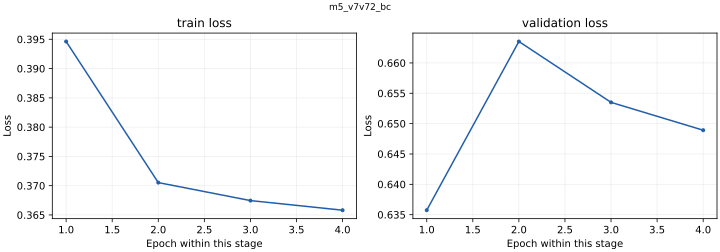

# m5_v7v72_bc

<!-- scorecard:start -->
| Metric / 指标 | Result / 成绩 |
| --- | --- |
| Best epoch / 最佳轮次 | 1 |
| Train accuracy / 训练准确率 | 0.848722 |
| Val accuracy / 验证准确率 | 0.710701 |
| Test accuracy / 测试准确率 | 0.682590 |

**Paper / 模拟盘 — all five runs / 全部五轮（USDC）**

| UTC run / 运行 | Metric / 口径 | PnL |
| --- | --- | --- |
| [20260517T022156Z](../../evidence/paper/run-p22-three-profile-72h-20260517T022156Z/reports/report-20260517T083623Z.json) | nav_delta_total | -99.5530 |
| [20260517T223411Z](../../evidence/paper/run-tpsl-three-profile-72h-no-raw-tp30-20260517T223411Z/final-reports/report-20260519T135915Z.json) | adjusted_total_pnl_usdc | -47.7168 |
| [20260519T141035Z](../../evidence/paper/run-tpsl-three-profile-72h-no-raw-v2merge-tp30-20260519T141035Z/codex_reports/report-20260522T234126Z.json) | adjusted_total_pnl_usdc | -0.4547 |
| [20260527T161918Z](../../evidence/paper/run-four-profile-72h-mpv2-restart-20260527T161918Z/reports/report-20260530T162518Z.json) | adjusted_total_pnl_usdc | +20.1954 |
| [20260602T135518Z](../../evidence/paper/run-four-profile-7d-direct-official-20260602T135518Z/reports/standard/report-terminated-20260607T122104Z.json) | adjusted_total_pnl_usdc | +84.7787 |

Signal outputs plus external execution/risk rules; June 2 run stopped early. Live N/A — no corresponding evidence. / 使用 signal 输出和外部执行风控；6 月 2 日运行提前结束。实盘 N/A：无对应证据。

[All results and limitations / 全部成绩与限制](../../RESULTS.md) · [完整中文](../../RESULTS.zh-CN.md)

<!-- scorecard:end -->

[English / 中文](../../README.md) · [Structured model record / 结构化记录](../../catalog/m5_v7v72_bc.json)

**Architecture / 架构:** Causal TCN market branches + Chainlink MLP + causal Transformer (128 hidden, 2 layers, 4 heads) + 11-state late fusion and execution heads.

沿用M3的TCN与Transformer市场骨干，额外处理11维代理状态，晚期融合后输出仓位大小、委托类型、限价与风险；方向头读取市场骨干。

**Parameters / 参数量:** 467957. Counts exclude non-trainable normalization/position buffers; ONNX-only counts derive from the preserved architecture and configuration. / 不含归一化及位置缓冲，ONNX-only参数量按原架构和配置计算。

**Weight version and gaps / 权重版本与缺口:** ONNX requires agent_model_m5.onnx.data in the same directory. m5_baseline / m5_run_bc_diag are deployment aliases for these v7v72 weights; invalid .bak0428 is excluded. / ONNX 必须与外部权重同目录；部署别名不另计候选，失效备份不发布。

**Feature order / 特征顺序:** [contract](../../contracts/m5_feature_cols.json). Normalization is inside the forward graph; use raw ordered features, do not normalize twice. See the colocated NPZ and graph buffers. / 前向内部执行归一化，应输入按顺序排列的原始特征，不要重复归一化，参见同目录NPZ和图缓冲。

**Runtime use / 实际输出使用:** B1/B2/M5 BC paper uses signal outputs with external execution and risk rules; not evidence that every execution head influenced actions. / B1、B2、M5 BC 模拟盘使用 signal 输出和外部执行风控规则，不证明全部执行头有效参与。

**Training parameters, data and split / 训练参数、数据及切分**

Raw market observations come from Polymarket, Binance and Chainlink. Data files are not redistributed. Published split/config manifests describe the historical train/validation/test boundaries; a retained manifest does not make the raw dataset downloadable. M3 checkpoints have data paths and historical split rules, but their referenced exact split manifests were not found locally: N/A. / 原始数据来自Polymarket、Binance、Chainlink，本包不分发数据集。M3权重保留数据路径和历史切分规则，但旧路径引用的精确切分清单未找到，为N/A。

<details>
<summary>Exact retained record / 完整留存记录</summary>

```json
{
  "oracle_mode": "B",
  "freeze_scope": "j1",
  "init_source": "m3",
  "seq_len": 240,
  "epochs": 20,
  "batch_size": 2048,
  "lr_policy": 0.001,
  "lr_open": 0.0001,
  "weight_decay": 1e-05,
  "oracle_c_threshold": null
}
```

</details>

**Training / offline / paper / live results / 分层成绩**

<details>
<summary>Exact retained record / 完整留存记录</summary>

```json
{
  "best_epoch": 1,
  "best_checkpoint_accuracy": {
    "train": 0.8487224113378172,
    "val": 0.7107007466309146,
    "test": 0.6825902547341633
  },
  "last_epoch": 4,
  "last_val_accuracy": 0.703286,
  "last_test": "N/A — not independently evaluated / 未独立评测",
  "paper": "See run-specific paper table / 见逐次模拟盘表",
  "live": "N/A — no standalone corresponding run evidence / 未找到单体对应实盘证据"
}
```

</details>

[All run-specific results, offline comparisons and failure criteria / 全部逐次结果、离线对照与失败判据](../../RESULTS.md) · [中文完整结果](../../RESULTS.zh-CN.md). Maker Phase 6.5/6.6: `FAIL_NO_MAKER_EDGE`; Phase 6.7: `FAIL_CONTROL_AMPLIFICATION`. Offline replay PnL is never substituted for test loss. / 离线回放收益不能代替测试损失。

**Evidence and files / 证据与文件**

- [agent_model_m5.onnx](https://huggingface.co/slowchillchill/failed-market-maker/resolve/main/models/m5_v7v72_bc/agent_model_m5.onnx)
- [agent_model_m5.onnx.data](https://huggingface.co/slowchillchill/failed-market-maker/resolve/main/models/m5_v7v72_bc/agent_model_m5.onnx.data)
- [best_model.pt](https://huggingface.co/slowchillchill/failed-market-maker/resolve/main/models/m5_v7v72_bc/best_model.pt)
- [eval_report.json](eval_report.json)
- [feature_stats_76.npz](https://huggingface.co/slowchillchill/failed-market-maker/resolve/main/models/m5_v7v72_bc/feature_stats_76.npz)
- [last_checkpoint.pt](https://huggingface.co/slowchillchill/failed-market-maker/resolve/main/models/m5_v7v72_bc/last_checkpoint.pt)
- [pipeline.log](pipeline.log)
- [probe_policy.json](probe_policy.json)
- [run_config.json](run_config.json)
- [run_manifest.json](run_manifest.json)
- [split_info.json](split_info.json)
- [summary.md](summary.md)
- [train_history.json](train_history.json)

[Unified file/source/license manifest / 统一来源许可证清单](../../manifest.json). Original code/weights: Apache-2.0. Curated card/reports: CC-BY-4.0. Synthetic-forward success proves executability only, not learned profitability. / 原创代码权重Apache-2.0，整理模型卡及报告CC-BY-4.0，构造输入只证明可运行。

**Complete retained loss traces / 全部留存损失曲线**

Separate panels keep different objectives on their own scales; BC and RL epoch counters restart by stage. / 不同目标分别展示，BC与RL轮次在各阶段重新计数。


