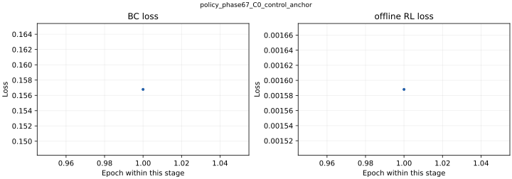

# policy_phase67_C0_control_anchor

[English / 中文](../../README.md) · [Structured model record / 结构化记录](../../catalog/policy_phase67_C0_control_anchor.json)

**Architecture / 架构:** 160-feature linear projection → 2-layer GRU (128 hidden); 4 Alpha + 5 account values → context MLP; fusion → quote / offset / size / risk heads.

160维序列经线性投影和两层128维GRU编码；4维Alpha与5维账户状态经MLP处理，与市场编码融合后输出四个报价槽位、偏移、大小和风险。

**Parameters / 参数量:** 272149. Counts exclude non-trainable normalization/position buffers; ONNX-only counts derive from the preserved architecture and configuration. / 不含归一化及位置缓冲，ONNX-only参数量按原架构和配置计算。

**Weight version and gaps / 权重版本与缺口:** PyTorch checkpoint: N/A — not retained. Historical paired Alpha ONNX: N/A — not retained for this candidate; policy weights alone are available. / 无本地PyTorch权重；仅R1 seed2保留完整历史Alpha＋Policy ONNX组合。

**Feature order / 特征顺序:** [contract](../../models/policy_phase67_C0_control_anchor/feature_spec.json). Normalization is inside the forward graph; use raw ordered features, do not normalize twice. See the colocated NPZ and graph buffers. / 前向内部执行归一化，应输入按顺序排列的原始特征，不要重复归一化，参见同目录NPZ和图缓冲。

**Runtime use / 实际输出使用:** Four quote slots (UP buy, DOWN buy, UP sell, DOWN sell), offset/size logits and risk score, interpreted by the external action schema. / 四个买卖槽位的报价、偏移、大小与风险输出，由外部动作合同解释。

**Training parameters, data and split / 训练参数、数据及切分**

Raw market observations come from Polymarket, Binance and Chainlink. Data files are not redistributed. Published split/config manifests describe the historical train/validation/test boundaries; a retained manifest does not make the raw dataset downloadable. M3 checkpoints have data paths and historical split rules, but their referenced exact split manifests were not found locally: N/A. / 原始数据来自Polymarket、Binance、Chainlink，本包不分发数据集。M3权重保留数据路径和历史切分规则，但旧路径引用的精确切分清单未找到，为N/A。

```json
{
  "amp": false,
  "batch_size": 4096,
  "bc_epochs": 1,
  "d_model": 64,
  "max_paths_per_shard": 4,
  "n_features": 160,
  "n_layers": 1,
  "offline_rl_epochs": 1,
  "quote_sparsity_lambda": 0.0,
  "schema_version": "maker_policy_v2_policy_config_v1",
  "seq_len": 180,
  "training_objective": "behavior_clone_advantage",
  "transition_shard_count": 3
}
```

**Training / offline / paper / live results / 分层成绩**

```json
{
  "last_bc_loss": 0.1567794230919498,
  "last_offline_rl_loss": 0.0015880443905514957,
  "independent_val_test_loss": "N/A — no independent loss report / 无独立损失报告",
  "paper": "N/A — no standalone corresponding report / 无单体对应报告",
  "live": "N/A — no standalone corresponding run evidence / 未找到单体对应实盘证据"
}
```

[All run-specific results, offline comparisons and failure criteria / 全部逐次结果、离线对照与失败判据](../../RESULTS.md) · [中文完整结果](../../RESULTS.zh-CN.md). Maker Phase 6.5/6.6: `FAIL_NO_MAKER_EDGE`; Phase 6.7: `FAIL_CONTROL_AMPLIFICATION`. Offline replay PnL is never substituted for test loss. / 离线回放收益不能代替测试损失。

**Evidence and files / 证据与文件**

- [action_schema.json](action_schema.json)
- [alpha_source_manifest.json](alpha_source_manifest.json)
- [feature_spec.json](feature_spec.json)
- [maker_policy_v2_smoke_report.json](maker_policy_v2_smoke_report.json)
- [model.onnx](https://huggingface.co/slowchillchill/failed-market-maker/resolve/main/models/policy_phase67_C0_control_anchor/model.onnx)
- [model_bundle.json](model_bundle.json)
- [normalization.npz](https://huggingface.co/slowchillchill/failed-market-maker/resolve/main/models/policy_phase67_C0_control_anchor/normalization.npz)
- [policy_config.json](policy_config.json)
- [reward_config.json](reward_config.json)

[Unified file/source/license manifest / 统一来源许可证清单](../../manifest.json). Original code/weights: Apache-2.0. Curated card/reports: CC-BY-4.0. Synthetic-forward success proves executability only, not learned profitability. / 原创代码权重Apache-2.0，整理模型卡及报告CC-BY-4.0，构造输入只证明可运行。

**Complete retained loss traces / 全部留存损失曲线**

Separate panels keep different objectives on their own scales; BC and RL epoch counters restart by stage. / 不同目标分别展示，BC与RL轮次在各阶段重新计数。


